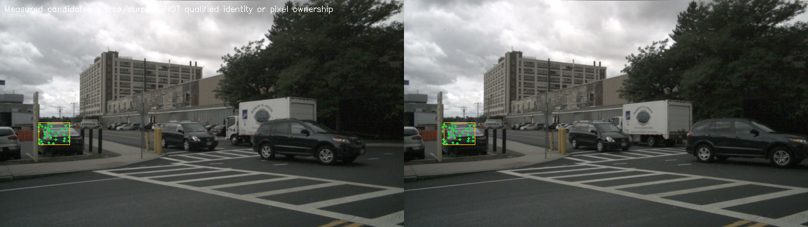
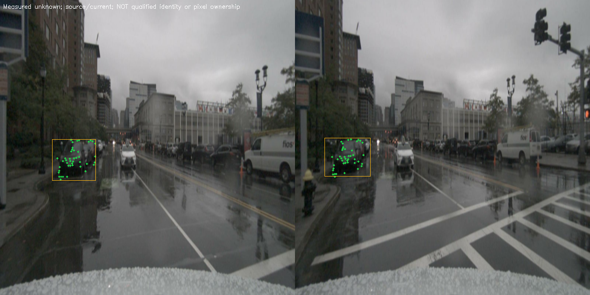

# OmniDrive M1.1：逐场景观测诊断、来源修复与独立验收

代码、实验框架、真实来源传递、逐场景漏斗、离线身份评分和独立版本账本均已实施。**Gate_A_Operational PASS；Gate_A_Functional BLOCKED；Gate_B BLOCKED；Gate_C PASS。未进入 M2。**

实际基准 HEAD：`e8632ab7f3947c927a8bfcc7025eb796fa16dbe8`。Python 为 OmniDrive 环境；全部执行继承 CPU `0-3,6-31`。GPU 为 RTX 3090，启动前空闲，没有停止其他任务。observe-only、M2/M3 关闭，原模型、LoRA、Planning、生成设置及 5% 风险/95% 单侧界均未调整。

## 逐场景运行与实际覆盖范围

CPU 主实验：**6 个独立场景 × 12 个连续可用 keyframe × 2 次独立重复**。每个场景和重复均新建 WorldStateManager、Store、历史相机和身份历史，独立目录、计时、状态与异常账本。两次重复的候选/测量/版本来源/拒绝统计均复现。

完整模型：**2 个验证场景 × 12 个 keyframe**，每场景独立 Python 进程与模型实例；每个场景分别执行关闭 M1 的原生完整 Planning 和开启 M1.1 的完整 Planning。每场景感知、backbone、原生 Memory 摘要一致，实际 Planning 文本文件逐字节一致。执行前后源码摘要一致。模型每场景只有一次开关配对，额外跨运行 GPU 重复计时为 Not Run；没有把配对相等宣称为该项重复性。

CPU 的历史检测来自训练集，38 个目标场景具备相应检测，本轮按 scene_token 固定升序执行前 6 个，其余 **32 个可回放目标未执行**；训练集其他场景缺少该历史检测。GPU 原配置使用验证集，共 150 场景，固定升序执行前 2 个，**148 个未执行**。没有更换模型数据配置来迁就历史检测。数据选择、全部场景/log/frame 映射、缺失检测和截断帧见 `cpu_scenes02/protocol.json`、`gpu_scenes02/selection.json` 及 `selection_and_coverage.json`；没有完整测试集结论。

这是 nuScenes **keyframe** 实验，实测帧间隔约 0.400–0.550 s，非高频视频。逐场景原始时间范围、每帧间隔、序列索引与缺帧/超窗记录见各 metrics 文件和 `scene_summary.csv`。本次已执行的前缀内没有缺帧或长间隔重置；相关异常在单元回归中专门覆盖。场景切换 reset 是额外工程测试，没有用它替代主实验的独立实例。

## 每个场景实际结果

单位为跨帧累计事件，不是独立物体数。当前裁剪观测只说明本次实际 commit 获得图像描述子；历史观测支持另列，不能混用。所有场景均 12 帧/72 个有效输入相机图像。

|执行|Scene / Log|帧 / 相机|投影候选|当前裁剪观测|历史观测支持 / 覆盖率|身份候选 / 总提案 / Unknown|稳定像素比例|正式认证|
|---|---|---:|---:|---:|---:|---:|---:|---:|
|CPU|`08110c8640454affb5167801442a85fd` `6f7fe59adf984e55a82571ab4f17e4e2`|12 / 72|554|512|0 / 0.000%|0 / 656 / 656|0.000000%|0|
|CPU|`102b894332464704900264216480a8f7` `853a9f9fe7e84bb8b24bff8ebf23f287`|12 / 72|95|69|0 / 0.000%|0 / 108 / 108|0.000000%|0|
|CPU|`1891b66d9f58463399aa242f3b521232` `4de1fda752ae4cf8b650a5245734eb4c`|12 / 72|318|281|0 / 0.000%|0 / 327 / 327|0.005263%|0|
|CPU|`1959c8f440a340fda3ea2cac0ac528ec` `ab1e1b004548466f86b31f879a2d9e50`|12 / 72|293|294|0 / 0.000%|56 / 345 / 289|4.050908%|0|
|CPU|`20ec831deb0f44e397497198cbe5a97c` `20db5722b62c4c17bbff2d7b265a3c51`|12 / 72|27|17|0 / 0.000%|3 / 8 / 5|0.000241%|0|
|CPU|`3034b3f33e1d49f4a7b6c84bdea57004` `6c12081a828548b6b0a36f12d53be6ca`|12 / 72|419|313|0 / 0.000%|0 / 488 / 488|0.000398%|0|
|GPU|`01452fbfbf4543af8acdfd3e8a1ee806` `53cf9c55dd8644bea67b9f009fc1ee38`|12 / 72|1038|953|45 / 4.335%|186 / 1527 / 1341|6.488576%|0|
|GPU|`01e4fcbe6e49483293ce45727152b36e` `8c66d9d518c54aed98dce7e3095501bc`|12 / 72|897|507|0 / 0.000%|0 / 183 / 183|0.000017%|0|

完整逐场景双向/几何/排除前后局部点数、前景候选/Unknown、每帧提交/重置、版本与来源检查结果、各类拒绝原因均在 `scene_assessment.json`、`scene_summary.csv` 和场景目录 metrics/原始 JSONL 中。CPU 与 GPU 的数据人口及坐标系不同（640×360 原图回放 / 640×640 原模型预处理），分别汇总。

## Micro 与 Macro

|执行 / 指标|Micro|Macro 均值 / 中位数|Macro P05/P95 / 范围 / 标准差|
|---|---:|---:|---|
|CPU / Anchor 观测覆盖|0.0000%|0.0000% / 0.0000%|0.0000%/0.0000%；0.0000%–0.0000%；0.0000%|
|CPU / 身份候选覆盖|3.0538%|8.9553% / 0.0000%|0.0000%/32.1830%；0.0000%–37.5000%；14.0744%|
|CPU / 稳定观测像素|0.6761%|0.6761% / 0.0003%|0.0000%/3.0395%；0.0000%–4.0509%；1.5092%|
|GPU / Anchor 观测覆盖|2.3256%|2.1676% / 2.1676%|0.2168%/4.1185%；0.0000%–4.3353%；2.1676%|
|GPU / 身份候选覆盖|10.8772%|6.0904% / 6.0904%|0.6090%/11.5717%；0.0000%–12.1807%；6.0904%|
|GPU / 稳定观测像素|3.2443%|3.2443% / 3.2443%|0.3244%/6.1641%；0.0000%–6.4886%；3.2443%|

Macro 分母是该指标有定义的场景数量；无定义值为 null，并保留有效场景数。Micro 使用原始分子/分母重算。CPU 的身份候选 Micro 为 59/1932，而 Macro 均值明显更高；GPU 的历史观测支持 Micro 为 45/1935，但一个场景仍为 0，不能用总体非零掩盖它。总体前景与拒绝计数另保存在 `scene_assessment.json` 的 extended_micro_macro。

CPU 中 `08110…`、`102b…`、`1891…`、`3034…` 的身份提案全部 Unknown。`1959…` 稳定观测像素约 4.051%，其他 CPU 场景接近零，分布极不均匀。GPU `01452…` 有实际 Anchor 支持和身份候选，`01e4…` 两项为零。逐场景功能门因此仍阻塞。这些不同输入人口的结果不构成 M1.0→M1.1 同帧覆盖率提升证明；本轮只读诊断不改变原接受判定，已有非干扰回归验证。

## 零覆盖根因与证据漏斗

每个帧/Anchor/相机的原始检查写入 `precheck.diagnostics.anchors`；`diagnosis_cpu02/`、`diagnosis_gpu/` 分别提供完整 CSV 和逐帧归因。分别保留全部历史视图与几何合格候选视图两种人口，避免大量视野外项掩盖真正候选。

|CPU 可投影候选视图检查|总数|通过|拒绝|未知|
|---|---:|---:|---:|---:|
|historical_frame_source|374|374|0|0|
|source_epoch|374|374|0|0|
|state_version|374|374|0|0|
|execution_signature|374|374|0|0|
|historical_crop|374|323|51|0|
|source_descriptor_reconstruction|374|323|0|51|
|descriptor_residual|374|52|322|0|
|visibility_minimum_points|374|2|302|70|
|visibility_support_fraction|374|3|301|70|
|visibility_spatial_fraction|374|3|301|70|

CPU 合格候选视图拒绝原因：`{"observation_mismatch": 271, "no_historical_observation": 51, "projected_occlusion": 39, "temporal_support_insufficient": 13}`。动态/未知运动视图的几何失败统计：`{"uncertainty_exceeds_search": 3484, "incomplete_depth": 4277, "outside_camera_horizon": 3}`。

在本轮可投影视图上，真实源帧、Epoch、版本和执行签名匹配；存在历史裁剪时描述子均可从实际源图重建。历史裁剪缺失是某相机此前没有有效裁剪，保留 Unknown，不能当作来源哈希错误修好后直接放行。主要实际阻塞是：关键帧位姿/投影及裁剪变化导致外观残差不通过；动态对象的运动不确定性超过静态搜索门；遮挡；经过运动/遮挡排除、预测框运动边界后实际点数/比例/象限不足。

`1959…` 的 54 个合格相机视图在“排除前局部光度/几何支持比例”上通过，但实际 anchor_visibility 仍会因遮挡、最小点数、运动边界和空间分布拒绝。例如真实记录 `10c5988cddea4e46a2772f78f32f0935` / `g2:a21` / CAM_BACK_LEFT，源裁剪只有 3 个点，实际支持仅 1 个、比例 1/3、象限 1/4；这不满足原 4 点、0.8 比例和 0.75 象限要求。没有因此放宽任何一项。

静态类先验不证明物体静止；动态身份候选不证明速度或精确位置；局部 LK、稳定像素和盒内几何也不证明前景归属。前景、度量几何和神经等价继续保持未认证。当前覆盖差异是真实场景/观测条件差异，不是统一开关失效。

## 可信日志与独立状态验收

`LogSourceContext` 从真实 scene.json/sample.json 建立不可变映射及摘要，只读取来源，不读取实例/标注。frame_from_info 与 frame_from_model 都可绑定同一上下文；完整模型通过最小的 m1_source_context 接线传入。没有上下文且没有真实日志字段时明确 missing，从不从 frame_id 合成日志；重复 scene/sample 映射、错误日志、frame/scene 冲突拒绝。同一日志包含多个场景合法，资格中仍只有一个日志单位。

日志来源进入原有 frame_digest 元数据绑定；同场景已知日志变化或消失触发拒绝/重置。独立 `scene_revalidate.py` 不只检查版本非空，而是将每个历史 Anchor 和相机证据版本与该场景此前真实提交的对应版本逐一匹配，同时检查真实日志映射、当前计算提交和保留版本没有被替换。**12 条 CPU 重复轨迹和 2 条模型轨迹全部通过**，证据为 `version_ledger_cpu.json` 与 `version_ledger_gpu.json`。

## 离线身份评分与资格阻塞

在线运行和来源/提案冻结后，才调用离线 nuScenes 标注读取器。评分使用原有“同类、独立传感器支持、2 m 唯一匹配、0.25 m 歧义余量”协议。它给检测关联提供可评分实例身份，不是稠密前景像素真值。校准/验证日志划分在本轮标注读取前冻结，见 `offline_cpu_final/protocol.json` 和 `offline_gpu/protocol.json`。同日志多场景聚合为一个单位，没有把场景数或连续事件当作独立样本。

|执行|全部提案：正确 / 错误 / 不可判定|候选：正确 / 错误 / 不可判定|正式认证 / FAR / 置信上界|
|---|---:|---:|---|
|CPU|558 / 20 / 1354|48 / 0 / 11|0 / null / null|
|GPU|311 / 30 / 1369|98 / 0 / 88|0 / null / null|

全部提案包括被拒绝的 Unknown 几何边；其中错误边不等于正式错误接受。候选可评分子集虽然暂未出现错误，CPU 有 11 个、GPU 有 88 个候选不可判定，且正确事件集中在极少日志并重复出现，不能称为零风险。各场景的正确/错误/不可判定和 Macro 见两个离线 summary 及场景文件。

本地官方验证人口 150 场景仅 18 个独立日志；按既定 95% 单侧精确界、5% 门限，真实零错误也至少要 59 个独立单位。正式认证为 0，无可评分合法接受人口，实际 FAR 与置信上界均为 null / Not Run。没有生成资格文件，没有复用旧协议资格；GT 未进入在线 M1，来源修复没有代替资格。Gate B 保持 BLOCKED。

## 性能与回归

|执行 / Scene 前缀|Precheck P50/P95 ms|Commit P50/P95 ms|进程 CPU P50/P95 ms|E2E P50/P95 ms|
|---|---:|---:|---:|---:|
|CPU `08110c86`|166.4/186.4|380.9/770.9|887.5/1323.3|665.0/1057.6|
|CPU `102b8943`|131.3/147.6|46.1/62.7|546.3/610.8|252.9/288.1|
|CPU `1891b66d`|141.9/499.2|201.1/278.4|695.6/1130.1|519.9/972.4|
|CPU `1959c8f4`|131.3/146.4|311.6/346.5|717.8/803.3|639.5/758.5|
|CPU `20ec831d`|100.1/116.7|11.5/29.3|504.8/531.0|259.8/344.2|
|CPU `3034b3f3`|173.8/185.6|247.0/315.1|780.2/1189.1|603.8/1033.7|
|GPU `01452fbf`|323.9/363.0|1837.8/2213.7|11959.7/14122.7|5392.0/6025.4|
|GPU `01e4fcbe`|284.2/317.3|283.9/352.3|6220.5/6666.0|3701.5/3951.4|

CPU E2E 包含读图/解码、M1、审计构造，排除日志持久化和可视化；m1_cpu_process_ms 单独记录只含 precheck/commit 的进程 CPU 工作量。GPU E2E 是同步的完整原生模型调用（包含 M1 和 Planning），排除 batch IO、输出哈希。CPU process time 是全部线程工作量，可以大于 wall latency，不能相加。诊断模式含大量逐候选测量和日志，不是生产性能或净加速基准。

完整模型两场景关闭 M1 的逐帧延迟保存在 `baseline_latency.json`；逐帧配对原样本在各 `results.json` 的 frame_measurements。Micro 延迟重汇所有帧；Macro 另给各场景 P50 的分布。没有用总体延迟掩盖 Commit 在 `01452…` 明显高于 `01e4…` 的开销；没有 GPU 跳算或神经 Tensor 复用。

完整回归 **746 passed、0 failed、0 skipped**；补充图像/账本测试 **31 passed**（其中 30 项与完整回归重复、1 项新增），合计 **747 个不同测试通过**：M1 434、M2 127、M3 131、跨模块 55。其中 M1.1 新增 31 项，含来源合法/缺失/重复/不匹配、同日志多场景、边界历史清空、时间连续性/缺帧、Micro/Macro/null、诊断非干扰、离线风险/泄漏以及独立版本账本篡改。原 M1 验收的 716 项是上一轮结果，未与本轮相加。完整命令见 `commands.sh`，最终证据为 `regression_delivery.xml` / `.log` 与 `visualization_and_ledger_tests.xml` / `.log`。

## 验收结论与最小剩余修复

- **Gate_A_Operational：PASS。** 两类真实场景独立执行、事务与生命周期正确；场景边界回归和独立版本/来源账本通过。
- **Gate_A_Functional：BLOCKED。** 存在实际非零覆盖的 GPU 场景，但六个 CPU 场景和另一个 GPU 场景 Anchor 支持仍为 0，多个场景身份全部 Unknown；大量目标场景未执行。不能宣布全场景有效。
- **Gate_B：BLOCKED。** 独立日志、可评分接受人口和合法当前协议资格不足；实际资格风险未获认证。
- **Gate_C：PASS，限来源/版本/失效/接口。** 真实日志和状态版本可核验，未捕获神经特征明确 unavailable。进入 M2 的前置条件仍不满足。

下一步最小工作是针对已定位的失败 ROI 核对源/当前裁剪和已有运动对齐测量，先做不改变门限的对齐消融；对遮挡、动态不确定性和少于最小点数的记录继续 Unknown，只有新增可验证前景/可见性证据才可解除。资格方面需要足量互斥日志、可判定接受人口及合法固定摘要工件。性能方面优先评估只在同一事务内共享不变协议摘要等保持语义的 CPU 开销，不能通过跳过网络计算推进本轮。当前没有把这些剩余事项写成已实现结果。

## 文件与案例

修改原因清单见 [implementation_changes.md](implementation_changes.md)；补丁 `implementation.patch`，逐场景完整表 `scene_summary.csv`，Micro/Macro 与拒绝分布 `scene_assessment.json`，四门结论 `formal_gates.json`。全部未执行场景完整列在 `selection_and_coverage.json`。复现需全新目录，`--scenes 0` 支持全部可用目标，`--frames 0` 支持全部可用 keyframe。

下图是实际测量候选，**不是已认证身份或前景**；没有候选的场景记 Not Available。拒绝病例及完整源帧、相机、点数清单在两个 identity_cases 目录。

旧实验、失败/未完成尝试均保留；开发期计时合并异常、一次批量编辑语法异常及不匹配数据集的场景选择拒绝单列于 `development_attempts.json`，没有计为通过。所有本轮输出位于新目录，原有未跟踪 M3 目录未修改。
