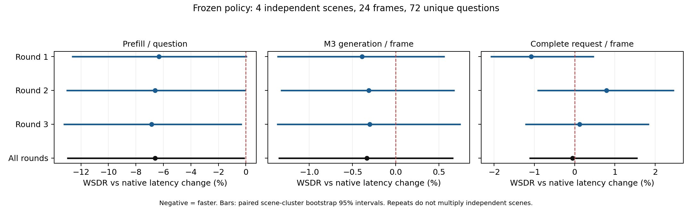

# 冻结 WSDR-KV 独立场景验证

结论：**NOT_YET_VALIDATED**。4 个独立 M3 场景、24 帧、72 个唯一问题，两个正式路径各 3 轮。重复测量不扩大质量样本量。

未通过项主要是重复端到端收益不稳定，以及运动 profile 仅 1 个样本、缺少多场景质量区间。已观察的 F1 损失为 0，新增关键退化为 0；质量证据不足与已观察超预算分别报告。

首轮实际复用 8 请求、3675 token；精确 6 请求 / 3349 token；近似 2 请求 / 326 token；跨帧近似 2 次。候选长度不计入实际收益。

## 配对重复测量

变化定义为 WSDR − native，负时延变化表示改善。Prefill/Decode 单位为每问题；M3 与完整请求为每帧。

| 轮次 | Prefill 变化 % | M3 变化 % | 端到端变化 % | native / WSDR 帧时延均值 ms |
|---|---:|---:|---:|---:|
| 1 | -6.331 | -0.391 | -1.079 | 4622.961 / 4573.063 |
| 2 | -6.608 | -0.312 | 0.794 | 4633.171 / 4669.944 |
| 3 | -6.855 | -0.300 | 0.123 | 4643.193 / 4648.922 |

场景聚类 Bootstrap（保留同场景所有连续帧及重复测量，5000 次）：

- Prefill/问：配对均值差 -12.022 ms，变化 -6.599%；95% CI ms [-23.918017563996493, -0.12669852927879052]，百分比 [-13.004064148135786, -0.07020637025993981]。
- M3/帧：配对均值差 -11.900 ms，变化 -0.334%；95% CI ms [-47.83021499558041, 24.0292717418116]，百分比 [-1.3590787366664303, 0.666877686738232]。
- 端到端/帧：配对均值差 -2.465 ms，变化 -0.053%；95% CI ms [-51.34617177666061, 76.27927082487278]，百分比 [-1.126720041871998, 1.5609565569992156]。

| 轮次 / 路径 | Prefill mean/P50/P95 ms | M3 mean/P50/P95 ms | 完整请求 mean/P50/P95 ms | 帧/s | 峰值 allocated GiB |
|---|---|---|---|---:|---:|
| 1 native | 181.620 / 179.702 / 201.154 | 3558.189 / 3412.566 / 5656.920 | 4622.961 / 4636.742 / 6744.612 | 0.216 | 15.225 |
| 1 wsdr | 170.121 / 181.008 / 203.118 | 3544.289 / 3382.941 / 5661.624 | 4573.063 / 4380.189 / 6765.453 | 0.219 | 15.551 |
| 2 native | 182.472 / 180.590 / 203.174 | 3563.569 / 3416.400 / 5653.501 | 4633.171 / 4650.864 / 6813.068 | 0.216 | 15.225 |
| 2 wsdr | 170.414 / 180.952 / 204.544 | 3552.451 / 3390.118 / 5677.967 | 4669.944 / 4448.467 / 6890.575 | 0.214 | 15.551 |
| 3 native | 182.498 / 180.365 / 203.351 | 3562.085 / 3416.974 / 5650.471 | 4643.193 / 4617.942 / 6868.480 | 0.215 | 15.225 |
| 3 wsdr | 169.987 / 180.760 / 203.104 | 3551.402 / 3389.686 / 5671.990 | 4648.922 / 4508.706 / 6876.919 | 0.215 | 15.550 |

## 独立质量与新增错误

质量损失定义 native_score − wsdr_score；首轮 GT Token F1 0.409 / 0.409，损失 -0.000，场景聚类 95% CI [-0.0, -0.0]。答案一致 72/72。新增关键退化请求 0；各轮具体输出及错误见 paired_questions.jsonl、new_error_cases.jsonl。

| profile | 唯一问题 | F1 损失 | 95% CI | 新增关键退化请求 |
|---|---:|---:|---|---:|
| full_visual | 37 | -0.000 | [-0.0, -0.0] | 0 |
| map_relations | 14 | -0.000 | [-0.0, -0.0] | 0 |
| object_attributes | 20 | -0.000 | [-0.0, -0.0] | 0 |
| object_ego_motion | 1 | -0.000 | None | 0 |

| 任务代理 | n | native / WSDR 均值 | native 已有错误 | 新增 correct→incorrect |
|---|---:|---|---:|---:|
| numeric_exact | 13 | 0.000 / 0.000 | 13 | 0 |
| numeric_value_precision | 13 | 0.015 / 0.015 | N/A | N/A |
| numeric_value_recall | 13 | 0.010 / 0.010 | N/A | N/A |
| spatial_label_match | 44 | 0.523 / 0.523 | 21 | 0 |
| spatial_label_f1 | 44 | 0.672 / 0.672 | N/A | N/A |
| motion_label_match | 23 | 0.435 / 0.435 | 13 | 0 |
| motion_label_f1 | 23 | 0.493 / 0.493 | N/A | N/A |
| safety_label_match | 10 | 0.400 / 0.400 | 6 | 0 |
| safety_label_f1 | 10 | 0.533 / 0.533 | N/A | N/A |

这些数字/空间/运动/安全标签是明确的词法代理。输出一致不代表任务绝对正确，空分母不是零误差。道路驾驶子集指标及逐场景质量差见 comparison_summary.json；未进行人工完整语义判定。

## M1/M2 信号与离线回放

首轮 M1 有效性 {'True': 72}；M2 有效性 {'True': 72}；M2 刷新比例 {'n': 72, 'mean': 1.0, 'p50': 1.0, 'p95': 1.0, 'maximum': 1.0, 'total': 72.0}；mapping_available {'False': 72}。

- without_m1：216 个重复测量，改变决策 0，拒绝→接受 0，接受→拒绝 0，规划 token 差 0。
- without_m2：216 个重复测量，改变决策 0，拒绝→接受 0，接受→拒绝 0，规划 token 差 0。

真实决策回放不一致 0。离线回放仅说明规划敏感性，不能解释成真实精度或加速收益。刷新长期为 1 或缺少区域映射时，不能宣称 M2 区域映射改善了 M3。

## 冻结、可复现性与验收

策略、模型 SHA-256、Git commit、原配置和代码版本见 freeze_initial.json、freeze_execution.json；数据来源和场景隔离见 historical_data_audit.json、data_manifest.json、sequence.json。每轮 GPU 状态、环境、顺序及真实命令见 commands.json、run_plan.json，原始失败日志保留在 raw_logs/。

| 验收项 | 结果 |
|---|---|
| independent_scenes | True |
| frozen_policy | True |
| actual_cross_frame_approximation | True |
| empirical_quality_budget | False |
| positive_end_to_end_interval | False |
| every_repeat_end_to_end_improved | False |
| exact_generated_token_agreement | True |
| planner_replay_reproduced | True |

不能以部分 Prefill 节省替代稳定端到端净收益。未通过项应作为下一阶段问题，禁止在本独立集上调阈值再宣布通过。未校准/被禁用的任务与超出成本输入范围的请求继续完整计算；各 profile 实际复用数量见原始日志。

复现（必须使用新的目录准备和运行；analyze 只重建派生统计）：

```bash
taskset -c 0-3,6-31 /home/qh/miniconda3/envs/OmniDrive/bin/python -m tools.worldstream_m123.benchmark.independent_validation prepare --run-dir outputs/NEW_UNUSED_RUN
taskset -c 0-3,6-31 /home/qh/miniconda3/envs/OmniDrive/bin/python -m tools.worldstream_m123.benchmark.independent_validation run --run-dir outputs/NEW_UNUSED_RUN
taskset -c 0-3,6-31 /home/qh/miniconda3/envs/OmniDrive/bin/python -m tools.worldstream_m123.benchmark.independent_validation analyze --run-dir outputs/m3_independent_validation_20261026_run01
```

限制：

- Few scene clusters; percentile intervals are descriptive and do not establish population safety.
- Only short natural consecutive scene segments; no claim of complete-scene evaluation.
- Quality labels are lexical proxies, not human semantic correctness.
- M3 native timing is summed native generation wall per frame; WSDR timing is whole runtime wall.
- Read-only tracing adds scalar metadata bookkeeping to WSDR measurement; no extra model forwards.
- Offline counterfactuals change planner signals only, with fixed observed overhead; not accuracy/speed evidence.
- Non-reuse requests and every repeat retained; repeated questions do not multiply quality N.

## 补充审计与测试

GPU 回归 **435 passed，0 failed**；CPU M3/集成回归 **160 passed**。命令见 test_results.json，原始日志在 raw_logs/tests_*.log。

完整逐请求统一字段见 request_records.jsonl。原生路径无策略准入与 M1/M2 风险规划，相关字段使用 null；冷缓存尚未进行签名准入的请求也明确标注。帧级时延附在每问记录中仅作为上下文，不能逐问相加。

原生已有严格代理错误涉及 31 个唯一问题，具体样例见 native_error_examples.jsonl；新增变化与退化保存在 new_error_cases.jsonl，二者分别统计。

两例真实近似复用的参考、回答及原生既有空间遗漏见 [样例审阅](approximate_case_review.md)。

逐 profile 的首轮真实执行类型：

- full_visual: {'none': 37}
- map_relations: {'none': 6, 'exact': 6, 'bounded_approx': 2}
- object_attributes: {'none': 20}
- object_ego_motion: {'none': 1}

当前问题类型中不发生近似复用的 profile，只能报告完整计算或精确复用，不能宣称具有近似复用质量证据。运动 profile 的样本非常少，不能作任务级泛化保证。

质量表中连续分数的严格错误计数用 N/A，质量下降通过配对分数差衡量。缺少足够场景形成 profile 区间时属于证据不足；已观察质量损失和新增错误数量另行报告。

配对差全部为 0 时，Bootstrap 区间退化为 [0, 0]，只描述已观察差异，不能据此约束未见场景中的错误概率。

P50/P95 的 WSDR − native 百分比变化（正值变慢；比较相同配对工作负载的边际分位数）：

| 轮次 | Prefill P50/P95 % | M3 P50/P95 % | 端到端 P50/P95 % |
|---|---|---|---|
| 1 | 0.727 / 0.976 | -0.868 / 0.083 | -5.533 / 0.309 |
| 2 | 0.201 / 0.674 | -0.769 / 0.433 | -4.352 / 1.138 |
| 3 | 0.219 / -0.122 | -0.799 / 0.381 | -2.365 / 0.123 |

## 最终问题逐项回答

1. 独立自然场景中实际跨帧近似复用 2 次（首轮口径）；全部重复轮次原始记录保留。
2. 首轮真实跳过 3675 个 Prefill Token，近似前缀共 326 Token，超出严格精确前缀的部分为 256 Token。
3. 首轮新增关键退化请求 0，平均 GT F1 损失 -0.000000；重复质量不增加唯一样本 N=72。
4. 全部配对重复的均值变化：prefill -6.599%, m3 -0.334%, end_to_end -0.053%。
5. 每轮端到端均改善：False；端到端聚类区间支持正净收益：False。P50/P95 见逐轮变化表。
6. M1/M2 是否改变最终规划：without_m1: 0/216, without_m2: 0/216。
7. 未得到实际近似执行证据的 profile：full_visual, object_attributes, object_ego_motion；维持冻结策略的完整计算回退。
8. 总验收状态 NOT_YET_VALIDATED。现有独立证据可支持继续研究，但正式论文中的广泛质量/安全与稳定净收益结论仍需更多唯一场景和任务样本；本轮不调参。

场景车辆/行人运动、类计数变化和自车角度覆盖见 scene_coverage.json；这些是元数据覆盖描述，不是新增模型精度结果。模型环境版本见 environment_manifest.json。正式源码未修改，验证见 protected_verification.json；冻结时源码完整副本在 frozen/source/。

统一审计表复现：`taskset -c 0-3,6-31 /home/qh/miniconda3/envs/OmniDrive/bin/python outputs/m3_independent_validation_20261026_run01/complete_audit.py`。

全部轮次及聚类区间可视化：[SVG](paired_latency_stability.svg)、[原始绘图表](paired_latency_stability.csv)。


