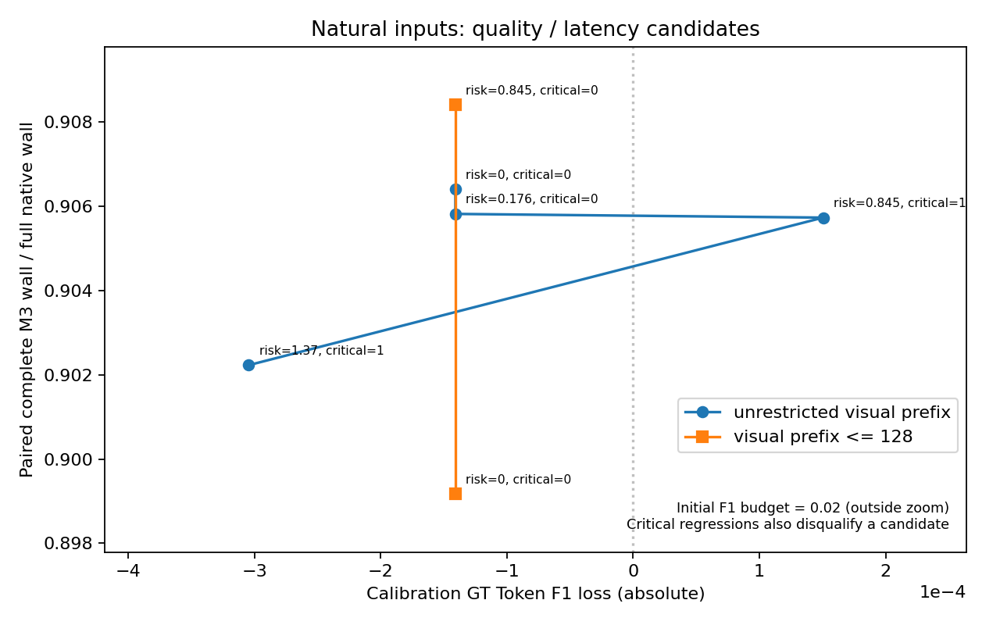

# OmniDrive M3：Quality-Bounded WSDR-KV（2026-10-26）

本轮已将 M3 从候选匹配升级为真实计算复用。最终 24 帧、72 问实际跳过 **5,607 / 42,130 token（13.31%）**，包含 **7 次自然跨帧有界近似复用**。最终回答和生成 token **72/72 一致**，GT Token F1 下降为 **0**。

测得 Prefill 总时延降低 **9.16%**，完整 M3 wall 降低 **1.01%**，整帧平均时延降低 **2.21%**。这是有限样本的实测工作点，不能解释成全局最优或完整生产质量保证。

必须同时说明：7 次最终实际近似复用全部属于 map_relations，位于校准/开发段；新留出的 6 帧在最终服务策略下没有近似复用。首次服务验证暴露了一次 full_visual 精确前缀的空间标签退化，已按原标准撤销该规则；最终同样本回放是回归验证，不能当成另一份未使用过的独立测试。

## 1. 唯一执行路径与代码精简

主线为：

`当前 M1/M2 状态 → native 多模态展开 → ReusePlanner → ReuseDecision → PrefillExecutor → 原始 HF Decode → 单缓存更新`

M3Runtime 负责生命周期、可选历史文本、展开、调用规划与执行、记录诊断。Scheduler 只读取一份 `outputs/final_route/m3_reuse_policy.json`，在经验质量预算内选择预测成本最低的连续前缀。无合格净收益时令 `reuse_length=0`，仍由同一个 PrefillExecutor 完成计算；原生 generate 只用于离线参考。

删除了真实 OmniDrive 不使用的动态 group 重排及旧多证据准入分支。`exact_prefix` 只限制同一规划器的近似候选，保留作测试/benchmark 参考，没有另一套精确执行器。旧 M3 成本/质量 JSON 原样保留，但不参与新主线决策。

保留模型/LoRA/后端签名、场景/相机/epoch、时间及状态版本、文本/位置/mask、KV 形状和预算、生成 RNG/EOS、末 token logits、不可变分支等约束。`tools/test.py` 在实际加载 checkpoint 后只计算一次文件身份；只读 benchmark 计时包装不改变可移植后端键，真实数值包装仍被签名，live cache 仍检测包装变化。

## 2. 真实数据映射与风险信号

- 载体保持 **object 256 → ego 1 → map 256**，共 513 token；object/map 是学习 latent query，不是逐物体身份槽位。
- 32-token 块仅表示 LLM 序列中的连续计算范围，不是 EVA 空间窗口。
- M1 复用现有 Commit 前冻结快照与 `query_world_state()` 来源检查。普通关联不是物理身份认证，部分历史不能证明计数或缺失。本轮 `history_text=false`，避免把未校准的文本增强变化混入 KV 收益。
- M2 窗口经过全局 EVA 后缀和稠密任务头才成为 carrier，没有可靠 window ID→carrier token 映射，始终报告 `m2_region_mapping_unavailable`。只使用实际刷新、年龄、全量原因和上下文作风险线索。本段 M2 刷新比例恒为 1.0，不能据此单独证明 M2 指导的增益。

同帧仍使用严格精确匹配。跨帧逐块计算对称归一化 RMS/Frobenius 变化和最大 token 变化，按已有任务 profile 加权。object/map/motion 提高相关组权重，full_visual 使用较高统一权重。候选保留此前所有块的最大风险；遇到首个超界或不合法块后，不能使用其后非连续 KV。

## 3. ReuseDecision 与误差继承

决策显式包含长度、exact/bounded_approx/none、风险、预测节省、缓存帧、年龄、近似深度及理由。近似执行校验当前输入和缓存版本、连续前缀证明、策略界限、来源及年龄深度；不能只传一个近似标志删除 LCP 检查。整数长度接口只支持严格精确 benchmark。

缓存保存 root frame、prefix lineage、近似深度和风险所用 profile。近似缓存即使 nominal embedding 相同，也不能标为 exact；当前问题改变时重新加权继承风险。策略限制年龄最多 2 帧、近似深度最多 1，本轮实际最大均为 1。近似全请求命中仍重算末 token logits。

缓存分支使用拥有的 clone。回归测试检查旧 CacheEntry 不被诊断或验证局部变量延长生命周期。普通推理不新增显式 CUDA synchronize；变化统计只回传小型元数据，不保存另一份大型特征。

## 4. 实验身份与样本独立性

真实权重：`ckpts/iter_10548.pth`。

SHA256：`6468af836dbdbc41034545d2a4669abc3b5288a669b4e13ac9a99bf9bb53c30d`。

每次实际加载严格验证 learned state_dict，无缺失 learned key、unexpected learned key 或形状差异，只忽略派生 nonpersistent RoPE cache。环境为 OmniDrive、RTX 3090 24 GiB；所有命令以 `taskset -c 0-3,6-31` 启动，避开故障 CPU 4/5。

原生生成参数保持 sampling=True、temperature=0.1、top_p=0.75、beams=1、max_new_tokens=320、use_cache=True。真实问题保持原 tokenization；标签只用于离线评分，不输入规划器。最终主链使用显式问题清单保持配对。

| 数据段 | 帧 / 问 | 用途 |
|---|---:|---|
| 校准 | 12 / 36 | d1e57234fd6a463d963670938f9f556e、e60ef590e3614187b7800db3e5284e1a；按真实位姿移动量预选低/中运动场景。 |
| 开发 | 6 / 18 | 第三场景 82cabcf15a1a48aca6bbf082f8710e39 前 6 帧；原验证发现长前缀风险后改作开发，不计入最终独立样本。 |
| 新验证 | 6 / 18 | 第三场景随后 6 个此前未运行的帧，未用于阈值搜索。 |

共 24 个不同自然帧。为保留时序上下文，追加原生参考重放了第三场景前 12 帧，前 6 帧与先前重叠。`native_reference/` 是两次实际原生运行的可追溯拼接，来源见 [derivation.json](native_reference/derivation.json)，没有合成时间或预测。

校准使用共同 RNG 逐问题配对，并检查捕获输入能够复现原生 token。服务运行保留真实整帧 RNG 演变，不能将逐问题回放当作端到端结果。服务验证用于撤销失败规则，没有重选阈值；撤销后的重复回放只是回归，仍需新独立场景确认。

## 5. 校准与质量—时延曲线

首先按自然校准特征分位数生成阈值 **0 / 0.175981 / 0.844620 / 1.373136**，没有使用余弦阈值或手工高相似特征。长前缀存在关键关系退化，map 近似规则在原独立段的 F1 经验上界为 **0.40048**，超过 0.02，未采用。

随后只追加一个更短候选：跨帧最多复用 **128 个视觉 token**，仍按 32-token 块，只比较 0 与自然分位阈值 0.844620。初步记录 `calibration/`、长前缀 `calibration_final/` 完整保留；最终参数来自 `calibration_short/`。



[SVG](quality_latency_curve.svg) · [CSV](quality_latency_curve.csv) · [配对记录](calibration_short/paired_records.jsonl)

横轴为 GT Token F1 下降，纵轴为配对完整 M3 wall 比例；critical 标记不能被平均 F1 掩盖的新增代理退化。曲线只使用校准场景。图中的统一阈值试验不是最终按 profile 决策的混合策略，不能把其中最快点直接作为最终结果。

成本拟合包含规划、KV 读取/复制、剩余 Prefill、缓存更新及受影响 Decode，保留固定开销项，并替换为当前请求的实际决策耗时。策略在实测输入长度及复用范围内选预计成本最低的方案。0.02 是可配置的初始研究预算，不是所有任务的最终标准。

| 最终 profile | 规则 / 参数 | 证据与实际使用 |
|---|---|---|
| full_visual | 复用规则失效 | 首次服务有 1 次空间代理退化，自动撤销 exact 规则；当前完整 Prefill。 |
| map_relations | risk≤0.844620，视觉前缀≤128，block=32 | approx 回放样本校准 5 / 新验证 1，观察 F1 损失 0；最终实际 7 次跨帧近似、8 次精确。 |
| object_attributes | risk≤0.844620 | exact 经验 F1 上界 0.02597 超预算；approx 回放仅 1/1 且范围受限，最终没有实际使用。 |
| object_ego_motion | 无合格规则 | 没有校准样本；少量速度建议/减速带语境不足以证明运动判断准确性。 |

这是有限候选、有限样本下的工作点，不是全局最优证明。小样本经验上界不是理论保证，尤其近似 profile 的独立样本很少。

## 6. 最终真实执行与复用

| 指标 | 最终结果 |
|---|---:|
| 输入 token | 42,130 |
| 实际执行 Prefill token | 36,523 |
| 实际跳过 token | 5,607（13.31%） |
| 实际复用请求 | 15/72（20.83%） |
| exact | 8 请求，4,466 token |
| bounded_approx | 7 请求，1,141 token |
| 相对严格 LCP 额外跳过的视觉 token | 896 |
| 最大缓存年龄 / 近似深度 | 1 / 1 |

7 次近似均为自然跨帧 map 问题，每次连续复用 35 个严格文本 token + 128 个近似视觉 token，共 163。不存在跳过一个变化块再拼接后方 KV。

全部请求满足 `reused + effective_prefill = input`，实际 forward lengths 总和等于 effective_prefill；没有将计划数误报为跳过数。72/72 PrefillExecutor 与 Decode 完成，24/24 M1 Precheck/Commit、M2、M3 链完成，Detection/Map 输出摘要 24/24 与原生相同，实际复用来源有效。

新验证 6 帧有 2 次 exact、0 次 bounded_approx；7 次实际跨帧近似位于校准/开发段。可以确认自然实际复用已发生，不能宣称新独立服务段充分覆盖了跨帧近似。

## 7. 真实效率与显存

Prefill/Decode 是每问题 CUDA stream span；完整 M3 是每帧三问 host wall；整帧包含加载/预处理、M1/M2/任务头、语言与答案写入。嵌套计时不能相加。P95 为有限样本实测分位数，不是置信区间。

| 配置 | Prefill 平均 / P50 / P95 ms | M3 平均 / P50 / P95 ms（每帧） | 整帧平均 / P50 / P95 ms | frame/s | 峰值 allocated GiB |
|---|---:|---:|---:|---:|---:|
| 原生完整 Prefill | 182.742 / 178.101 / 219.551 | 3548.090 / 2749.904 / 7579.150 | 4635.318 / 3915.270 / 8605.230 | 0.215735 | 15.234 |
| 最终 WSDR-KV | 166.006 / 178.953 / 223.771 | 3512.310 / 2764.332 / 7431.654 | 4532.635 / 3828.687 / 8338.332 | 0.220622 | 15.554 |

整帧平均下降 **2.21%**，实测 speedup **1.0227×**，吞吐增加 **2.27%**；Prefill 总时间下降 **9.16%**，完整 M3 wall 下降 **1.01%**。

M3 P50 与 Prefill P50/P95 没有全部改善：多数请求仍完整计算并维护候选缓存。整帧差异大于 M3 差异，不能将其他阶段单次波动全部归功于 KV。当前各配置仅一次短序列参考，不能推出稳定泛化加速。

准备平均 **0.608 ms/问**，规划/匹配平均 **2.184 ms/问**。KV 分支 GPU 平均 **0.134 ms/全部请求**，对 15 个实际分支平均约 **0.642 ms**，最大 **0.883 ms**。最大拥有缓存 **332.755 MiB**，低于 512 MiB；峰值 allocated 比原生增加 **326.683 MiB**。分支工作区另有真实逐请求记录，不将 reserved 当作缓存量。

主要瓶颈仍是原生 Decode、必须完整计算的 EVA/任务头，以及大量 full_visual 请求。M2 本轮没有窗口输出复用，未修改其成本表制造增益。

## 8. 相对精确限制参考的真实增量

此前正式严格方案受旧多份证据限制，实际复用为 0。本轮不再依赖旧文件，实际 token 非零；不能把“解除旧门控”全部归功于近似算法。

同一执行器的 threshold=0 提供配对精确限制参考，没有另跑大型基线。5 个校准自然跨帧额外前缀样本的完整计算、精确限制、短近似 M3 wall 分别为 **882.876 / 894.783 / 876.397 ms**：短近似比该精确限制少 **18.386 ms/问**，比完整计算少 **6.480 ms/问**。

但整个 36 问校准集上，精确限制平均 **966.949 ms**，统一短阈值试验平均 **976.875 ms**，后者反而慢约 **1.03%**，因为继承/深度刷新会改变后续复用机会。最终只启用有条件净收益的地图规则。因此没有普遍优于可运行精确方案的结论，也没有独立的精确限制完整端到端对照来证明这种优势。确定的新增能力是 7 次跨帧真实复用、额外 896 个视觉 token。

## 9. 质量、原模型错误与关键样例

最终原生与 WSDR-KV 的 GT Token F1 均为 **0.43650577**，字面 exact-match 为 0。数字值（含英文数词）严格序列一致为 **1/10**，空间标签集合精确匹配为 **12/38**，运动标签为 **14/31**，安全标签为 **3/8**；两种路径完全相同。这些是明确的抽取代理，不是人工完整语义正确率。

旧数字个数指标在 8 个含阿拉伯数字参考的问题上为 0%，MAE 因个数不同为 null；不能把 null 当作误差 0。还记录数字值覆盖、对齐误差、标签 F1 与新增退化，避免平均文本 F1 隐藏关键变化。

原模型本身已有坐标错误，不能归因于近似：例如参考位置 (+13.2,-1.4)，原生答到 (+12.0,-3.3)，最终保持原生。一致性表示没有新增错误，不表示坐标正确。

首次服务的关键样例为 ae463fd0ba0e430984c1fa560856f4d8，问题是“Are there any traffic elements that might influence your driving behavior?”。该请求使用 exact，同帧前两问没有近似。新回答未提到参考中的 front，空间标签 F1 从 0.5 降为 0，虽然文本 F1 从 0.4713 升到 0.4901。不能用平均 F1 改善掩盖这一退化。

现象与 FP16 改变 Prefill GEMM 形状后的数值/采样敏感性相容；未测其逐 logits 差异，不能声称完全定位底层误差。`--qualify-service` 将真实证据写回同一策略，使 full_visual exact 的 critical_regressions=1，没有改阈值、预算或批准标志。最终该样例与原生一致。

原始首次服务 `wsdr_kv/` 和[服务证据](service_qualification/service_evidence.jsonl) 保留；最终为 `wsdr_kv_final/`。微型模型测试检查 exact tokens/logits/RNG；真实模型最终 exact 8/8 token 一致，但首次 exact 曾发生输出变化，因此不宣称输入相等就保证 FP16 logits 位级一致。近似依据任务质量和实际成本评价。

## 10. 变更、测试与复现

最终 GPU 回归：**429 passed，0 failed/skipped，7.33 秒**，见 [tests_final_gpu.log](tests_final_gpu.log)。测试实际张量、执行长度、模型输出、来源/版本、年龄深度、策略选择和完整链路，没有仅靠字符串验收。

覆盖同帧精确、跨帧 suffix-only、首个失败块终止、非法/陈旧 proof、不连续 KV、风险或成本超预算、场景/模型/位置兼容、继承风险重新加权、年龄深度、校准可复现、独立样本、数字值/部分空间退化、服务规则只撤销不调参、入口权重身份与缓存引用寿命。

| 范围 | 修改文件 |
|---|---|
| M3 主执行 | worldstream/m3/{config,runtime,reuse_planner,scheduler,prefix_matcher,prefix_kv_cache,prefill_executor,visual_state,__init__}.py；新增 checkpoint.py。 |
| 主入口 | projects/configs/OmniDrive/worldstream_m123_auto.py（仅 M3 配置）、projects/mmdet3d_plugin/models/detectors/petr3d.py（来源/审计）、tools/test.py（加载后身份绑定）。 |
| 实验工具 | tools/worldstream_m123/benchmark/{worker,observe,prefill_validate}.py；新增 quality_calibration.py。 |
| 测试 | tests/worldstream_m3/{test_wsdr_kv,test_quality_calibration,test_code_signature,test_execution,test_trusted_history}.py；tests/worldstream_m123/{test_benchmark,test_final_route,test_always_execute}.py。 |
| 策略/文档 | 新 outputs/final_route/m3_reuse_policy.json；README.md、docs/worldstream_final_route.md、docs/worldstream_m3_wsdr_kv.md。 |

M1/M2 Python、原模型配置、M1 yaml、Detection/Map/LLava 核心 head 与既有 final_route JSON 共 **41 个保护文件哈希未变化**，见 [protected_verification.json](protected_verification.json)。未修改权重、删除旧结果或回写旧批准。

复现命令见 [commands.json](commands.json)，最终汇总见 [comparison_summary.json](comparison_summary.json)，逐帧/逐问题数据分别在 native_full/、native_extra/、wsdr_kv/、wsdr_kv_final/。运行下列命令可重建汇总和图：

```bash
taskset -c 0-3,6-31 /home/qh/miniconda3/envs/OmniDrive/bin/python outputs/m3_quality_bounded_20261026_run01/analyze.py
```

## 11. 验收回答与剩余问题

1. **M3 是否升级为真实复用？** 是，15 个请求真实执行更短 Prefill，共跳过 5,607 token。
2. **跨帧近似是否真实发生？** 是，7 个自然请求各复用 128 视觉 token，来源为同场景上一帧，深度 1。
3. **多少质量损失对应多少收益？** 配置预算 0.02；最终回归观察损失 0、72 答案一致，Prefill -9.16%、M3 wall -1.01%、整帧平均 -2.21%。不是新独立测试后的泛化质量保证。
4. **相对精确方案增加多少？** 额外 896 视觉 token；配对适用子集约多省 18.386 ms/问，但全校准集短试验慢 1.03%，没有普遍或端到端因果优势结论。
5. **哪些问题不适合当前复用？** 长前缀地图曾超预算；全局/计数/空间敏感请求当前完整计算。运动及部分物体问题证据不足。精确 FP16 前缀也不能仅凭输入相同假定回答稳定。

剩余工作是更大独立场景、结构化语义指标、新独立段实际触发地图跨帧复用，以及重复计时与更充分成本拟合。没有可靠区域映射，不宣传区域级/窗口级 LLM KV。
