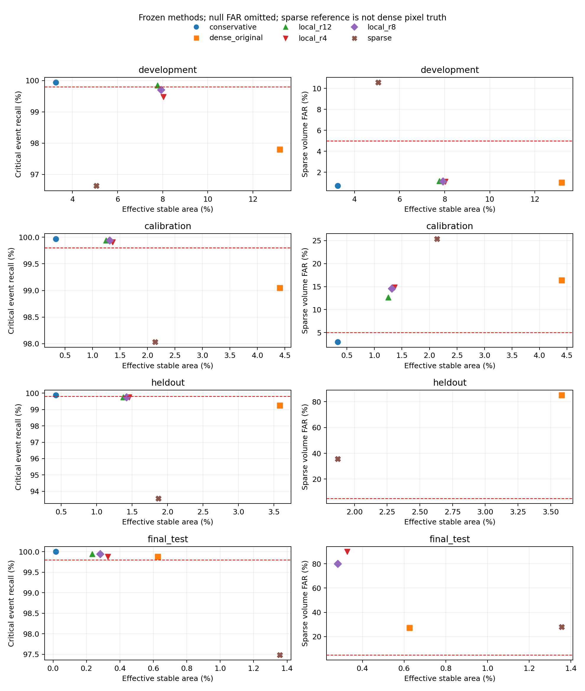
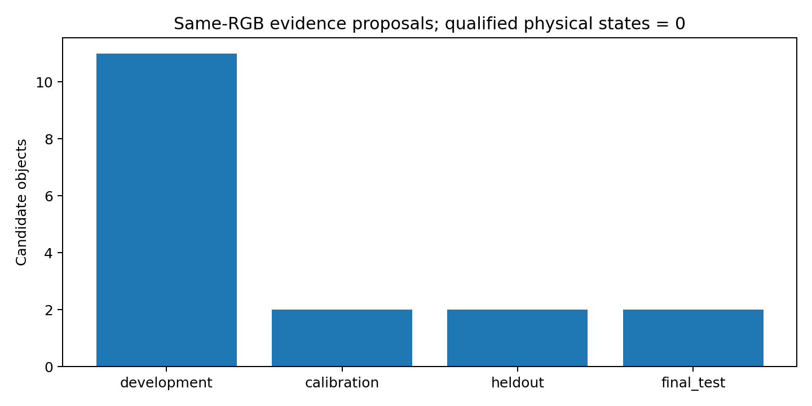

# M1 物理证据闭环与局部区域专项实验

本轮实现可验证的真实测量证据接口、实验性前景对应生产器、局部边界拒绝和状态不可变性边界。所有质量结论来自本轮真实执行；没有把受控测试夹具当成物理成功，也没有使用 GT 在线补证。

## 数据与冻结

本轮在 train 中冻结 38 个未在旧 M1 产物出现的 scene，并采用 38 个互异采集 log：20 Calibration、6 Heldout、12 Final Test，每 scene 12 帧。456 个 sample token 在此前整个 outputs 的 JSON/JSONL/Markdown 中无匹配。它们属于 OmniDrive 的模型训练人口，只能称为对 M1 开发新的场景，不能声称模型泛化或官方隐藏测试成功。test 图像存在但缺少 sample_annotation，未用其伪造风险评价。

全部新场景检测来自本轮原 checkpoint 的实际 GPU 感知执行，使用原 test 图像预处理和检测推理参数。此前 val 的 26 个 scene、368 帧全部作为 Development/Reproduction。新旧共 64 个质量场景、824 个唯一回放帧；多个方法及重复帧不是独立样本。数据清单、日志/token、时戳、预测哈希和成本保存在 data_selection.json、model_observation_provenance.json 与 traces/。

候选算法/阈值在新质量标签读取前固定；只允许 Calibration 选方法，algorithm_selection.json 和 formal_validation_protocol.json 在 Heldout/Final 评分前写入。原关联 local margin 仍为 0，global edge-removal 只作离线比较。所有 GT/annotation/LiDAR 仅在 tools 中评分，从未作为 Precheck/在线认证/Commit 参数。

## 复现原失效与本轮区域结果

| 原确认组（本轮均为开发数据） | 关键事件召回 | 关键点漏刷 |
|---|---:|---:|
| heldout | 99.722607% | 97/62184 |
| final_test | 100.000000% | 52/205440 |
| development_long | 99.935525% | 367/74752 |

旧刷新精确 Mask 与本轮 conservative 的逐相机比较见 critical_change_failure_cases.json。事件仍要求 ROI 刷新≥90%；点级分母和事件级分母均保持，不将不可评分背景改成静态负例。实际像素、预测/参考 source UV、漏刷原因和可视化保存于 traces/ 与 visualizations/。

局部方案保持动态扫过保护，将全图的支持邻域 guard 从 8 改为 2，并只在旋转补偿后的视差跳变、折叠、双向流失配或显著光度残差周围拒绝稳定性（Unknown）。半径固定比较 4/8/12；没有扩大全图 guard。其收益和新增错误同时报告，未通过则不设为默认。

Calibration 选中的实验候选：**None**。这不是生产批准；默认配置仍为原保守模式。

| 分组 | 方法 | 有效稳定面积 | 事件召回 | 关键点漏刷 | 稀疏参考错误/接受 |
|---|---|---:|---:|---:|---:|
| calibration | conservative | 0.3316% | 99.969231% | 45 | 9/306 |
| calibration | dense_original | 4.4068% | 99.046154% | 1825 | 481/2939 |
| calibration | full_refresh | 0.0000% | 100.000000% | 0 | 0/0 |
| calibration | local_r12 | 1.2489% | 99.938462% | 466 | 169/1336 |
| calibration | local_r4 | 1.3647% | 99.907692% | 547 | 228/1538 |
| calibration | local_r8 | 1.3123% | 99.938462% | 500 | 215/1475 |
| calibration | sparse | 2.1371% | 98.030769% | 1775 | 351/1382 |
| heldout | conservative | 0.4247% | 99.873737% | 15 | 0/0 |
| heldout | dense_original | 3.5853% | 99.242424% | 390 | 17/20 |
| heldout | full_refresh | 0.0000% | 100.000000% | 0 | 0/0 |
| heldout | local_r12 | 1.3766% | 99.747475% | 69 | 0/0 |
| heldout | local_r4 | 1.4611% | 99.747475% | 81 | 0/0 |
| heldout | local_r8 | 1.4235% | 99.747475% | 73 | 0/0 |
| heldout | sparse | 1.8722% | 93.560606% | 393 | 21/59 |
| final_test | conservative | 0.0163% | 100.000000% | 4 | 0/0 |
| final_test | dense_original | 0.6263% | 99.880240% | 493 | 15/55 |
| final_test | full_refresh | 0.0000% | 100.000000% | 0 | 0/0 |
| final_test | local_r12 | 0.2337% | 99.940120% | 80 | 0/0 |
| final_test | local_r4 | 0.3271% | 99.880240% | 139 | 9/10 |
| final_test | local_r8 | 0.2813% | 99.940120% | 115 | 4/5 |
| final_test | sparse | 1.3567% | 97.485030% | 1363 | 64/229 |

区域约束：事件召回≥99.8%，关键点召回≥99.8%，annotation-owned 稀疏参考 FAR≤5%，至少 3 个接受 scene，且有效稳定面积不低于保守方案。Final 不重新选方法。Trial CP 上界只作描述，并报告 scene-cluster bootstrap、接受场景数和无分母重采样；相关点不能当独立样本。未标注背景、未评分像素不计作正确，全图刷新仅为零收益参考。

## 物理证据与代价

| 分组 | 对象提案 | 几何/背景可区分候选 | 候选支持 Scene | 候选前景生产 CPU/对象 P50 ms |
|---|---:|---:|---:|---:|
| development | 7756 | 11 | 5 | 1.4727589441463351 |
| calibration | 5128 | 2 | 2 | 1.5179296024143696 |
| heldout | 790 | 2 | 1 | 1.5249843709170818 |
| final_test | 2011 | 2 | 1 | 1.4499209355562925 |

生产器实际消费双向 RGB 点、源/当前相机位姿、可观测三角化、旋转框成员关系、空间象限和邻域环深度分离。光流一致不自动证明静态前景：缺少视差、环无法测深、目标与背景不能区分或多视图矛盾，均输出 Unknown。检测框只提出几何候选；没有伪造实例前景 Mask。

稀疏 LiDAR 与 annotation 体积约束可发现错实例和目标体积外的背景候选，但体积内点仍不等于完整像素归属真值。foreground_correspondence_results.json 明确分解可评分/不可评分点、背景候选、错对象和观测不足。当前生产器没有足够的独立身份/前景质量资格，因此没有批准为正式可信对象来源。额外分割网络/传感器组件未提供，未训练或集成，其质量和开销为 Not Run，不提供虚构毫秒数。

认证器已不再固定返回 False：它验证带执行回执的实际数值测量，以及 scene/frame/epoch/图像 digest/几何版本、声明范围和经审计哈希固定的生产器质量资格。受控正例仅证明代码能消费完整合规输入，不是现实世界成功。实际缺少批准资格时默认拒绝；本轮严格接受仍为 0，FAR=null，上界=null，独立接受 Scene=0。

允许研究的最小声明为“静态候选对象身份连续性与局部射线一致性”；它不批准中心、距离或速度。认证发生在完整感知后的 Commit，不能反写之前的 Precheck；每次新 Detection 替换几何都更新 state_version，旧认证不能附着到新值。

质量实验完成后加强了资格协议指纹：绑定全部证据相关配置和生产器源码。该改动只改变诊断 digest；所有实验资格均为空，数值算法 AST、阈值和接受决策不变。冻结协议未改写，实测原型源码保存在 measured_prototype_source/，唯一源码哈希差异及决策不变性见 evidence_protocol_binding_audit.json。最终回归、独立 GPU 和 CPU 计时使用加强后的源码。

20 个校准 scene 的条件 scene-max 半径（xy）：(1.9794703251840247, 1.9794703251840247)。即使为有限值，它也仅覆盖经过离线唯一身份/2m 门限筛选的人口；在线无法确认该人口成员资格，所以仍不可用于完整三维属性认证。中心与尺寸残差、不可评分人口、独立 pose/calibration 真误差缺失分别列出，不把 P95 当确定性误差界。

## 17 项验收回答

1. 生命周期/来源仍保持：复用原子发布和 Frame Digest，新增源状态 digest、不可变 bytes-backed 几何/描述子/历史图像，以及隔离的 feature snapshot。
2. 固定拒绝已改为可验证证据接口；生产器回执、数值和离线资格全部检查，不能靠 identity_verified/foreground_verified 布尔值通过。
3. 当前观测能支持同源 RGB 表面/局部射线一致性提案；只有独立质量资格批准后，才支持限定对象连续性声明。
4. 实测获得的前景候选与真实实例证据分开报告；没有获得可正式批准的实例归属生产者。
5. 环深度对比能拒绝同深度/不足视差等情况，但无法在全部真实样本中证明目标与 ROI 背景归属，保持 Unknown。
6. 未得到非零、独立风险合格的严格物理历史状态，不能以全部拒绝宣称成功。
7. 物理 FAR 和单侧上界均为 null，未达到冻结的≤5%要求；重复帧不增加独立样本量。
8. 精确中心/距离/速度仍缺少适用误差界，均不可认证；类别为 barrier/cone 或高检测分数不会改变结论。
9. 条件关联人口已分解：独立唯一身份、超出2m、身份竞争、无传感器支持 GT、源不可评分。被拒绝的正确链接与被接受的错误链接均保留。Global assignment 唯一不等于物理实例唯一，因此没有未经验证增加在线复杂度。
10. 具体漏检由逐点 source 对应与运动/新实例/独立 LiDAR 遮挡参考定位；RGB 对应可能在前景变化时仍追踪背景。局部拒绝结果与剩余失败逐例保存，没有通过扩大全图刷新抹去失效。
11. 99.8% 是否达到，以以上完整分组表和 go_nogo_decisions.json 为准；不只引用成功场景或框事件，而忽略关键点漏刷。
12. 有效覆盖只在同一质量约束下比较；未达约束的覆盖增长不记为成功，full refresh 有效覆盖恒为0。
13. 按 scene/camera/frame 记录面积、误差、ego 位移、间隔、强制刷新和光流诊断；平均值不替代长尾失败。
14. 实测新增生产器 CPU、认证、Association、Mask/Precheck/Commit 成本，逐场景结果见 m1_runtime_cost.json。并发实验时序不用于声称加速，额外提供预加载单进程对照；没有质量资格前不开展 P1。
15. 本轮实际 8 帧 GPU 感知数值一致：{'outputs': True, 'memory': True, 'backbone': True}。Checkpoint SHA256 一致，模型权重、感知输入预处理/参数、M2/M3 算法未变。
16. 有对本地记录的 M1 开发新的 scene/log，且样本 token 审计无旧匹配；它们仍是模型训练人口，不能宣称原模型泛化、官方测试或未知外部域保证。
17. 工程接口和异常边界可继续作为 observe-only 基础；物理状态消费必须等待独立前景/身份资格，区域消费仅能受四项决策的具体范围约束。

## 四项独立决策

- **M1 Engineering：Go**。380 passed，0 skipped；旧测试保留。
- **M1 Physical Certification：No-Go**。实际严格覆盖=0；不将零接受报告为零风险。
- **M1 Region Validation：No-Go**。原因/范围：['No local candidate met frozen calibration screen']。
- **M1 Runtime Cost：No-Go for optimized deployment; costs measured, P1 not run**。

完整图像未评分像素的风险仍没有被认证；本轮不批准完整系统部署，不声称端到端加速。下一步最小信息是独立核验的源/当前实例归属及身份证据；精确几何另需适用人口的定位/运动误差界。当前候选生产器的成本已实测，尚不存在的额外组件成本明确 Not Run。

## 独立计时结果

预加载相同 8 个开发帧，1 次预热、4 次计时，交替方法顺序。以下包含 Adapter + Precheck + Commit，排除图像 IO、Oracle 和日志；这是同机对照，不代表端到端加速。

| 方法 | P50 ms | P95 ms | 前景生产 P50 ms/帧 |
|---|---:|---:|---:|
| baseline | 145.08 | 162.54 | 0.00 |
| new_without_producer | 156.41 | 166.80 | 0.00 |
| new_with_producer | 254.28 | 265.83 | 87.00 |

独立 GPU 感知协议下，完整 M1 适配/验证/提交 P50/P95 为 266.98/298.03 ms（8 帧，含启动帧；非同一 CPU 输入分辨率）。拆分与原始值见 gpu_adapter_profile.json。
生产器新增成本没有换来经过独立资格批准的状态覆盖，因此保持显式实验开关，默认关闭。

## 关联歧义离线对照

以下为预冻结的 0m 诊断门限，保持原 2m/竞争 Oracle 口径。Global 列是排除匹配边后重求最大匹配数、最小总代价的结果；它没有接入在线策略，也不是身份真值。

| 分组 | 门限方式 | 保留候选 | 可评分保留 | 其中错误 | 不可评分保留 | 正确但拒绝 |
|---|---|---:|---:|---:|---:|---:|
| development | local | 7864 | 3362 | 22 | 4502 | 24 |
| development | global | 8773 | 3390 | 26 | 5383 | 0 |
| calibration | local | 5198 | 2646 | 12 | 2552 | 21 |
| calibration | global | 5798 | 2675 | 20 | 3123 | 0 |
| heldout | local | 805 | 442 | 3 | 363 | 4 |
| heldout | global | 876 | 446 | 3 | 430 | 0 |
| final_test | local | 2035 | 1041 | 8 | 994 | 6 |
| final_test | global | 2196 | 1047 | 8 | 1149 | 0 |

没有合法局部竞争边时 margin=+∞，严格 JSON 中记为 null；全局匹配数下降单独记录，不将它伪装成有限米制距离。全部身份人口与错误实例见 identity_error_diagnostics.json，逐场景原始边见 traces/*/*/association.json。
