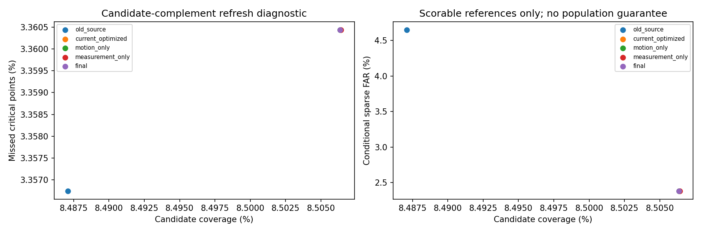
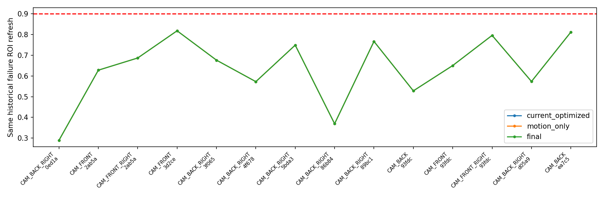
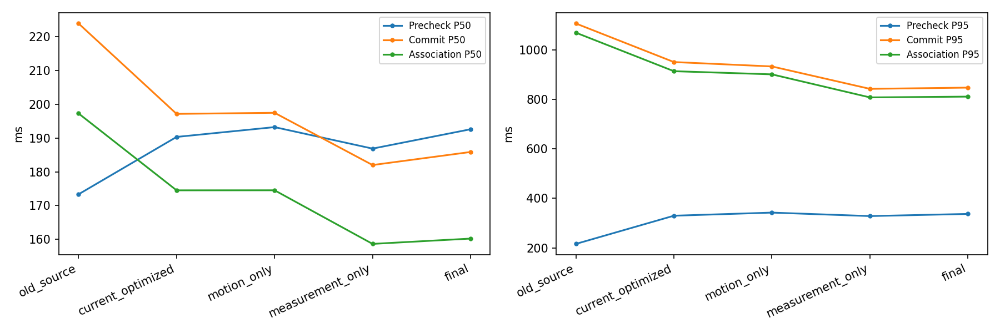
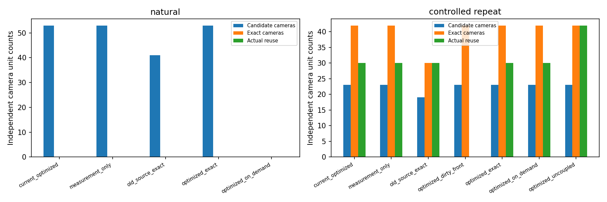

# M1 动态风险、候选物理评价与最终性能优化

冻结对照为实际 HEAD 3113df2，工作区开始时干净；历史输出未覆盖。本轮使用相同 96 帧、576 个相机 Development 观测，统一标记 exploratory_reused_population。线上只读取已提交历史与当前真实 RGB/标定/时间；Annotation/LiDAR 在 Precheck 后只供离线分析、分层与评分。

14 个旧失败全部逐帧重放：10 个没有重叠的历史投影，3 个存在重叠投影，1 个存在被动态排除清除的已测变化。重叠的类别/投影不证明与 GT 对象为同一身份。原始变化、排除、稠密/稀疏测量、残差和 GT 均在 critical_event_root_cause.json 与 critical_event_overlays/ 保存。

实现 Source-Aware Motion Risk Revocation：在已提交且时间/相机/签名相符的有限历史运动占用范围内，实测灰度变化撤销计算候选；源占用冲突或失败对应仅给 Unknown。历史 Box/Hull 不作前景或真值。Observation Link 和 Identity 保留，reuse_candidate_eligible 单独输出，M2 Exact gate 不变。动态排除前的变化另存风险通道，未改旧身份/严格刷新输入。

| 方法 | Candidate % | 接受中错误/接受 | Event/Point Recall % | 最低 ROI % | M1 P50/P95 ms |
|---|---:|---:|---:|---:|---:|
| old_source | 8.487081 | 2/43 | 98.4799/96.6433 | 29.1429 | 383.25/1280.80 |
| current_optimized | 8.506407 | 1/42 | 98.4799/96.6396 | 28.8980 | 412.13/1122.03 |
| motion_only | 8.506357 | 1/42 | 98.4799/96.6396 | 28.8980 | 420.93/1130.18 |
| measurement_only | 8.506407 | 1/42 | 98.4799/96.6396 | 28.8980 | 404.03/1024.29 |
| final | 8.506357 | 1/42 | 98.4799/96.6396 | 28.8980 | 413.85/1042.92 |

旧 14 个失败修复 **0** 个，仍失败 **14** 个，新失败 **0** 个；候选相对面积损失 0.0006%。逐事件、同一卡车连续失败和 CAM_FRONT 行人配对在 candidate_paired_analysis.json。严格部署刷新最低 ROI 为 1.0，候选补集失败不等于发生了非法跳算。

运动风险没有表现出事件召回或已评分错误拒绝的独立收益，不继续添加模型。工程配置 worldstream_m1_engineering_frozen.yaml 保持该分支关闭，采用测量复用单项优化；风险开启的 final 是实验全方法，不能与推荐工程配置混称。

物理评价预先固定随机种子、每层 32 个链接上限和完整分母/权重。最终随机样本 21985，可评分 0，Correct/False=0/0。精确参考交集 census 可评分 42，Correct/False=41/1。两者分开，不用 census 冒充随机样本覆盖。稀疏 FAR 仍保留“接受中错误”原口径，运动对应即使物理可跟踪也不证明无需刷新。背景无独立身份参考仍 Unscorable；没有使用 2px 邻近真值或未经运动补偿的多帧点云。实例刚体/可见性与传感器时差假设仍限制评分能力，置信区间仅描述性，不形成认证。

96 帧的 Shadow/Object 状态决策摘要等价：True。优化未修改身份生产器、关联候选、阈值或 StateStore。cProfile 确认身份测量主导 Commit，复用单调用灰度 float32/Sobel 中间结果后，当前优化到最终方法 M1 P50/P95 为 412.13/1122.03 → 413.85/1042.92 ms。运动与测量单独消融见 runtime_optimization_ablation.json；线程阶段有重叠，不相加推导请求时延。

工程推荐的 measurement_only 对照为 404.03/1024.29 ms，优于当前 Optimized 的 P50/P95；相对更早 old_source 的 383.25/1280.80 ms，P50 仍较慢，P95 改善。不能宣称新接口全面优于旧接口。身份生产器的协议摘要绑定源码和配置，新标志使诊断签名变化；实际状态决策与 M2 计算来源另行核验，不把这些签名字符串宣称逐位相同。

| 人口/方法 | 请求 | E2E P50/P95 ms | 实际 Camera 复用 | 任务门 |
|---|---:|---:|---:|---:|
| 自然/current_optimized | 16 | 3184.51/4089.86 | 0 | 32/32 |
| 自然/full_maintain | 16 | 3275.43/3898.57 | 0 | 32/32 |
| 自然/measurement_only | 16 | 3238.80/3918.68 | 0 | 32/32 |
| 自然/old_source_exact | 16 | 3172.17/4166.31 | 0 | 32/32 |
| 自然/optimized_exact | 16 | 3197.78/3935.56 | 0 | 32/32 |
| 自然/optimized_on_demand | 16 | 3158.77/3925.70 | 0 | 32/32 |
| 自然/original | 16 | 2871.70/2900.58 | 0 | baseline |
| 受控重复/current_optimized | 8 | 2780.83/3249.18 | 30 | 16/16 |
| 受控重复/full_maintain | 8 | 3230.01/3251.12 | 0 | 16/16 |
| 受控重复/measurement_only | 8 | 2776.63/3228.83 | 30 | 16/16 |
| 受控重复/old_source_exact | 8 | 2787.73/3209.14 | 30 | 16/16 |
| 受控重复/optimized_dirty_front | 8 | 3246.42/3280.53 | 0 | 16/16 |
| 受控重复/optimized_exact | 8 | 2807.41/3237.83 | 30 | 16/16 |
| 受控重复/optimized_on_demand | 8 | 2853.39/3309.21 | 30 | 16/16 |
| 受控重复/optimized_uncoupled | 8 | 2755.44/2882.75 | 42 | 16/16 |
| 受控重复/original | 8 | 2873.33/2904.61 | 0 | baseline |

本轮 CUDA 回归：608/608。真实完整模型包括 EVA、Detection、Map、Memory、原 LLM 文本和规划输出。全部计时包含统一诊断特征 CPU 拷贝，原生 Memory 写盘在计时外；基线先执行，其余臂旋转，单次测量重复不支持小幅速度差的统计显著性结论。新旧接口使用同 Camera Boundary、成本表、数值/任务质量门；maintain 每帧执行 Precheck/Commit，on-demand 可省可选 Dense 验证但持续维护历史身份。自然输入无合法实际跳算时不宣称视觉计算加速。GPU 内存、传输字节、Adapter 和开销详见 m1_m2_integration.json。

模型臂中 current_optimized 是上一轮完整优化配置，measurement_only 是本轮推荐工程配置，optimized_exact 是包含风险撤销的实验完整配置，optimized_on_demand 在其上使用 CheapAdmission。full_maintain 持续维护相同 M1 服务并完整重算视觉。on-demand 的等价边界是必要历史维护、普通 Object ID、来源和缓存回执；可选 Dense 支持、候选与 Shadow 诊断证据不承诺逐位相同，不把省略这些证据伪装成完全相同的观测服务。

Dense Observation 与 Strict Surface 保留为上一轮相同 96 帧历史对照，原始结果和源码版本不改；数值嵌入 refresh_quality_comparison.json 的 historical_controls，明确不是本轮新执行，时延不与本轮配对优化混用。

工程接口冻结：**Go**；候选质量冻结：**No-Go**；转入 M2 研究：**Go**。条件复用授权、正式物理认证均 **No-Go**。Calibration/Heldout/Final Test = Not Run，Qualified Certification=0，Qualified FAR=null。当前证据不足的风险不由 GT 补齐，不再堆叠 M1 物理认证方法。

实现和采样修改清单见 implementation_changes.md；复现命令见 commands.sh；最终验收见 artifact_validation.json。
