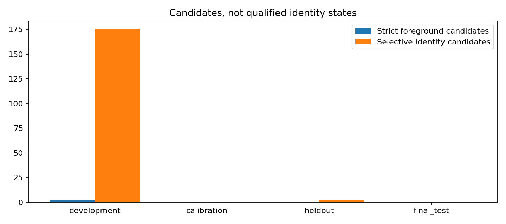
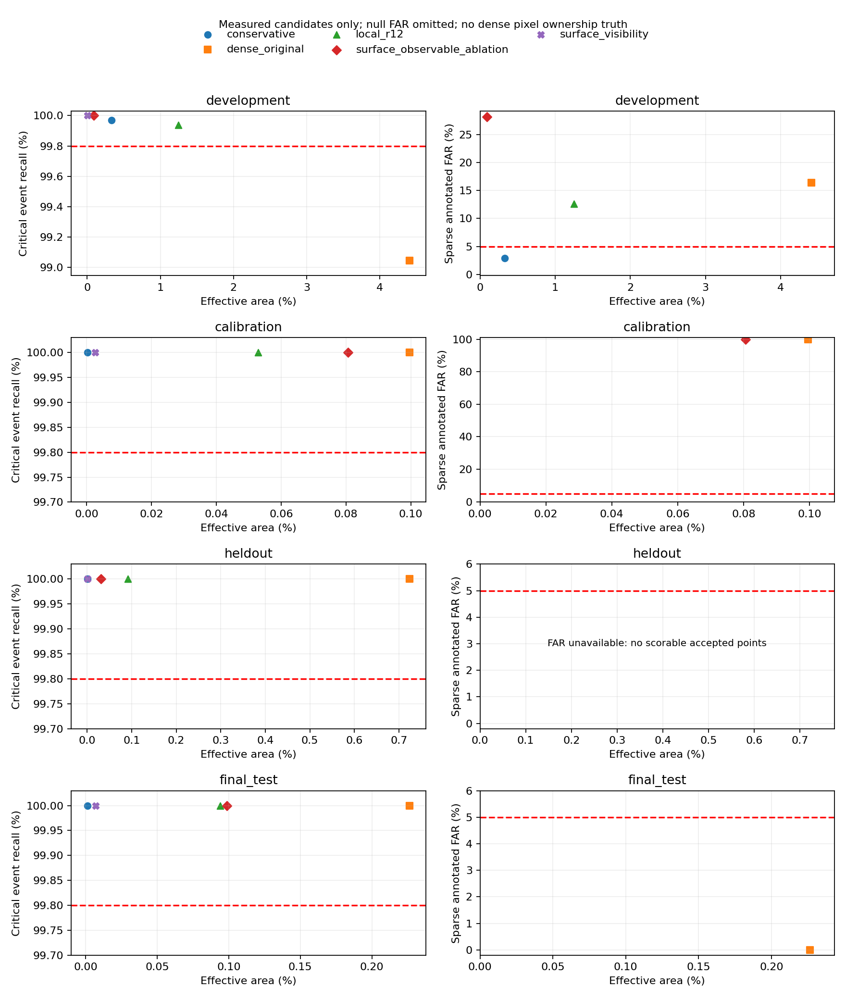

# M1 物理身份连续性与局部表面可见性实验

本轮完成独立身份声明、真实候选生产、Commit 后读取闭环与三帧表面原型。真实候选、离线可评分正确对应和取得资格的持久物理状态分别统计；本轮没有发放真实风险资格。

## 数据与协议

旧 Calibration 20 场景/240 帧全部转为 Development。新增 12 个场景和 12 个未在旧 M1 质量记录曝光的采集 log，冻结为 4/4/4 Calibration/Heldout/Final，共144帧，由原 Checkpoint 本轮实际 GPU 采集。它们属于原模型 Train Population，不能声称模型独立泛化。另有 8 帧原模型 GPU 数值对照、8 帧独立计时与40帧旧开发长序列生命周期检查。

新增 sample token 扫描只匹配旧可用性清单 train_data_availability.json，没有旧 M1 质量产物匹配；清单出现不等于阈值开发曝光。scene/log 清单、模型输出哈希、相机顺序、执行环境见 data_selection.json、sample_exposure_audit.json 和 execution_manifest.json。

root_cause_audit.md 在修改核心代码前生成；experiment_protocol.json 在实现和新质量运行前冻结假设及门槛。Calibration 结束写入 algorithm_selection.json 与 frozen_validation_protocol.json 后才运行 Heldout/Final。没有根据测试结果改算法或重选方法。GT/annotation/LiDAR 仅在 tools 评分，运行时 Precheck 没有当前检测或 Oracle 输入。

风险独立单位是 scene/log。一个单位内任一错误接受即单位失败；零错误也需至少59个独立接受单位才能让单侧CP95≤5%。校准排除后新 Heldout+Final 仅8个 log，即使全部完整可评分且零错，上界仍约31.23%，至少还缺51个这样的独立单位；当前尚有不可评分候选，实际资格缺口更大。不得用重复帧/对象或像素补足。

## 身份结果

A 保留原严格前景/静态射线生产器。B 为同类、上一实际来源、无门内竞争、检测更新位移≤0.5m、共有视图中实际轨迹和裁剪支持的选择性身份人口。B 不要求独立三维中心/静止/环深度分离；没有前景 Mask，必须通过独立身份资格才能批准。

| 分组 | 方法 | 全部几何候选 | 方法候选 | 可评分候选 | 错误身份 | 不可评分候选 | 可评分支持 scene | 条件场景上界 | 正式认证 |
|---|---|---:|---:|---:|---:|---:|---:|---:|---:|
| development | strict_foreground | 5798 | 2 | 1 | 0 | 1 | 1 | 0.95 | 0 |
| development | selective_identity | 5798 | 175 | 144 | 0 | 31 | 4 | 0.527129195498412 | 0 |
| calibration | strict_foreground | 683 | 0 | 0 | 0 | 0 | 0 | None | 0 |
| calibration | selective_identity | 683 | 0 | 0 | 0 | 0 | 0 | None | 0 |
| heldout | strict_foreground | 825 | 0 | 0 | 0 | 0 | 0 | None | 0 |
| heldout | selective_identity | 825 | 2 | 2 | 0 | 0 | 1 | 0.95 | 0 |
| final_test | strict_foreground | 1127 | 0 | 0 | 0 | 0 | 0 | None | 0 |
| final_test | selective_identity | 1127 | 0 | 0 | 0 | 0 | 0 | None | 0 |

以上候选/正确数按链接计数，同一实体跨帧不会增加独立统计样本；去重实体数另见 identity_recovery_results.json。所有候选仍包含 2m 唯一身份筛选的截断和无 GT 对应人口。条件 FAR/上界不代表全部候选的风险；qualified FAR/上界均为 null。正确但拒绝、错误但保留、缺帧重现与 fragmentation 分别列在 identity_candidate_diagnostics.json、identity_false_acceptance_cases.json 和 identity_recovery_results.json。受控资格正例只验证接口，不计作真实认证。

## 表面根因和结果

逐点精确复现旧 Local R12 的169个错误稳定点。主分类为 {'Unknown_Root_Cause': 123, 'C_geometric_degeneracy': 46}；46点低视差，其余123点不能区分真实表面切换、纹理错配和参考误差，保留 Unknown Root Cause。它们的光度/FB/Jacobian 已通过旧门槛；不能把两帧自洽三角化当成独立表面证明。完整 flow、RGB、pose、texture、Jacobian、几何、原判定与实际图见 traces/、visualizations/。

新方法要求可观测的三帧射线/对应闭合，并检查直接与复合的长基线轨迹。固定原门槛，没有 Radius Grid。缺历史/视差/闭合证据均为 Unknown，额外历史有固定帧数上限。两帧仅可观测性为消融；全刷新仅安全零收益参考。

| 分组 | 方法 | 有效面积 | 事件召回 | 关键点召回 | 稀疏错误/接受 | 稀疏FAR | 接受scene |
|---|---|---:|---:|---:|---:|---:|---:|
| development | conservative | 0.331562% | 99.969231% | 99.980976% | 9/306 | 0.029411764705882353 | 2 |
| development | dense_original | 4.406813% | 99.046154% | 99.228460% | 481/2939 | 0.16366110922082341 | 6 |
| development | local_r12 | 1.248860% | 99.938462% | 99.802993% | 169/1336 | 0.12649700598802396 | 3 |
| development | surface_observable_ablation | 0.091166% | 100.000000% | 99.978862% | 182/645 | 0.28217054263565894 | 2 |
| development | surface_visibility | 0.001666% | 100.000000% | 100.000000% | 0/0 | None | 0 |
| development | full_refresh | 0.000000% | 100.000000% | 100.000000% | 0/0 | None | 0 |
| calibration | conservative | 0.000220% | 100.000000% | 100.000000% | 0/0 | None | 0 |
| calibration | dense_original | 0.099596% | 100.000000% | 99.858444% | 6/6 | 1.0 | 1 |
| calibration | local_r12 | 0.052948% | 100.000000% | 99.954959% | 0/0 | None | 0 |
| calibration | surface_observable_ablation | 0.080598% | 100.000000% | 99.926005% | 6/6 | 1.0 | 1 |
| calibration | surface_visibility | 0.002660% | 100.000000% | 100.000000% | 0/0 | None | 0 |
| calibration | full_refresh | 0.000000% | 100.000000% | 100.000000% | 0/0 | None | 0 |
| heldout | conservative | 0.000523% | 100.000000% | 100.000000% | 0/0 | None | 0 |
| heldout | dense_original | 0.723532% | 100.000000% | 99.878304% | 0/0 | None | 0 |
| heldout | local_r12 | 0.091847% | 100.000000% | 99.990264% | 0/0 | None | 0 |
| heldout | surface_observable_ablation | 0.031616% | 100.000000% | 99.993510% | 0/0 | None | 0 |
| heldout | surface_visibility | 0.001516% | 100.000000% | 100.000000% | 0/0 | None | 0 |
| heldout | full_refresh | 0.000000% | 100.000000% | 100.000000% | 0/0 | None | 0 |
| final_test | conservative | 0.001144% | 100.000000% | 100.000000% | 0/0 | None | 0 |
| final_test | dense_original | 0.226339% | 100.000000% | 99.977241% | 0/1 | 0.0 | 1 |
| final_test | local_r12 | 0.093937% | 100.000000% | 99.994942% | 0/0 | None | 0 |
| final_test | surface_observable_ablation | 0.098702% | 100.000000% | 99.997471% | 0/0 | None | 0 |
| final_test | surface_visibility | 0.006993% | 100.000000% | 100.000000% | 0/0 | None | 0 |
| final_test | full_refresh | 0.000000% | 100.000000% | 100.000000% | 0/0 | None | 0 |

点和事件分母保持原协议：事件 ROI 刷新≥90%；错误稳定为 annotation-owned LiDAR 的来源偏差>2px 或真实标注运动。未标注像素与无返回背景均不当正确负例；零可评分稳定接受时 FAR=null，错误数下降不能替代有效覆盖与风险资格。scene/camera/frame、描述性CP与场景bootstrap见 region_quality_by_*.json、region_risk_coverage.json。

## 合法持久状态接口与成本

commit() 保留原返回值，get_current_certifications() 提供已原子提交的 frozen 结果和防御性证书副本。新检测替换几何即清除旧证书；scene/frame/version/epoch/timestamp 不匹配不返回。pending 查询只看到之前提交；异常不发布准备中的证书。M1Result 的 Precheck 字段不反填当前检测结论。身份声明不授权像素、静止性、米制几何或后续模块。

| 相同8帧预加载工作量 | 完整M1 P50 ms | P95 ms | 身份耗时 P50 | 严格前景耗时 P50 | 表面相机耗时和 P50 |
|---|---:|---:|---:|---:|---:|
| previous_baseline | 153.61 | 170.16 | 0.00 | 0.00 | 0.00 |
| identity_only | 221.23 | 247.44 | 34.47 | 0.00 | 0.00 |
| strict_only | 255.78 | 276.45 | 0.00 | 87.40 | 0.00 |
| both_producers | 327.37 | 342.58 | 35.67 | 87.65 | 0.00 |
| surface_identity | 466.34 | 494.02 | 35.50 | 0.00 | 688.44 |

Surface 列是并行相机任务各自 elapsed 耗时的和，任务重叠，因此可大于完整帧 wall time，不能与其他阶段相加或解释为实际CPU占用。完整M1列才是同机单帧耗时对照。
独立实际 GPU 输入协议下完整 M1 P50/P95 为 268.02/299.17 ms（8帧含启动）。该输入分辨率与CPU回放不同，不能直接解释为CPU加速。Transfer/Input/Output adapter拆分见 gpu_adapter_profile.json。

这是声明路径成本消融，排除 IO/Oracle/日志；不声称获得部署加速。身份路径不调用其声明不需要的严格前景三角化；原 A 路径仍保留。A 开关前后 B 的逐帧测量/判定一致，保守 Mask 也与基线完全一致。必要条件预筛只拒绝明确不属于所定义人口的候选，没有启用经验概率跳过；尚无合格物理状态收益，因此没有继续扩大 P1 优化、缓存或削减验证条件。

## 20项验收

1. 原强生产器稀少来自视差、双OBB、环测深/分离、空间支持和多视图静态假设的交集，详细拒绝漏斗保留。
2. 独立实例标签可验证 B 的部分候选真实同实例；未评分人口不能自动填正确。
3. 候选可评分正确覆盖与正式认证分开；正式可信持久身份状态仍为0。
4. B 仅身份连续性；A 是原有限静态射线声明；两者都不自动批准完整三维状态。
5. 正式身份错误率/上界仍null，没有满足5%正式资格。
6. 新质量单位仅12log，选择后独立评价8log，数量不足59且可评分人口不完整。
7. 最小缺口是覆盖全部所选人口的可靠独立身份证据，及足量新日志；完整表面/几何还需额外观测参考。
8. Post-Commit 查询闭环通过受控完整证据和模拟资格验证，实际结果无资格仍空。
9. Precheck 仍只消费合法当前输入和历史，未被当前 Detection 后验结论反填。
10. 46/169错误可确认低视差；其余主要根因未知，未凭光流错误主观归类A/B。
11. 三帧判据减少错误数，但收益必须同时检查面积和可评分接受；拒绝全部不算成功。
12. 有限非零区域不代表有用覆盖；未达到相对保守方案的风险约束覆盖收益。
13. 每组事件召回见上表，保留原90% ROI定义。
14. 每组点级召回见上表，未通过改分母抹除失效。
15. 稀疏FAR和单侧描述性上界分别报告，零接受为null。
16. 独立接受场景数逐组列出；不足则不批准。
17. 新身份、严格前景、surface、adapter/Precheck/Commit、memory/transfer的实际成本分别记录；缺少的硬件独立微测不虚构。
18. 预筛属于固定必要条件而不是经验快捷规则；没有声称在零实际认证下获得有用认证收益。
19. 实际GPU8帧原始感知/backbone/head memory相等，回归403通过，checkpoint SHA一致。
20. 当前只保留observe-only工程基础和实验原型，不能正式批准物理/区域输出供后续模块使用。

## 独立结论

- **engineering：Go**
- **identity_feasibility：Negative for frozen independent confirmation**
- **physical_certification：No-Go: Qualification Insufficient; unscorable accepted population unresolved**
- **region_feasibility：Negative**
- **region_validation：No-Go**
- **runtime_cost：No-Go for deployment; claim-specific costs measured**

最小新增能力优先是独立且完整的对象身份/源当前表面参考。当前没有额外传感器、分割权重或人工核查会话，因此这些新增能力的采集/推理成本为 Not Run；本轮没有训练或集成新网络。本轮固定选择性方法失败不证明所有轻量方法不可能，也不能把仍然未知的参考/物理误差主观解释为已解决。

