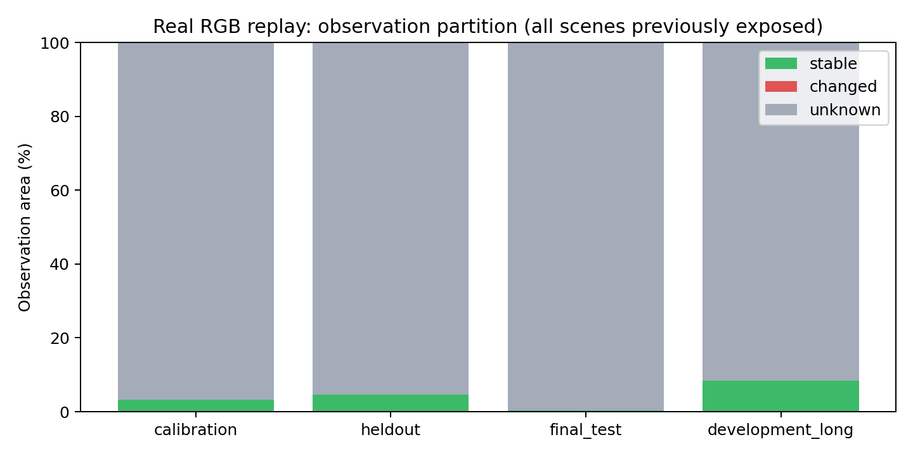
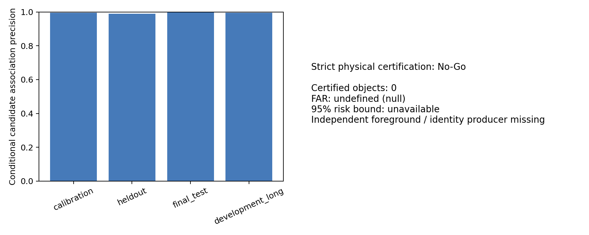
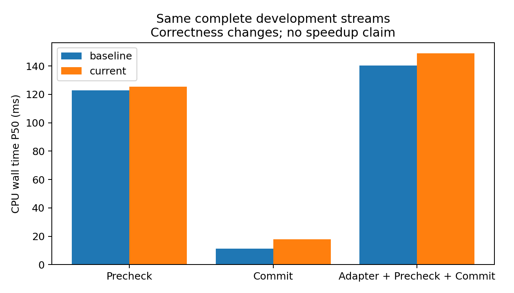

# M1 独立重构与真实世界状态验证

本轮完成 M1 代码、事务与来源修复、关联拒绝规则、四类精确 Mask、真实数据确认和原始感知不变性验证。没有得到风险受控的非零物理认证覆盖；不能据此宣称达到完整研究目标。

工程回归：346 passed，1 skipped（M1 138 项）；真实 RGB/标定与历史模型预测的 14 类受控生命周期异常均通过：True。当前实现的原始模型 8 帧感知输出、backbone 与 Head Memory 完全一致：True。

## 数据、冻结与执行范围

审计 5,272 个旧 JSON/JSONL 产物后，本地 150 个 val scene 均有记录曝光。无法证明存在新的独立场景。本次 calibration 96–101、heldout 102–107、final_test 108–119 名称仅表示互斥的重构确认分组，全部是已暴露数据；不是新的独立泛化测试。每 scene 12 帧，共 288 帧；另外完整回放已知 scene 0/64，各 40 帧。共 26 个唯一场景、368 个唯一帧、2,208 个相机图像。Baseline 额外重复相同开发帧，不增加独立样本数。

协议在读取本轮预测/annotation 前冻结，无质量门限搜索。保留历史风险标准：物理 FAR 单侧 95% 上界≤5%，至少 30 个可评分接受及 3 个支持 scene（30 个零错误仍不足以达到 5%，最终以上界为准）；关键变化召回≥99.8%。区域事件要求 ROI 刷新≥90%。按 scene 隔离分组，不将同 scene 的多帧当独立风险样本。

首次确认运行保存在 attempt_before_atomic_publication/；完善公开状态原子发布与来源字段后使用最终源码重新运行，同样场景与门限，不以先前运行作为最终源码验证。GPU 同样保留首次和最终两次记录。

CPU 回放来自已有真实 OmniDrive detection 文件；不是新模型推理。GT instance/annotation/LiDAR 仅在 Precheck 后由 tools 离线读取、评分，不进入 Frame、Association、Certification 或 Commit。完整模型对照实际执行原 checkpoint 的 EVA、Detection/Map 分支，语言生成和 M2/M3 关闭。

## 实测结果（final_test 已暴露确认组）

| 指标 | 结果 |
|---|---:|
| 候选几何关联总数 / 延续数 | 2383 / 2107 |
| 可评分延续数 / Unscorable | 1028 / 1079 |
| 条件关联 Precision / Recall | 0.9970817120622568 / 0.7427536231884058 |
| 观测到的候选 ID Switch | 3 |
| 模糊/缺帧拒绝比例 | 0.11582039446076374 |
| 严格物理认证数量 / FAR / 上界 | 0 / null / null |
| 观测稳定 / Changed / Unknown | 0.355434% / 0.000311% / 99.644254% |
| 最终刷新面积 / 有效稳定面积 | 99.693789% / 0.306211% |
| 关键区域事件数 / 召回率 | 2265 / 1.0 |
| 可评分接受的 annotation-owned LiDAR 点 / 错误 | 12 / 0 |
| 该稀疏样本对应错误率 | 0.0 |

final_test 仍漏刷新 52/205440 个关键 LiDAR 点。heldout 确认组关键区域召回 99.722607%，低于冻结的 99.8%，因此区域质量实际尚未通过，不能只引用 final_test 的 100% 框级事件召回。final_test 仅接受 12 个可评分 LiDAR 点，零观察错误远不足以证明总体风险。

关联 Oracle 采用独立同类别≤2m 唯一匹配，排除竞争 margin≤0.25m 的标签。Precision/Recall 只适用于此可评分人口；没有对应标签的预测为 Unscorable，不算正确。Source Localization Error 同样被 2m 门限截断，不能用于总体误差保证。Recall 分母为已建立源标签与当前所选检测均存在的条件连续链接，不是全体 GT 对象的感知 recall。

区域参考严格排除未标注背景作为静态负例，只在 annotation-owned 独立 LiDAR 采样位置判断历史对应错误/运动，并单列关键区域事件。Annotation box 不是实例像素 mask，不能把稀疏点 FAR 外推成全图像素风险。零接受组不报告零 FAR，全图刷新召回也不算有效增量成功。640×360 raw replay 与 GPU 640×640 crop/resize 输入分别计量，不比较面积。

## 单模块成本与状态大小

完整开发流 CPU 回放的 Adapter+Precheck+Commit P50/P95 为 149.04/203.01 ms；Precheck P50=125.41 ms，Commit P50=17.79 ms。时间不包含读图、离线 Oracle 和输出日志。分位数不能相加得到整体分位数。

最终实际 GPU 感知运行的完整 M1（含输入/输出适配及传输）P50/P95=224.79/262.51 ms。这是短流冷启动样本，无重复随机化，不作为优化基准或完整系统加速结果。输入/输出 transfer、precheck/commit 分项见 m1_gpu_adapter_profile.json。

墙钟主体为时序/稠密证据与对象观测验证。相机并行的累计工作时间不可相加当成总时延；离线三维可观测性诊断不计入在线 M1 成本。两条 40 帧真实流的 anchor/feature/元数据大小与有界关联历史逐帧保存于 long_sequence_results.json；这只能说明此工作负载的边界生效，不是小时级稳定性证明。默认不捕获大 tensor，预算异常由测试额外验证。

## 对需求中 16 个问题的回答

1. **原生命周期存在实际问题**：Precheck 原位 prune/verify；Commit 逐项写入后异常不能撤销；全预测匹配后再截断；SciPy 缺失会改为不等价 greedy。需求指出的 invalidation_area_ratio 旧 bug 在当前 checkout 已不存在，本轮增加完整分区和统计校验，没有虚报修复。
2. **重复/部分更新/来源风险已修复并测试**：绑定精确 Frame、epoch 与单调超时，拒绝重复/陈旧 Commit；私有工作对象一次发布；失败保留已提交来源和版本；下一帧保守刷新恢复。
3. **三个语义已分离**：投影/几何 candidate、兼容 valid_anchor_ids 的观测支持、strict physically_certified_anchor_ids 分别输出。观测/几何次数不增加 certified_observation_count。
4. **ID Switch 仍可能发生**：同类别近邻交叉、源中心偏差、目标替代、遮挡与缺帧都不能仅凭距离消除。新增双端竞争拒绝和缺帧后新 track，宁可显式 fragmentation；不能保证普通候选 ID 绝对正确，逐例见 false_correspondence_cases.json。
5. **当前前景证据不足**：原始在线接口只有 RGB、框、预测速度、模型特征和位姿，没有独立实例前景/身份生产者。
6. **不能可靠证明 ROI 纹理属于目标**：保留光流、几何和局部残差，但不将框内点或三角化框内点称作物理前景。已有几何候选的可观测性诊断见 geometry_observability.json。没有 GT 像素 mask，前景生产者质量/成本评价为 Not Run，不能虚构。
7. **定位与不可观测性明确拒绝**：旋转 OBB membership 替代 AABB；保留视差、双向重投影、源帧一致性与动态拒绝；geometry_uncertainty=0 仍为 Uncalibrated。六个校准 scene 不足以建立有限的 95% scene-max 区间，且源标签截断，结果为 No-Go。独立 Ego/camera pose 真误差无法从本地输入单独辨识，未编造数值。
8. **没有得到非零独立可信物理对象**：严格接受数为 0；只是基础正确性和缺证据拒绝完成，不算认证成功。
9. **物理风险不通过**：FAR=null，上界=null，独立支持 scene=0，不能通过全部拒绝宣称零风险。
10. **四类输出语义与编码一致**：Stable/Changed/Unknown 互斥覆盖；Refresh 为 Changed|Unknown 加强制策略；强制刷新保留观测分区，比例由最终 mask 计算，Tile 不漏 Invalid 像素。
11. **区域部署质量未证明**：非零同源 RGB 支持与关键事件召回均实测报告，但无新的独立 scene、无稠密实例真值，不能据此断言满足整体像素接受风险要求。
12. **异常可保守恢复**：受控真实输入故障与工程测试覆盖 Reset、倒退/重复、断帧、签名、非法位姿、缺失/顺序、Precheck/Commit 中断、超时、预算、来源 epoch 等。
13. **成本组成已测量**：Projection、Association、Observation、Temporal/Dense、Mask、Commit、事务复制/帧绑定分别记录。Full CPU 外部墙钟包括 prediction adapter；GPU 实际输入/输出适配与传输成本独立记录。相机线程时间相加是工作量，不是总墙钟。
14. **质量与开销是正确性改动后的新行为**：加入歧义拒绝可断轨；状态排序/截断、旋转几何、Unknown 定义和事务改变了部分结果，不将它们称为纯计算优化。完整开发流 Baseline/Current 同输入成本见 baseline_comparison.json；未做 P1 加速，未降低必要验证条件。
15. **三类证据明确分开**：gpu_perception_profiled/ 是最终有完整成本日志的新实际模型；traces/ 是真实图像+旧检测 CPU 回放；instance/LiDAR 是离线评分；受控异常注入不代表自然物理事件。
16. **暂不具备可信物理状态的系统集成条件**：可继续作为工程上可恢复的 M1 observe-only 模块；物理认证与区域部署承诺需要独立证据和新 scene。

## 四项决策

- M1 Engineering：**Go (tested engineering scope only)**。
- M1 Physical Certification：**No-Go**，独立前景/身份、校准的定位与对象运动误差生产者缺失。
- M1 Region Validation：**No-Go**，当前只有已暴露 scene 的稀疏独立参考，未证明完整像素风险。
- M1 Runtime Cost：**No-Go（部署优化验收）**，成本已测，质量未过前不开展 P1；不声称完整系统加速。

下一步最小必要输入是经过质量与成本测量的独立实例前景/目标对应，以及与其适用人口一致的定位和运动误差界；还需要尚未用于开发的新场景。不能用新增布尔字段、放宽 RGB 残差、检测分数或 GT 在线补齐。组件尚不存在，成本为 Not Run，不提供未经测量的毫秒估计。

可视化见 visualizations/（各相机：历史投影候选、三类分区、最终刷新），以及 visualizations/cases/index.json 中的真实源帧/当前帧正确关联、ID Switch、错误关联拒绝、Oracle 有效但证据不足拒绝、前景未认证和关键变化漏检案例。没有独立前景 mask，因此不能把一个物理错误例子臆称为“已证明的背景纹理匹配”；也没有物理正确认证案例。图表见 figures/。所有运行、源文件哈希、checkpoint SHA256、CUDA/PyTorch、相机顺序、样本/时间间隔/预处理、线程与协议见 execution_manifest.json、input_manifest.json、experiment_protocol.json、traces/ 和 commands.sh。

