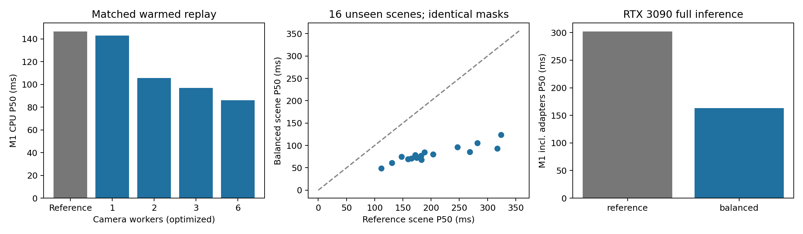

# OmniDrive 模块一：综合平衡优化报告

本轮选择保持原风险与覆盖行为的计算优化。新的校准样本不足以可靠选择质量阈值，未宣称达到全局最优或提升检测 mAP/NDS。详细架构与复现方法见 `docs/worldstream_m1_optimization.md`。

## 实现与选择依据

- 对象关联按类型/类别分组后向量化，地图曲线每个输入只采样一次；保持原尺寸、距离、方向门限及 Hungarian 分配。
- 六相机证据并行计算，再按固定相机顺序汇总。实测选择 6 个线程；库内不修改 OpenCV 全局线程设置。
- 增加仅由历史 commit 更新的检测分数、匹配观测次数和位置创新量。可选门限已实现，默认不启用额外限制。分数不是定位正确概率，重复匹配也无法消除固定定位偏差。
- 校准预先冻结 2 种光流预算 × 5 种历史质量门限；先约束风险、恢复率、覆盖率与局部失效范围，再看 Pareto 与耗时。独立样本不足时回退到原判断条件。

## 数据与实验边界

固定 16 个校准场景（排序索引 12..27）和 16 个本轮独立验证场景（32..47），每场景前 12 帧，共 384 个唯一 nuScenes keyframe。两个方法每帧分别执行，因此回放执行量为 768 帧次。它们是本地验证集上的新场景，不是官方隐藏测试集；历史回放只有检测锚点，地图关联另由单测与完整 GPU 推理验证。校准协议先于标签/指标读取写入 `protocol.json`；`selection.json` 在验证开始前冻结。

校准原判断接受 3 条记录，仅 2 个独立实例、1 个场景，错误 1 条。预先要求至少 10 个独立实例、3 个场景，实际不足。较高分数/历史门限在这批小样本上还会过滤正确状态，不能以减少接受量代替风险改善。800 点方案接受 2 条、错误 0 条，仍不足以说明泛化可靠，且候选量低于原来的 75% 约束。最终保留 1600 点、原门限。

## 独立验证结果

| 指标 | 修改前快照 | balanced |
|---|---:|---:|
| 历史状态检查数 | 3848 | 3848 |
| 可判定记录 | 2429 | 2429 |
| 接受候选数 | 1 | 1 |
| 候选率 | 0.0260% | 0.0260% |
| 物理错误/可判定接受 | 0/1 | 0/1 |
| 新出现区域召回（762 条事件） | 96.7192% | 96.7192% |
| 失效面积比例 | 98.1227% | 98.1227% |
| 回放 M1 P50（ms） | 184.28 | 79.29 |

该验证集只接受 1 个独立对象，0/1 不能证明低风险；逐记录描述性 95% 区间上界为 97.5%。接受率也说明现有证据规则在这些场景中非常保守。局部区域召回还有约 3.28% 未达 90% 失效覆盖门限；没有像素级变化真值，不能把未标注背景当作可靠负例。

逐帧审计 192 帧：候选、失效 ID、精确像素掩码、特征版本、provenance、关联配对全部一致。`parity_audit.json` 提供核验结果。回放耗时包含首次初始化且方法按固定顺序执行，不等于完整模型速度。

## 成本与完整模型

独立预热基准使用 4 个已知场景帧、1 轮预热和 4 轮交错计时，统计非首帧。CPU M1 P50 从 146.65 ms 到 86.18 ms。16 个验证场景的成对中位耗时降幅中位数为 58.10%（场景 bootstrap 描述性 95% 区间 56.06%–61.82%）。

GPU 环境：NVIDIA GeForce RTX 3090，PyTorch 1.13.1+cu117，CUDA 11.7。每种模式 8 个连续帧，1 次预热、3 次计时，共 96 帧次完整推理（8 个唯一帧）。LLM 每次使用新的输出目录并实际执行，模式间重置随机种子和 Head memory。

| 模式 | 完整帧 P50/P95 ms | M1 含适配器 P50/P95 ms |
|---|---:|---:|
| baseline | 2511.64/2522.05 | — |
| reference | 2865.34/3249.69 | 302.29/309.00 |
| balanced | 2733.57/3123.39 | 163.21/174.62 |

所有模式/重复的原始输出、backbone 张量和检测/地图 Head memory 摘要一致：**True**。GPU 已分配显存峰值 15.103 GiB。计时采用顺序模式，不是严格随机交叉的端到端速度试验；M1 的线程提速不等于跳过 backbone 或实现增量推理。并行后各相机阶段耗时之和是累计工作时间，不能相加当作墙钟；应读 `precheck_total` 或 `m1_total_including_adapters_ms`。

回归测试：74 项通过（含 10 项新增关联等价、历史门限和并行一致性检查），19 条依赖库弃用警告；完整模型配置加载和 `git diff --check` 通过。

## 结论与剩余限制

本轮给出可复现的成本改善，同时保持已验证的风险和覆盖行为。现有低候选率、同源 RGB 证据、固定定位偏差、地图/对象 carrier 无一一对应，以及全局注意力依赖，仍限制真实深层特征复用。新增质量控制作为后续校准工具，不应在当前稀少样本上宣称已得到可靠置信度。若目标转向提升检测/规划精度，需要另外定义 mAP/NDS/规划碰撞等任务指标并开展训练或可靠定位建模；本轮没有重训模型。

