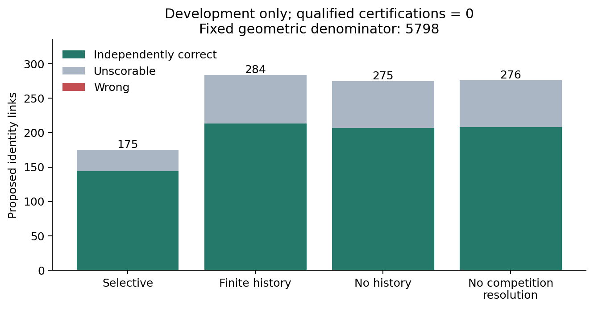
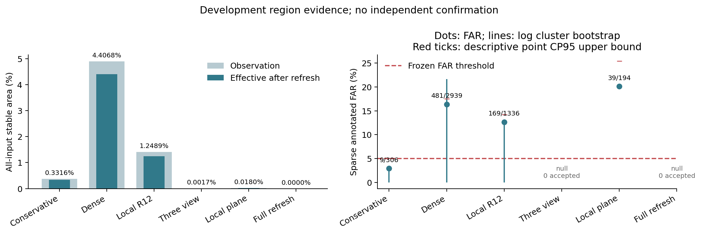
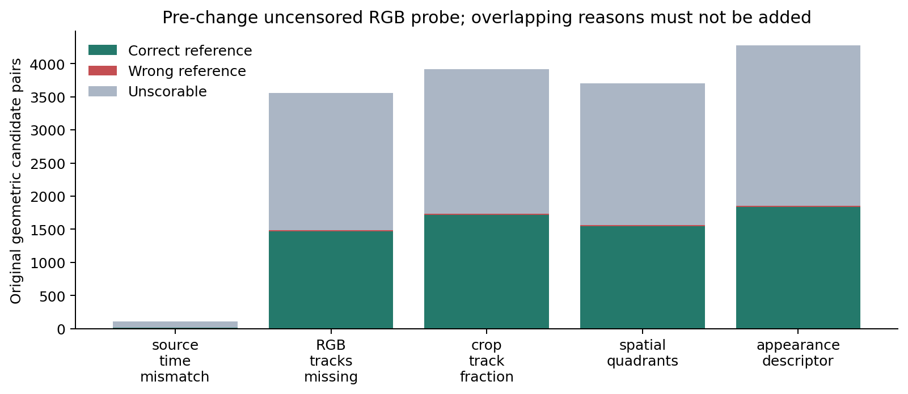
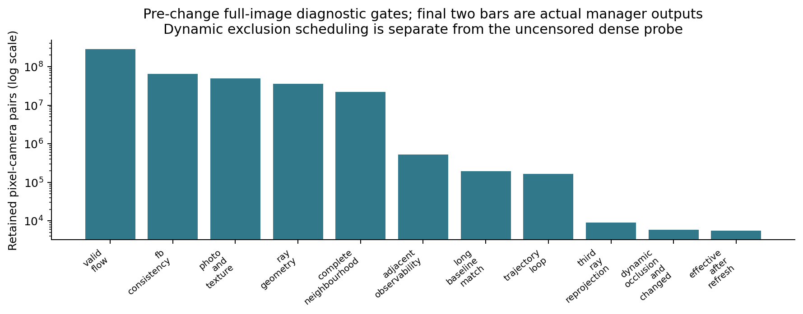

# M1 质量与可信覆盖专项实验报告

本轮完成可关闭的新身份和局部表面方法、真实 Development 回放及机制消融。正式物理认证与区域验收仍为 **No-Go**：当前可访问数据中没有剩余未曝光采集 Log，新 Calibration/Heldout/Final 均为 **Not Run**，方法选择保持 null。

## 身份方法与结果

新路径从实际历史图像直接测量裁剪内双向 LK、光度支持和局部仿射残差，使用真实来源时间和互斥图像支持解决合法竞争；短时缺帧从有限已提交图像中直接重测。唯一两帧证据足够时不强制三帧；竞争时需要更早实际图像的闭合支持。它只提出 object_identity_continuity，不认证静止、中心、速度、Box像素或特征复用。所有正式接受仍经过真实资格验证，未创建资格文件。

|方法|原几何分母|候选|可评分正确|错误|不可评分|唯一实例|支持Log|正式认证|
|---|---:|---:|---:|---:|---:|---:|---:|---:|
|hungarian_geometry|5798|5798|2655|20|3123|458|19|0|
|identity_no_competition|5798|276|208|0|68|43|6|0|
|identity_no_history|5798|275|207|0|68|43|6|0|
|selective_identity|5798|175|144|0|31|33|4|0|
|strict_foreground|5798|2|1|0|1|1|1|0|
|temporal_identity|5798|284|213|0|71|43|6|0|

相对 Selective：可评分正确链接变化 +69；候选覆盖 3.018282% → 4.898241%；可评分正确覆盖 2.483615% → 3.673681%。正式覆盖均为0、qualified_FAR=null。

完整接受 Log 的事件单侧95% CP上界、不完整可评分 Log、已知错误 Log 和最坏情况上界见 identity_risk_coverage.json。仅把完全可评分 Log 用于资格；未评分候选不算正确。分母沿用原 Hungarian 人口，新增恢复边单列。

## 局部表面方法与结果

新方法在小型局部单元中拟合逆深度平面。平面诱导跨帧投影，在观测充分的关键对应凸包内部逐像素核对预测源坐标与真实 Dense Flow；使用未参与拟合的关键对应、局部边界/折叠/FB和光度纹理共同拒绝不连续表面。相邻帧可观测性不足时可用更长真实时间基线的对应提供平面，并检查三时刻闭合。没有凸包外扩张、ROI填充或语义静态真值。该模型提供待独立验证的几何依据，不能独自证明像素归属。

|方法|Effective Stable|可评分接受|错误|Sparse FAR|事件召回|关键点召回|接受Scene/Log|
|---|---:|---:|---:|---:|---:|---:|---:|
|conservative|0.331562%|306|9|2.941176%|99.969231%|99.980976%|2/2|
|dense_original|4.406813%|2939|481|16.366111%|99.046154%|99.228460%|6/6|
|full_refresh|0.000000%|0|0|null|100.000000%|100.000000%|0/0|
|identity_no_competition|0.331562%|306|9|2.941176%|99.969231%|99.980976%|2/2|
|identity_no_history|0.331562%|306|9|2.941176%|99.969231%|99.980976%|2/2|
|local_r12|1.248860%|1336|169|12.649701%|99.938462%|99.802993%|3/3|
|surface_local_plane|0.017963%|194|39|20.103093%|100.000000%|99.996618%|1/1|
|surface_no_boundary_guard|0.017963%|194|39|20.103093%|100.000000%|99.996618%|1/1|
|surface_no_history|0.015673%|222|41|18.468468%|100.000000%|99.997463%|1/1|
|surface_observable_ablation|0.091166%|645|182|28.217054%|100.000000%|99.978862%|2/2|
|surface_visibility|0.001666%|0|0|null|100.000000%|100.000000%|0/0|
|temporal_identity|0.331562%|306|9|2.941176%|99.969231%|99.980976%|2/2|

相对 Conservative 的全输入有效面积变化为 -0.313599 个百分点。该变化只有满足质量约束且有独立支持时才属于可信收益；本轮没有独立确认，不能宣称正式稳定覆盖优化成功。所有有效面积均由最终 refresh_required_mask 计算，启动/周期强刷包含在分母。

逐 Scene/相机/帧及事件变化类型、ROI刷新比、稀疏 CP95 和按采集 Log 聚类的不确定性见 region_quality_by_*.json 与 region_risk_coverage.json。Bootstrap 中无可评分接受的重复样本保留为未定义，0/0 FAR 为 null。无完整实例表面GT的像素不默认正确。

## 根因与失败边界

修改前审计、互斥/多标签拒绝和逐门槛面积见 root_cause_audit.md、identity_rejection_diagnostics.json 与 surface_acceptance_funnel.json。原 Local R12 的169个错误点、RGB/Flow/Pose/LiDAR引用及哈希保持；46个低视差与123个 Unknown Root Cause 不重新主观归因。新错误保存在各场景 false_stable.jsonl 与 visualizations，身份错误保存在 identity_false_acceptance_cases.json。

两射线/平面/三帧自洽仍可能来自重复纹理或错误可见表面。更好的局部模型能减少过度拒绝，但无法凭缺失的独立表面标签认证完整图像；身份裁剪也可能包含一致背景，必须依赖独立风险验证。新增辅助模型/传感器未假定存在。

## 独立验证与五项结论

曝光审计覆盖 201 Scene/68 Log；剩余可访问新Log=0。模型训练人口曝光显式记录，不称模型独立泛化测试。Calibration没有可用新人口，algorithm_selection=null；Heldout/Final Not Run，无后验重选。

1. Engineering：Go；回归 {'regression': {'tests': 448, 'failures': 0, 'errors': 0, 'skipped': 1}, 'regression_gpu': {'tests': 467, 'failures': 0, 'errors': 0, 'skipped': 0}}；真实CUDA感知对照 Passed，详情 original_model_parity.json。
2. Identity Feasibility：Development positive; independent confirmation Not Run。完整正确、错误、未知和唯一实例/Log见表。
3. Physical Certification：No-Go，独立完全可评分接受Log不足；正式认证0，正式FAR=null。
4. Region Quality：No-Go，没有新独立Calibration/确认支持；开发面积或零错误均不能替代风险资格。
5. Scientific Feasibility：保留候选可行性结论及不可辨识条件，不能解释为仅参数未调好。

下一轮最小需要新增互不重叠采集Log，提供完整独立身份及实例拥有的同步深度/源像素对应参考。标定双目/深度可作为显式辅助观测消融，但需先验证输入可用性；不会自动改变原模型。

## 实现、复现与交付

改动仅限 M1、研究配置、测试与 tools/worldstream_m1。默认保守路径保持；Precheck不读取当前检测/Oracle，Commit事务后才发布。来源裁剪、相机、坐标空间、有限时间、状态版本/epoch、执行签名、帧和协议/资格摘要均保留。原模型权重、输入预处理、M2/M3算法未修改。

完整命令见 commands.sh；源码哈希、数据和协议指纹见 execution_manifest.json 与 frozen_validation_protocol.json。图见 figures/；所有未运行项显式 Not Run。

## 十项验收问题的直接回答

1. 有限实际图像历史和测得的局部运动替代单一相邻静态射线限制；竞争用正向排除测量与真实三时刻闭合解析，无法区分仍Unknown。原Selective两帧路径作为单列备用生产器保留，未把保留链接算成全部新增收益。

2. 身份路径只提出同实体候选。区域路径使用 $\rho(u)=n^T K^{-1}u$ 的局部逆深度平面、空间留出对应及凸包内部逐像素核对；不进行凸包外填充。自洽模型仍须独立风险参考。

3. 针对静态射线错误排除运动、来源只保留上一帧、共同视图不足即整体拒绝和逐像素三帧门槛进行改进。原0.5m外仅1条旧条件可观测链接，说明单独放宽位移阈值不能解决问题。

4. 候选覆盖 3.018282% → 4.898241%；可评分正确覆盖 2.483615% → 3.673681%。正确链接 144 → 213，错误 0、不可评分 71、唯一实例 33 → 43。正式覆盖仍为0。

5. 新区域有效面积 0.017963%，Conservative 0.331562%，变化 -0.313599 个百分点。错误/接受 39/194，FAR=20.103093%；事件/关键点召回 100.000000%/99.996618%。没有实现比Conservative更大的可信稳定收益。

6. 新Calibration、Heldout、Final均Not Run。全部68个可访问采集Log已被历史研究曝光，剩余新独立Log=0。方法选择保持null，未用旧Heldout/Final重新调参。

7. 身份候选只有 1 个完全可评分开发接受Log，事件CP95上界 95.000000%，并有不可评分接受人口；远未达到独立5%门槛。区域FAR超过5%，可评分接受仅 1 Scene/1 Log，正式支持也不足。

8. 正式物理身份资格：没有，qualified_certifications=0、qualified_FAR=null。可信稳定区域正式收益：没有。身份的正向结果限于开发人口上的候选可行性。

9. 最终回归与CUDA对照见regression_results.json和original_model_parity.json。对象与地图混合提交、异步相机时间绑定已补测。原模型/权重/预处理、M2/M3算法均未修改，旧五方法7200组相机质量记录与归档相等；LLM执行数值对照不在perception-only测试范围。

10. 优先补充新的独立采集Log及完整身份、实例拥有的同步深度/像素源对应参考。重复纹理、共运动背景和沿极线错误对应可满足RGB自洽条件，缺少独立表面归属时无法仅靠更复杂拟合取得正式资格。至少59个完全可评分零错误独立接受Log只是5%上界的必要统计条件。

## 图与原始失败证据

修改前完整图像探针没有应用动态排除调度ROI，因此其前九级是未删减人口的诊断实验，最后两级是实际管理器输出，不应把两者差值单独归因于遮挡。当前方法实际调度后的逐级漏斗另见surface_acceptance_funnel_new_method.json。

重叠拒绝原因按候选链接计数，不能相加或当成唯一物理实例。新拒绝分解、完整检测/未匹配人口分别见identity_new_rejection_diagnostics.json和independent_population_accounting.json；正确链接集合的保留/新增/丢失分别记录在identity_recovery_results.json。

受控测试不计真实成功；Attempts中的中断、GPU地图元素失败、相机参考时钟修复前结果均不参与最终指标。GPU使用perception-only测试，Checkpoint SHA256与历史值一致。

补充风险说明：新区域的 194 个可评分接受只来自 1 个Log；该Log包含错误，其Log事件单侧95%上界为 100.00%。条件Cluster Bootstrap在单个接受Log下可能退化，不能解释为可靠的跨场景误差区间。身份只有 1 个完全可评分开发接受Log，其事件上界为 95.00%；这些已曝光开发Log不计新验证资格。
