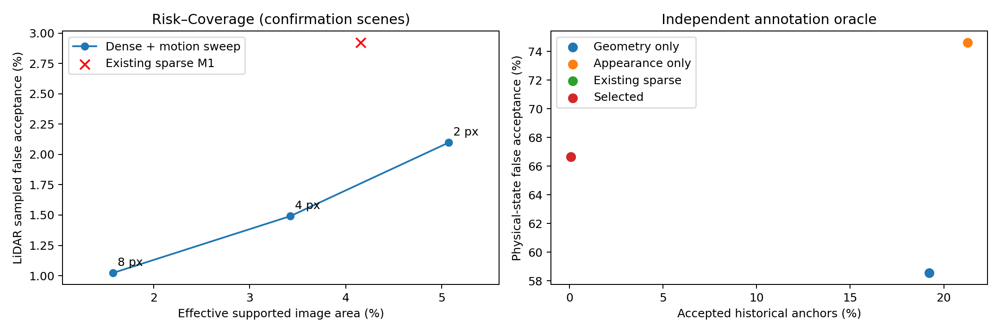
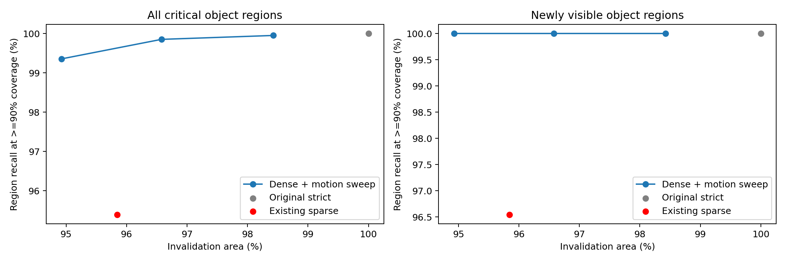
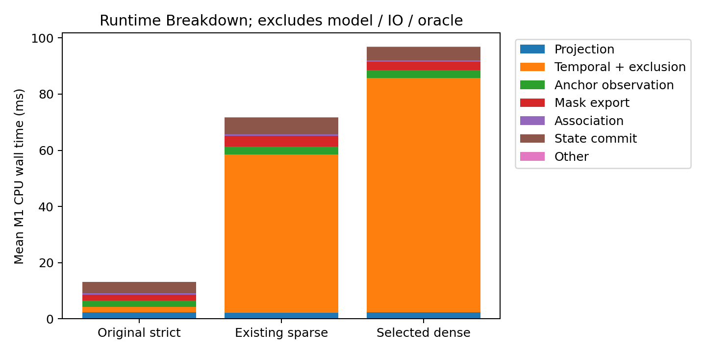
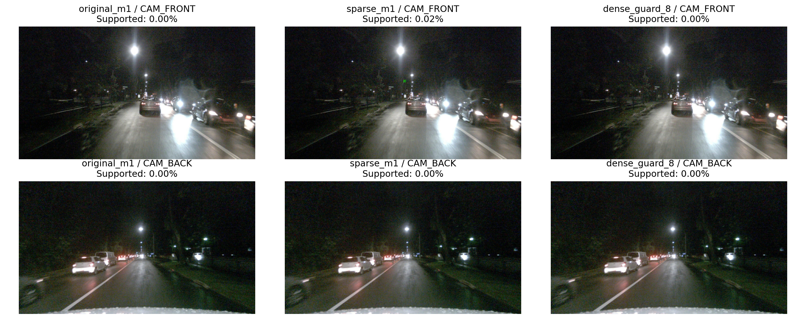
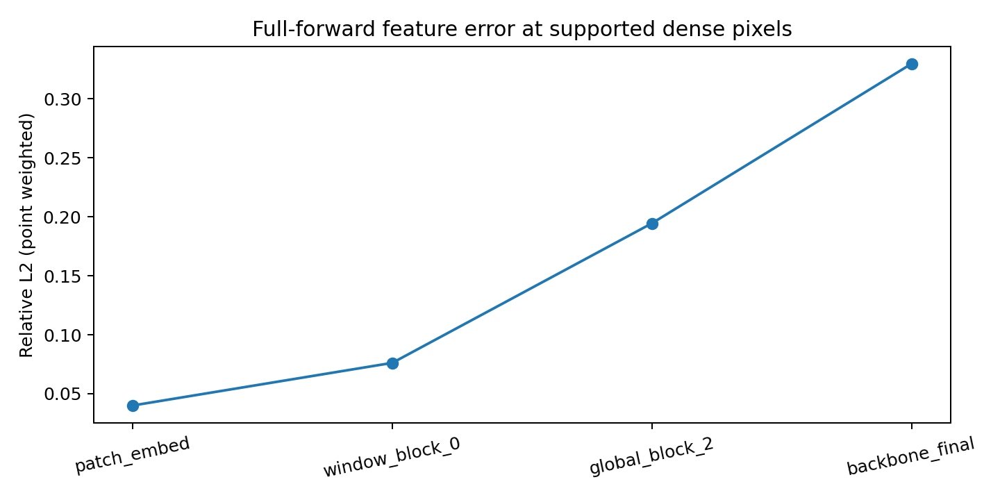

# M1：可信稳定区域覆盖优化与确认实验

核心结果：相对首轮严格模式，稳定观测面积从 0% 到 1.700%，刷新比例从 100% 到 98.425%；相对已有 sparse M1，最终保守配置的面积下降，但本次采样风险和关键变化漏检减少，并形成完整图像块候选。尚不能宣称获得有统计保证的安全深层缓存。

本轮已完成代码、真实实验和验证，但没有同时实现“比现有 sparse M1 覆盖更高、成本更低、风险不增加”的全部目标。该配置保留为 observe_only 实验入口；不将在线观测支持等同于安全的神经计算复用。

本报告以真实执行的 nuScenes 连续场景、独立离线标注/LiDAR 和完整 GPU Forward 为依据。`observe_only` 保留，主模型权重未修改。历史报告保存在 `coverage_round3/previous_refinement_report.md`。

## 首轮严格 0% 覆盖与 100% 刷新的原因

首轮 `outputs/module1/experiment_report.md` 的严格模式要求独立可见性 mask，但真实 RGB 适配器没有该输入；`novelty_detector` 也拒绝用物体框直接解释背景，缺少 dense geometry support 时全部未知。动态目标另受速度不可靠、搜索不确定性过大等门限限制。后续 sparse M1 已有局部非零支持，但 7×7 patch 分散，难以形成完整 patch 尺度的复用候选。

## 本轮算法

新增双向 DIS 稠密对应，逐像素验证反向误差 ≤0.35px、无折叠 Jacobian、正深度与双向重投影 ≤0.5px、非退化视差、双图局部纹理、灰度残差 ≤0.02、梯度残差 ≤0.04；只保留整个邻域都通过的内部像素。无矩形填充、掩码膨胀或神经网络。低平移采用有界旋转重投影，仍不能建立独立深度。
密集证据替代 sparse 像素支持，而原稀疏锚点验证仍保留。历史动态对象加入未裁剪的方向性扫过区域与原有运动不确定性余量，所有这些范围只拒绝复用。速度信息不用于认证未知运动。当前 GT、LiDAR 和当前完整感知结果均未传入 precheck。
最后加入计算范围优化：已确定必须刷新的区域不再执行无用的射线几何验证，仅为未排除区域保留完整的邻域计算边界；整个相机都被排除时直接跳过稠密计算。该优化没有改变支持门限或缩小刷新掩码。
实现使用 [OpenCV DISOpticalFlow](https://docs.opencv.org/4.10.0/de/d4f/classcv_1_1DISOpticalFlow.html) 的 FAST 提议器，严格验证由本项目额外实现。

## 实验过程与数据隔离

第一阶段：8 个校准场景 48..55、16 个验证场景 64..79，每场景 12 帧。首选 guard=2 在验证上覆盖提升，但关键 LiDAR 点漏检增多，因此没有将它当作通过的最终结果。第二阶段将这些已查看的 24 个场景明确转为开发/校准数据，新增未查看的 80..95 共 16 个场景作最终确认。每个场景先写 token 清单再运行；配置在确认开始前冻结，确认后的其他 guard 数值仅为预先定义的消融曲线。
开发集还发现局部运动保护误改了原稀疏锚点的证据标志，使物理 FAR 因分母变化而上升。已将像素拒绝范围与原锚点证据分开；配置和场景保持冻结，全部确认场景重新执行。scope_fix_verification.json 逐帧证明修改前后像素掩码完全一致，锚点判断与已有 sparse M1 一致。原执行记录保存在 holdout_before_scope_fix。
中间一次各方向等量扩张速度范围的尝试在开发阶段因过度刷新停止，未执行确认场景；记录保存在 `coverage_confirmation/status.json`。最终采用方向性且未裁剪的投影范围，避免视野外框被裁剪后错误扩张。
最终选择：**dense_guard_8**。最终确认包括 192 个唯一帧、1,152 个相机图像；每种方案处理相同输入。场景是本地 nuScenes 验证集的新划分，不是官方隐藏测试集。
每场景取前 12 个连续 keyframe（约 2Hz），不是高频视频或全场景评估。覆盖率与 LiDAR Oracle 使用保持纵横比的 640×360 原图回放；GPU 对照沿用实际部署的裁剪再缩放至 640×640 流程。两类实验的面积、候选数与耗时不能直接混用。

## 覆盖、刷新与独立风险

Certified Stable Area 在这里指通过在线图像/几何规则的观测面积，不是已证明相等的神经特征面积。effective stable 还扣除了场景切换和每 10 帧强制刷新；其数值等于 1 − Invalidation Area。

| 方法 | 稳定观测面积 | 有效可用面积 | 刷新面积 | LiDAR 位置错误接受 | 关键区域召回 | 关键 LiDAR 点召回 |
|---|---:|---:|---:|---:|---:|---:|
| original_m1 | 0.000% | 0.000% | 100.000% | N/A | 100.000% | 100.000% |
| sparse_m1 | 4.532% | 4.155% | 95.845% | 2.922% | 95.389% | 98.899% |
| dense_guard_2 | 5.462% | 5.073% | 94.927% | 2.098% | 99.355% | 99.235% |
| dense_guard_4 | 3.687% | 3.423% | 96.577% | 1.491% | 99.851% | 99.491% |
| dense_guard_8 | 1.700% | 1.575% | 98.425% | 1.023% | 99.950% | 99.829% |

相对已有 sparse M1，最终配置稳定观测面积变化 **-2.832 个百分点**，有效可用面积变化 **-2.580 个百分点**，刷新面积变化 **+2.580 个百分点**。相对首轮严格模式，有效可用面积增加 1.575%，刷新面积从 100% 降至 98.425%。
独立 LiDAR 位置：可评分 1,204,894，接受 65,330，错误 668。关键 LiDAR 点 240,555，漏刷新 411；关键物体区域事件 2,017。相对 sparse M1 新增未召回区域 0，修复原未召回区域 92。经验非退化检查：**True**。若该项为 False，本配置仅为实验候选，不能宣称满足严格约束。
LiDAR 判定使用独立点云、双帧深度支持与标注实例运动，采样位置的历史对应误差 >2px 或实际移动即为错误；新增、运动、前景遮挡点另统计漏刷新。它是稀疏采样参考，未标注点假设静态，相机/LiDAR 时间偏差和稀疏遮挡近似仍有影响。不能将采样 FAR 外推成全部像素的真实错误率。0 接受的首轮严格模式 FAR 为 N/A，不能写成零风险；它全图刷新的关键点召回是平凡的 100%，本轮任何非零漏点都不能说与它完全等价。
场景聚类 bootstrap 的 LiDAR FAR 差值 95% 区间为 -6.197 至 0.088 个百分点；区间跨越 0，因此点估计改善不等于已证明统计非劣。物理锚点确认集只接受 3 个可评分记录，其中错误 2 个，仍不能作为可靠的自动状态复用依据。
关键区域事件涵盖新增入视野、标注中心位移 >0.25m、可见性下降；区域内至少 90% 请求刷新才计为召回。此门限与旧评估一致。标注框不是像素分割，所以同时报告点级证据，不仅看框级召回。

| 关键事件类别（可重叠） | 事件数 | sparse 漏召回数 | 最终配置漏召回数 | 最终召回率 |
|---|---:|---:|---:|---:|
| newly_visible | 636 | 22 | 0 | 100.000% |
| moving_object | 1270 | 63 | 0 | 100.000% |
| visibility_drop | 372 | 14 | 1 | 99.731% |
| car | 910 | 38 | 1 | 99.890% |
| pedestrian | 486 | 41 | 0 | 100.000% |
| bus | 75 | 8 | 0 | 100.000% |

## Geometry Only / Appearance Only 与物理状态 Oracle

| 方法 | 历史候选率 | 可判定接受数 | 物理错误数 | 物理 FAR |
|---|---:|---:|---:|---:|
| geometry_only | 19.226% | 538 | 315 | 58.550% |
| appearance_only | 21.276% | 516 | 385 | 74.612% |
| original_m1 | 0.000% | 0 | 0 | N/A |
| sparse_m1 | 0.068% | 3 | 2 | 66.667% |
| dense_guard_2 | 0.068% | 3 | 2 | 66.667% |
| dense_guard_4 | 0.068% | 3 | 2 | 66.667% |
| dense_guard_8 | 0.068% | 3 | 2 | 66.667% |

Geometry Only / Appearance Only 沿用原项目定义，在相同历史状态上作只读消融判断；没有为它们虚构可信背景面积。物理 Oracle 仍要求同一实例、传感器支持、visibility=4、预测中心误差 ≤1m。物理锚点 FAR 与像素对应 FAR 分开报告，不混用分母。

## M2 可以获得的候选与边界

最终确认中累计获得 **4,180,992 个像素观测候选**（跨帧/相机累计，非独立物理表面），以及 **3,480/1,013,760 个完整 16×16 图像块**，比例 0.343%。已有 sparse M1 对应完整块为 0。
这些是后续建立局部依赖和重采样验证的实际输入候选，不是可立即跳算的 EVA token。图像缩放/裁剪、16×16 patch 足迹、窗口注意力和全局注意力均未被认证；**当前可直接认证精确复用的深层 token 数仍为 0，实际 GPU 跳算量为 0**。`dense_source_map` 提供当前像素到历史观测的坐标，历史只来自最近一次真实 commit；缺少证据继续刷新。

## 耗时与真实 Forward 特征

| CPU 回放方法 | P50 ms | P95 ms |
|---|---:|---:|
| original_m1 | 9.79 | 24.70 |
| sparse_m1 | 72.67 | 109.16 |
| dense_guard_2 | 98.68 | 137.13 |
| dense_guard_4 | 98.67 | 141.39 |
| dense_guard_8 | 97.92 | 145.22 |

CPU 回放排除 IO、Oracle 和完整模型。每个相机的并行耗时之和是工作量，Runtime Breakdown 使用实际 precheck 墙钟差分，避免重复相加。方法执行次序固定，以上是实测开销，不能直接推导端到端速度提升。

最终计算范围优化重新执行 768 帧次，精确 mask、锚点、特征候选、来源与刷新提示均与保存结果一致：**True**。表中 sparse/dense 的 CPU 耗时来自此次最终执行，original strict 来自前一轮确认；没有将不同版本的时间混写成同一轮。

补充预加载、交替顺序的 4 帧回放（1 轮预热、4 轮测量，排除每次场景首帧）：sparse P50/P95 84.07/90.94 ms；dense P50/P95 130.99/141.18 ms。各重复的输出指纹完全一致。

计算范围优化前后同一预加载微基准的 dense P50：146.75 → 130.99 ms；仅说明该 4 帧工作负载的局部成本变化，不能外推为整体模型加速。

RTX 3090 完整 Forward（记录 `gpu_roi/`）：输出、backbone、检测/地图 memory 摘要等价检查 **True**。LLM 使用每轮新的输出目录并实际执行。8 个唯一连续帧，1 轮预热、2 轮计时；重复不增加独立场景数。

| 模式 | 完整帧 P50/P95 ms | M1 P50/P95 ms |
|---|---:|---:|
| baseline | 2510.85/2517.73 | — |
| reference | 2724.68/2848.95 | 160.41/170.02 |
| balanced | 2800.12/2932.86 | 235.10/252.33 |

baseline 为关闭 M1，reference 为已有 sparse M1，balanced 为本轮配置。稠密验证仍增加开销，当前没有 GPU 跳算，不能宣称净推理加速。最终代码的 GPU 运行与计算范围优化前的记录分别保存，避免覆盖旧测量。

计算范围优化前后的本机完整 Forward M1 P50：260.10 → 235.10 ms。该复测来自相同 8 帧和相同计时协议，跨运行波动仍存在。

实际完整 Forward 在已接受稠密像素的固定 8px 采样网格上，对历史与当前空间特征作双线性坐标对齐。它是近似特征误差，不是严格 token 等价或下游任务精度。

| 层 | 采样数 | Relative L2 | Cosine | L2 ≤0.1 占比 |
|---|---:|---:|---:|---:|
| backbone_final | 29202 | 0.3298 | 0.9301 | 12.472% |
| global_block_2 | 29202 | 0.1945 | 0.9802 | 0.729% |
| patch_embed | 29202 | 0.0400 | 0.9992 | 99.914% |
| window_block_0 | 29202 | 0.0762 | 0.9970 | 91.870% |

特征实验使用已知场景的少量连续帧，重复执行不增加独立场景数。Branch carrier 无对象/token 一一对应，只能提供原有 mean-pool 诊断；不得当作复用认证。

## 审计与复现

关键文件：`protocol.json`、`selection.json`、`holdout_summary.json`、`verification.json`、`physical_ablation.json`、`m2_candidates.json`、逐场景原始记录与精确 mask。场景聚类 bootstrap 区间保存在 verification；帧和 LiDAR 点之间相关，不能当作百万独立样本。在线源码与最终执行记录哈希一致：True（roi_verification.json）。
测试：89 passed, 19 warnings in 4.14s
运行命令与配置边界见 `docs/worldstream_m1_coverage.md`。所有前期失败候选保留，没有用最终确认结果重新选门限。

