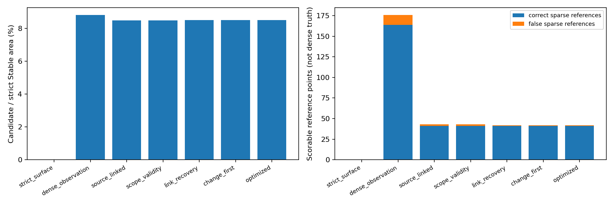
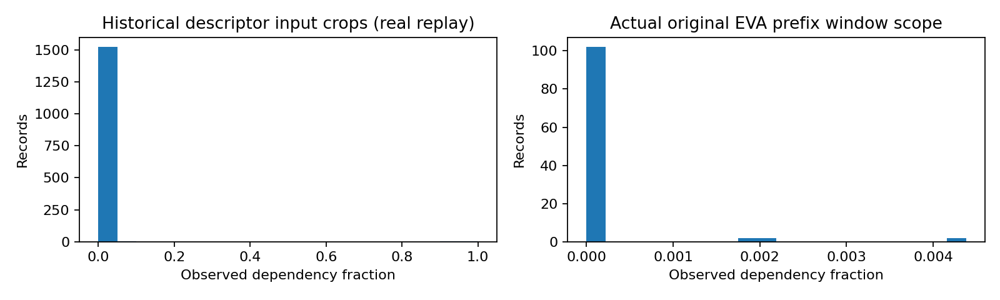
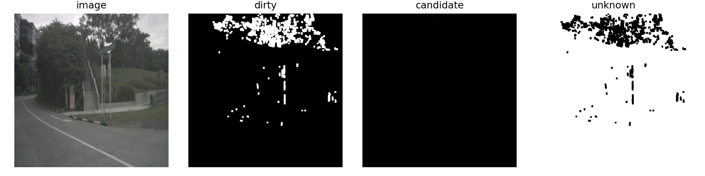
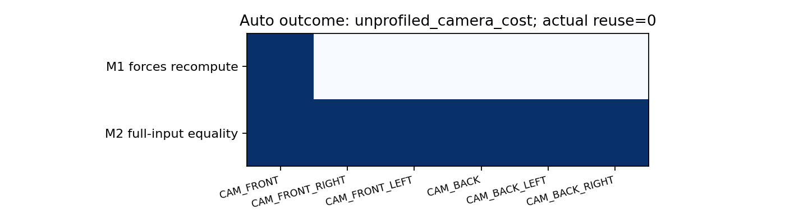
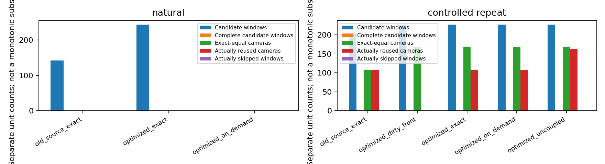
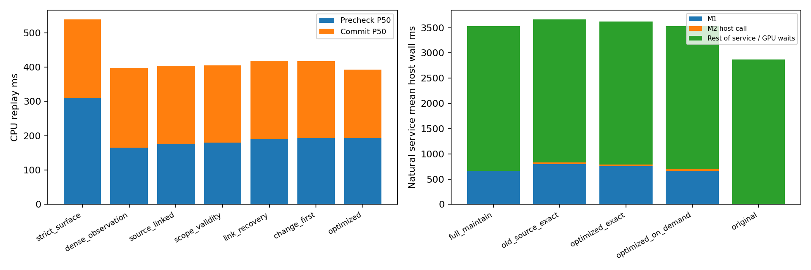

# M1 来源状态精细化与高效刷新接口：实测报告

本轮以冻结 HEAD a4d2740 为对照，保留上一轮全部结果。实际数据为 nuScenes 六相机 Development 连续回放，正式独立认证仍为 No-Go。M1 是否可冻结见 formal_go_nogo.json，不能用接口工程通过替代物理质量或真实驾驶加速。

Camera Dirty 改为逐相机强制更新，其他相机继续完整 Exact 检查。Scene、签名、版本、事务与 Full Refresh 仍全局失效。非零相机更新缺少当前签名任务/成本资格时仍执行完整 Backbone。Feature/Window 的支持比例来自实际输入依赖足迹；局部观测不再声明完整有效。新增稀疏 Link 仅是实际测得的中心，冲突和在线变化风险优先撤销候选，不扩张 Patch 或检测 Box。

最终源码 CUDA 回归 596/596 通过。主长序列完整任务质量核验 576 次通过；最终源码另做自然/重复各 4 帧多臂复查，共 40 次通过，EVA/Detection/Map/Memory 数值最大绝对差为 0，LLM 文本与规划输出一致。最终复查运行时源码哈希全部匹配；24 条真实来源记录覆盖 M1 Feature Slot 过期后仍由已提交 M2 Receipt 保留计算来源的路径。长序列之后修正了来源回执、描述子依赖范围和统计字段，因此长序列不能作为最终源码精确哈希一致的验证；最终源码完整范围回放在 replay_final/，短模型复查分别在 current_source_recheck/ 和 current_repeat_recheck/。

| M1 方法 | Candidate/Strict 面积 % | 可评分接受/错误点 | Precheck+Commit P50/P95 ms |
|---|---:|---:|---:|
| strict_surface | 0.004843 | 0/0 | 649.50/35667.52 |
| dense_observation | 8.820066 | 176/12 | 384.27/1290.36 |
| source_linked | 8.487081 | 43/2 | 394.46/1300.27 |
| scope_validity | 8.487081 | 43/2 | 410.70/1319.78 |
| link_recovery | 8.508597 | 42/1 | 433.91/1334.83 |
| change_first | 8.506407 | 42/1 | 434.70/1330.57 |
| optimized | 8.506407 | 42/1 | 414.83/1147.72 |
本轮实测：96 连续帧、576 个相机观测。优化方法候选覆盖 8.506407%，同人口旧 Source-Linked 为 8.487081%。稀疏可评分接受 42 点、错误 1 点；抽样中心 18373 个，其中新增中心 2832 个，新增中心可评分 0 个，其余保持 Unscorable。候选补集诊断的事件/点召回为 98.4799%/96.6396%，最小 ROI 刷新 28.8980%，未达目标。相同候选/刷新算法下，测量缓存使 M1 P50 从 434.70 降为 414.83 ms；这不等于整个新接口优于旧接口或原模型加速。

候选像素与稀疏参考点属于不同人口。没有参考的中心保持 Unscorable；RGB 光度/光流不是真值。新增中心的正确、错误和不可评分数量分别保留在 candidate_quality.json，不能由零已发现错误推断零风险。Critical Event/Point 与最小 ROI 保护同时报告候选补集诊断和实际严格刷新，所有失败事件保留在 change_first_refresh.json；本轮未据离线 GT 调整在线掩码或评分规则。
96 帧的人口比上一轮扩大四倍，不能把新增场景带来的覆盖差异当作方法增益。Scope 的多相机 Head/未知依赖记录是显式标记的相机片段，不声明完整 Head/Memory 依赖得到观测支持。邻近 LiDAR 诊断不替代精确像素参考，不能将邻近表面自动当成候选中心真值。

相同历史 24 帧对照中，Source-Linked 覆盖从 0.071540% 到最终候选的 0.078946%；事件/点召回仍为 99.3197%/99.8210%，最差 ROI 仍为 81.8182%，此前 CAM_FRONT 行人失败没有消除（frozen_population_comparison.json）。实际部署严格刷新在本轮 ROI 上保持完整覆盖；自然序列实际复用 Camera=0、实际跳过 Window=0，因此不宣称自然驾驶的计算节省。

最终 Scope 对已知局部描述子按其历史输入裁剪计数，使用去重的实测来源中心，不填充整个 Box。多相机或时序 Head 的完整依赖未知时，支持率/数量为 null，单相机片段另列；历史 source_linked 对照保留旧 any-pixel 语义且没有这些比例，不参与新接口完整范围断言。原 EVA 真实前缀的 108 个 Window 单独探测，其中 20 个仅部分支持，完整计算可用与观测支持相互独立。

| 人口 | 方法 | 测量请求 | E2E Wall P50/P95 ms | 实际复用 Camera | 完整任务质量门 |
|---|---|---:|---:|---:|---|
| 自然 | full_maintain | 24 | 3142.72/5036.28 | 0 | 48/48 |
| 自然 | old_source_exact | 24 | 3240.66/5415.47 | 0 | 48/48 |
| 自然 | optimized_exact | 24 | 3267.02/5056.87 | 0 | 48/48 |
| 自然 | optimized_on_demand | 24 | 3154.67/5065.13 | 0 | 48/48 |
| 自然 | original | 24 | 2870.37/2904.56 | 0 | baseline |
| 受控重复 | full_maintain | 32 | 3185.50/3250.17 | 0 | 64/64 |
| 受控重复 | old_source_exact | 32 | 2780.58/3212.53 | 108 | 64/64 |
| 受控重复 | optimized_dirty_front | 32 | 3195.57/3289.57 | 0 | 64/64 |
| 受控重复 | optimized_exact | 32 | 2769.91/3223.64 | 108 | 64/64 |
| 受控重复 | optimized_on_demand | 32 | 2786.13/3224.63 | 108 | 64/64 |
| 受控重复 | optimized_uncoupled | 32 | 2736.43/3164.52 | 162 | 64/64 |
| 受控重复 | original | 32 | 2878.73/2911.04 | 0 | baseline |

新旧接口主对照使用相同 Camera Boundary、模型、成本表、质量门和 Persistent State 服务；old_source_exact 在共享采样运行时保留旧配置与耦合/全局失效策略。original 仅提供当前输出，不能视作同一持久状态服务。baseline 先执行，其余臂按轮次旋转；该计时并非完全平衡的热状态消融。预热排除在时延统计外，质量核验包含预热。

E2E 包含 M1、当前 Detection/Map/Memory/LLM 和统一诊断特征 CPU 拷贝；原生 Memory 写盘在计时外。CUDA Event 区间包含主机发射间隙，M2 execution_ms 为主机入队墙钟，不冒充 GPU kernel sum。稀疏/稠密相机阶段可能在线程中重叠，不能直接相加当作总时延。完整逐阶段数据和传输字节见 runtime_breakdown.json。
时延图右侧按同一测量请求的均值拆分不重叠主机区间：M1、M2 调用及其余服务；其余项包含 Heads、LLM、GPU 等待和诊断。该图与表格 P50/P95 使用不同统计量，不能把各阶段 P50 之和当作 E2E P50。

受控重复输入、人工单相机 Dirty 负测试与自然驾驶分开。默认关闭的租约分离实验只在无时间/Pose 输入的 EVA 图像边界验证 Exact 缓存；当前 Heads、Pose、Temporal Memory 和 LLM 继续执行，周期刷新和所有质量门保留。该策略不是生产默认配置。Camera 命中不改写为 Window 执行器的跳窗数。

G1–G8 和 M1 冻结判断见 formal_go_nogo.json。Calibration/Heldout/Final Test = Not Run；Qualified Certification=0；Qualified FAR=null。自然驾驶是否发生实际计算节省以新原始执行记录为准，不从候选增长或重复输入命中率推断。
配置兼容性修订只将新增字段移到旧字段之后，保留 M1Config(False) 等位置参数语义。已归档修订前源码并验证三套配置的全部关键字值和规范化 AST 相同。自然序列源码精确哈希差异会如实保留，不能伪装成完全相同文件；该序列和回放均以关键字加载配置，数值算法未改变。详情见 config_compatibility_audit.json 与 original_model_parity.json 的 source_assessment。
另有 OOM 发布回执修订，仅在 cache_saved=False 时修正不存在的下一次发布版本；发布成功路径数值与元数据均不变。原始序列的精确源码哈希不改写，source_assessment 会核对 AST 差异及该序列每个相机路径均成功发布的事实。当前最终代码另外运行完整 CUDA 回归和短自然序列完整任务复查，不用这两项未覆盖条件的旧结果冒充新版本通过。

实现与 profiling 采样改动清单见 implementation_changes.md；复现见 commands.sh。失败与过渡实验保存在 attempts/；最终完整范围重放在 replay_final/，先前同人口数据保留在 replay/；CUDA 原始记录在 gpu_validation_v2/。主要长序列计时对应其各自记录的源码版本，最终源码另有自然/重复输入复查；不同版本或不同长短序列的延迟不混合。
