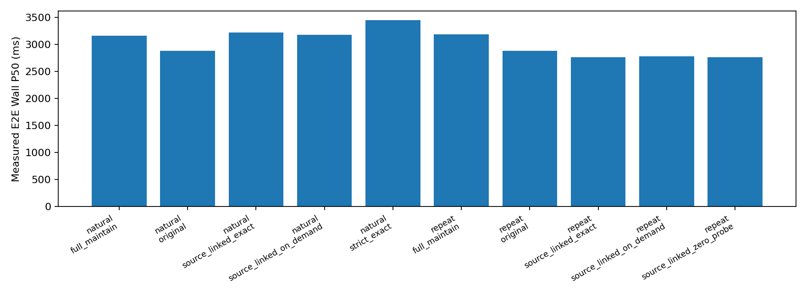

# M1 状态与 M1→M2 接口：GPU 补充验证

本轮批处理状态：**completed**。CUDA 回归：576/576 通过，
跳过 0；原模型感知一致性：passed。
完整模型自然序列：completed；受控重复图像：completed。
补充零更新成本与完整任务验证：completed。
未执行项目继续按 Not Run 记录，不能以主机存在 GPU 或 CPU 测试通过替代 CUDA 证据。

| 人口 | 方法 | 实测请求 | E2E Wall P50/P95 ms | 复用相机 | 跳过 Window | 质量门 |
|---|---|---:|---:|---:|---:|---|
| 自然连续帧 | full_maintain | 48 | 3159.75/5563.14 | 0 | 0 | 72/72 |
| 自然连续帧 | original | 48 | 2880.61/2912.31 | 0 | 0 | baseline |
| 自然连续帧 | source_linked_exact | 48 | 3222.69/5604.23 | 0 | 0 | 72/72 |
| 自然连续帧 | source_linked_on_demand | 48 | 3181.37/5580.43 | 0 | 0 | 72/72 |
| 自然连续帧 | strict_exact | 48 | 3446.57/5703.00 | 0 | 0 | 72/72 |
| 受控重复图像 | full_maintain | 32 | 3186.30/3264.61 | 0 | 0 | 64/64 |
| 受控重复图像 | original | 32 | 2884.76/2911.70 | 0 | 0 | baseline |
| 受控重复图像 | source_linked_exact | 32 | 2766.03/3217.75 | 108 | 0 | 64/64 |
| 受控重复图像 | source_linked_on_demand | 32 | 2780.87/3450.92 | 102 | 0 | 64/64 |
| 受控重复图像 | source_linked_zero_probe | 32 | 2765.58/3225.53 | 108 | 0 | 64/64 |

自然与受控重复输入分开统计；各序列重置，M1 各臂持续维护状态。质量门与既有阈值不变，
表中实测请求排除预热；质量核验包含预热，因此质量检查数可能大于计时请求数。
每个方法使用独立的新语言输出目录，并实际重新执行当前 Head、Temporal Memory 与 LLM。
原生 dtype Memory 快照、实际执行的 EVA 中间结果误差、计算来源、回退原因和显存峰值的确切目录见 gpu_followup_results.json 的 source 字段。
相机级复用与 Window 级复用分别计数；相机命中不能伪装成 Window 执行器的计数。
相机路径只测得 M2 总 host wall，未独立分离验证和执行时间，相关分项保留 null；
CUDA Event 区间包含主机调度间隙。计时包含诊断特征 CPU 拷贝，不冒充移除诊断后的部署时延。
每组序列先执行 original 以建立当前输出基准；补测按探测、Auto、按需、Full-Maintain 固定顺序执行，
并非完全平衡的时序消融。预热及测量轮数保留在各目录的 protocol.json；本表仅计测量请求。

original 仅提供当前模型输出；M1 各臂维护持久状态。strict_exact 保留旧 Window 边界，
新轻量两臂使用已有 Camera 边界及 Auto 成本/质量门；因此该比较衡量整体配置，
不能将差异全部归因于 M1 接口。完整模型没有强制启用未获下游资格的非零局部更新。

完整原始记录见 gpu_followup_results.json。CPU 阶段交付快照保留在 cpu_stage_delivery/。
独立人口资格不随 GPU 补测改变：Qualified Certification=0，Qualified FAR=null，正式结论保持 No-Go。

旧成本表与当前签名不匹配时，受控重复输入也全部安全回退，原始记录仍保留为 controlled_unprofiled_diagnostic。
补测使用全新实验目录中的成本表：先实测完整相机输入完全相同时的特征复制误差及成本，
再通过 source_linked_zero_probe 实际执行完整 Head/Memory/LLM 质量验证，全部通过后才允许当前签名的 Auto 零更新复用。
该 probe 只用于 Development 验证，禁止部分相机更新，不授予非零局部更新或独立物理认证资格。
自然连续驾驶实测未发生合法计算跳过，不能由受控重复输入的命中率推断真实驾驶加速。

## 先前 CPU 阶段记录（历史状态，不代表当前 GPU 结果）

# M1 状态与 M1→M2 接口重构实测报告

已完成可选代码路径、CPU 回归与真实 nuScenes 回放；完整 CUDA 模型验收尚未完成。正式结论 **No-Go**，没有宣称端到端加速。

本次回放为 24 连续帧、144 个相机观测、2 个已曝光场景；均标为 exploratory_reused_population。原 OmniDrive 的真实测试图像变换生成 640×640 preprocessed_image 输入；历史原模型检测仅在 Commit 使用。离线 LiDAR/Annotation 只在 Precheck 之后评分，未参与在线候选或刷新。该回放没有重新执行原始 Head、Memory 或 LLM。

| 方法 | 候选/旧 Stable 面积 % | 稀疏正确/错误 | CPU Precheck+Commit P50/P95 ms |
|---|---:|---:|---:|
| strict_surface | 0.001236 | 0/0 | 429.69/2467.17 |
| conservative_observation | 0.010318 | 0/0 | 287.04/2443.17 |
| dense_observation | 0.073010 | 0/0 | 289.40/2403.94 |
| source_linked | 0.071540 | 0/0 | 296.23/2375.92 |
| source_linked_lease | 0.071540 | 0/0 | 295.94/2391.06 |
| source_linked_refresh | 0.071540 | 0/0 | 299.06/2499.05 |
| source_linked_on_demand | 0.000000 | 0/0 | 241.57/2531.14 |

候选误差率不能由零接受参考点推断为零。本人口没有候选命中可评分的标注内稀疏参考点，Candidate 正确/错误/不可评分稠密面积均无独立真值，保持 null。像素候选数单独保留，不能视作 Certified Stable。Lease 与 Refresh Contract 共享强制来源年龄检查；这些接口消融覆盖相同，不声称有额外算法收益。

轻量候选的补集曾出现关键 ROI 刷新不足。这是假设候选直接授权复用时的诊断失败，并非部署刷新掩码。每个失败事件、时间和相机在 refresh_contract_results.json 中保留。最终轻量路径的严格 refresh_required_mask/exact_invalidation_mask 保守全刷；候选单独进入 M2。Dirty 与 Candidate 不重叠，Unknown 只可通过完整独立 Exact 输入和依赖验证消除。

M2 CPU 工程测试实际执行小型 EVAViT，分别覆盖全候选、全 Unknown、相同/变化输入、Dirty、Full Refresh、已撤销事务、过期计算来源、全局依赖屏障及 OOM 原子发布。其实际跳窗和数值差异保留在 m2_dependency_correctness.json；这些是合成输入的单元测试证据，不能充当真实驾驶复用率或原模型任务质量证据。

三模块最终回归：569 通过，0 失败，1 跳过。跳过项目与原因见 regression_results.json。CPU 下实际 Petr3D 方法的四帧测试替身输出与时序状态相同；真实原模型 Detection/Map/Memory/LLM、完整 EVA 中间输出、CUDA 长序列、显存和 E2E P50/P95 为 Not Run，不能沿用旧实验通过结果。

沙箱内 CUDA 不可见；两次沙箱外只读 nvidia-smi 查询都因自动审批超时而未执行。该证据不能证明主机驱动损坏。完整五臂 CUDA 验证入口和自然/重复输入分离命令已提供；未完成 GPU 查询和本次完整质量对照前，不颁发任何新数值、任务或性能资格。

新状态保存 Observed Source 与 Computed Source 的区别。计算来源在后续验证帧和 Cache Publication 前进时保持不变。M1 只保存来源元数据；M2 拥有 Tensor。maintain 持续执行 Precheck/Commit/身份维护，拒绝机会时只推迟 Dense/Surface 验证；reset_on_reject 与 output_only 继续属于不同服务，不混报。

身份 ID 序列在 Dense、Source-Linked 和按需三臂比较一致性：True。物理证书生产器、身份算法、M3、原模型 Backbone/Head/LLM 和权重均未修改。尚未重放历史所有身份候选边，不将此项检查写成完整身份物理认证。

独立资格：Calibration/Heldout/Final Test = Not Run；Qualified Certification=0；Qualified FAR=null。G1–G8 逐项状态见 formal_go_nogo.json。候选更多与合法计算跳过之间仍有明确证据缺口；生产默认保留 Exact 检查、成本/质量门及 Full Forward 回退。

复现见 commands.sh；合同见 state_contract.md；实现审计见 implementation_changes.md。中间失败和修订前记录均保留在 attempts/ 和 logs/，最终统计只使用 replay/ 与 regression_final.xml。

