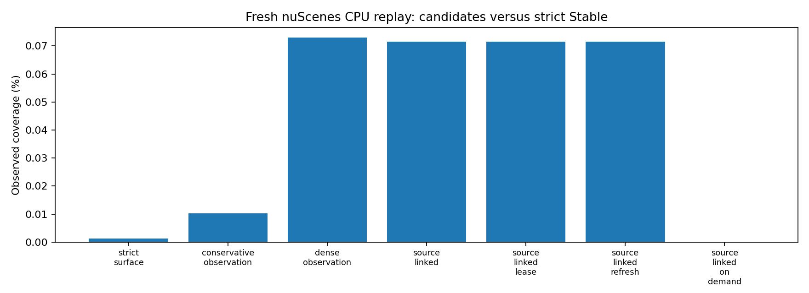
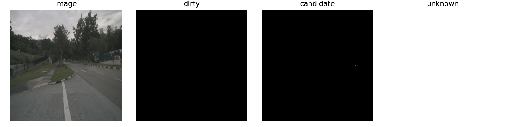
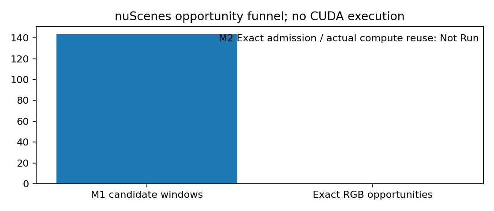
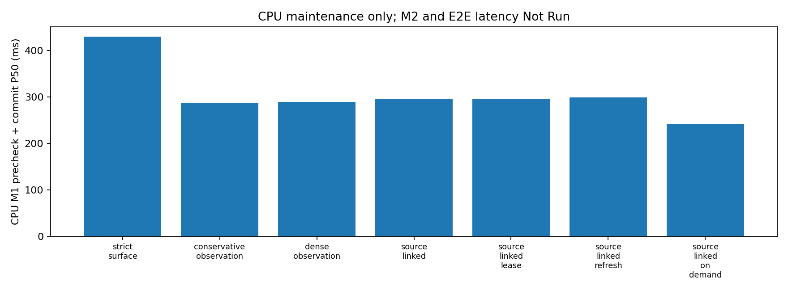

# M1 状态与 M1→M2 接口重构实测报告

已完成可选代码路径、CPU 回归与真实 nuScenes 回放；完整 CUDA 模型验收尚未完成。正式结论 **No-Go**，没有宣称端到端加速。

本次回放为 24 连续帧、144 个相机观测、2 个已曝光场景；均标为 exploratory_reused_population。原 OmniDrive 的真实测试图像变换生成 640×640 preprocessed_image 输入；历史原模型检测仅在 Commit 使用。离线 LiDAR/Annotation 只在 Precheck 之后评分，未参与在线候选或刷新。该回放没有重新执行原始 Head、Memory 或 LLM。

| 方法 | 候选/旧 Stable 面积 % | 稀疏正确/错误 | CPU Precheck+Commit P50/P95 ms |
|---|---:|---:|---:|
| strict_surface | 0.001236 | 0/0 | 429.69/2467.17 |
| conservative_observation | 0.010318 | 0/0 | 287.04/2443.17 |
| dense_observation | 0.073010 | 0/0 | 289.40/2403.94 |
| source_linked | 0.071540 | 0/0 | 296.23/2375.92 |
| source_linked_lease | 0.071540 | 0/0 | 295.94/2391.06 |
| source_linked_refresh | 0.071540 | 0/0 | 299.06/2499.05 |
| source_linked_on_demand | 0.000000 | 0/0 | 241.57/2531.14 |

候选误差率不能由零接受参考点推断为零。本人口没有候选命中可评分的标注内稀疏参考点，Candidate 正确/错误/不可评分稠密面积均无独立真值，保持 null。像素候选数单独保留，不能视作 Certified Stable。Lease 与 Refresh Contract 共享强制来源年龄检查；这些接口消融覆盖相同，不声称有额外算法收益。

轻量候选的补集曾出现关键 ROI 刷新不足。这是假设候选直接授权复用时的诊断失败，并非部署刷新掩码。每个失败事件、时间和相机在 refresh_contract_results.json 中保留。最终轻量路径的严格 refresh_required_mask/exact_invalidation_mask 保守全刷；候选单独进入 M2。Dirty 与 Candidate 不重叠，Unknown 只可通过完整独立 Exact 输入和依赖验证消除。

M2 CPU 工程测试实际执行小型 EVAViT，分别覆盖全候选、全 Unknown、相同/变化输入、Dirty、Full Refresh、已撤销事务、过期计算来源、全局依赖屏障及 OOM 原子发布。其实际跳窗和数值差异保留在 m2_dependency_correctness.json；这些是合成输入的单元测试证据，不能充当真实驾驶复用率或原模型任务质量证据。

三模块最终回归：569 通过，0 失败，1 跳过。跳过项目与原因见 regression_results.json。CPU 下实际 Petr3D 方法的四帧测试替身输出与时序状态相同；真实原模型 Detection/Map/Memory/LLM、完整 EVA 中间输出、CUDA 长序列、显存和 E2E P50/P95 为 Not Run，不能沿用旧实验通过结果。

沙箱内 CUDA 不可见；两次沙箱外只读 nvidia-smi 查询都因自动审批超时而未执行。该证据不能证明主机驱动损坏。完整五臂 CUDA 验证入口和自然/重复输入分离命令已提供；未完成 GPU 查询和本次完整质量对照前，不颁发任何新数值、任务或性能资格。

新状态保存 Observed Source 与 Computed Source 的区别。计算来源在后续验证帧和 Cache Publication 前进时保持不变。M1 只保存来源元数据；M2 拥有 Tensor。maintain 持续执行 Precheck/Commit/身份维护，拒绝机会时只推迟 Dense/Surface 验证；reset_on_reject 与 output_only 继续属于不同服务，不混报。

身份 ID 序列在 Dense、Source-Linked 和按需三臂比较一致性：True。物理证书生产器、身份算法、M3、原模型 Backbone/Head/LLM 和权重均未修改。尚未重放历史所有身份候选边，不将此项检查写成完整身份物理认证。

独立资格：Calibration/Heldout/Final Test = Not Run；Qualified Certification=0；Qualified FAR=null。G1–G8 逐项状态见 formal_go_nogo.json。候选更多与合法计算跳过之间仍有明确证据缺口；生产默认保留 Exact 检查、成本/质量门及 Full Forward 回退。

复现见 commands.sh；合同见 state_contract.md；实现审计见 implementation_changes.md。中间失败和修订前记录均保留在 attempts/ 和 logs/，最终统计只使用 replay/ 与 regression_final.xml。

