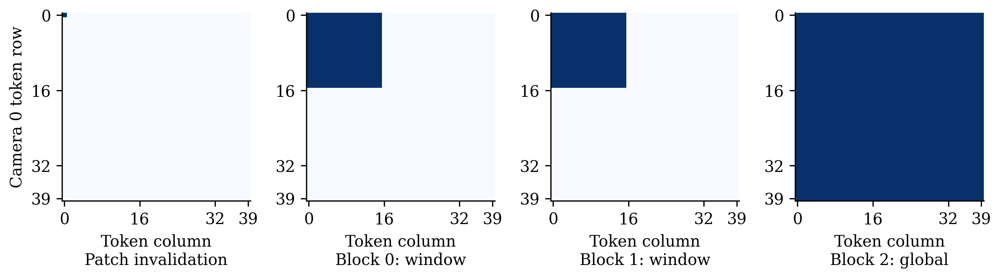
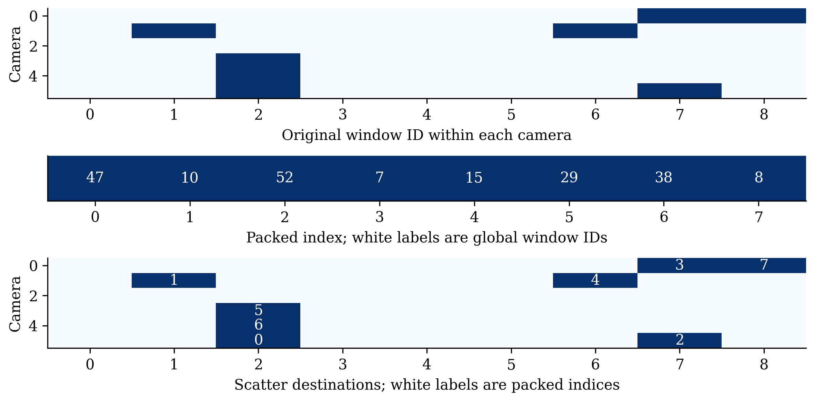
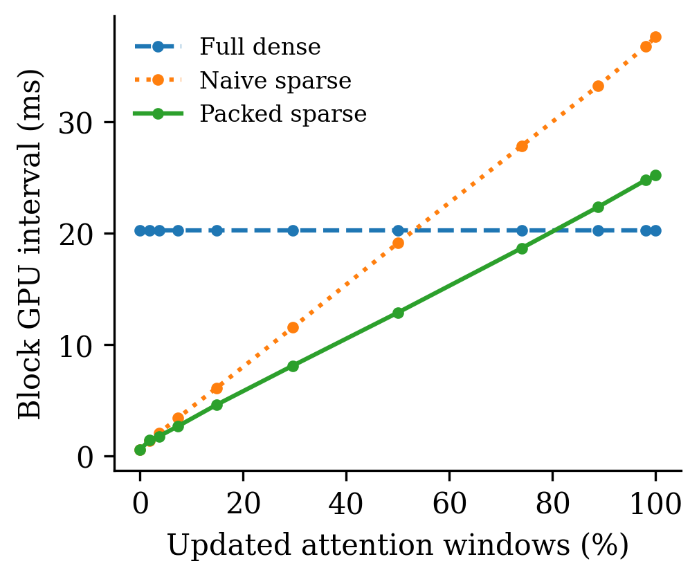
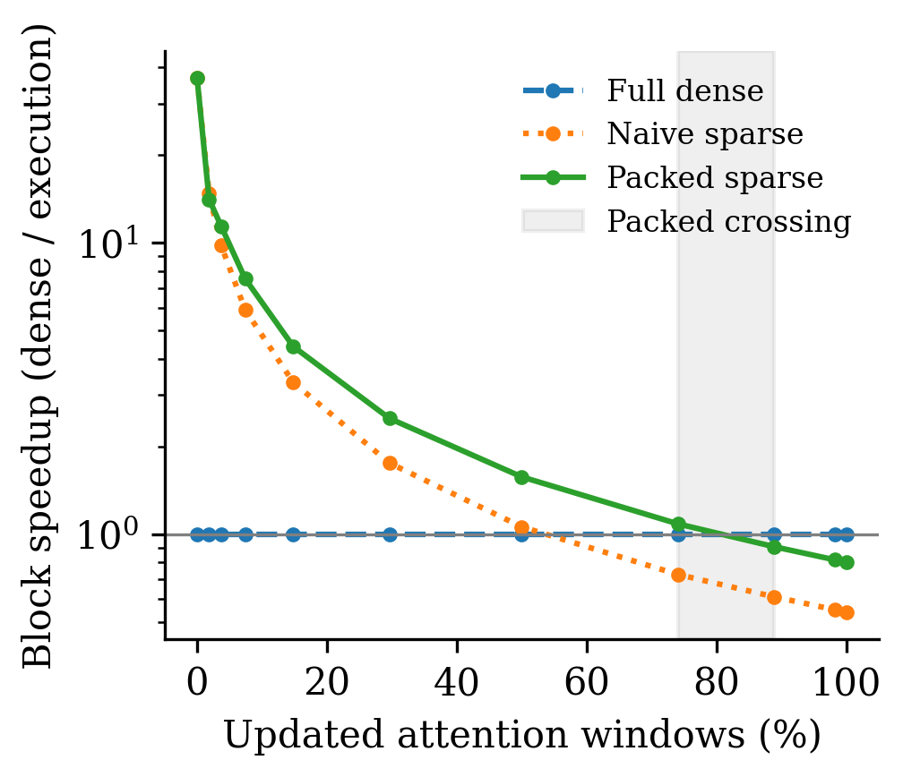
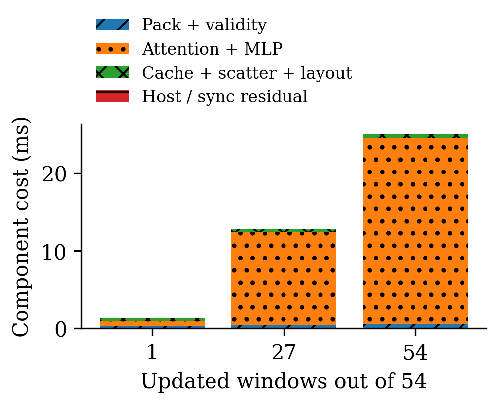
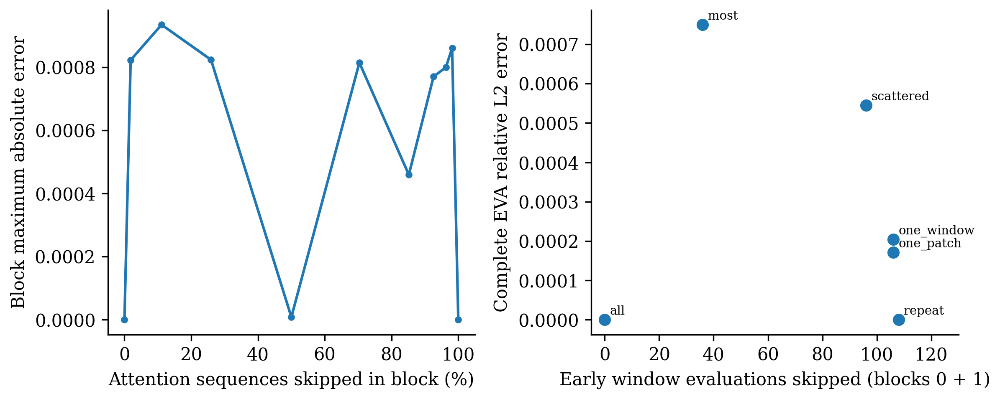
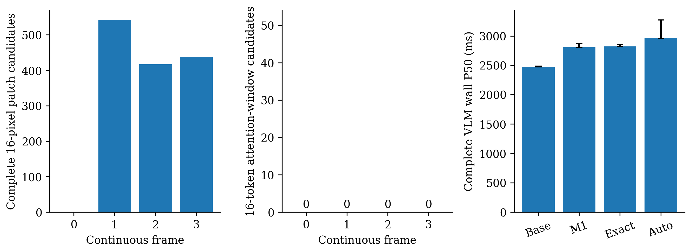

# OmniDrive M2 实现与真实 GPU 实验报告

本轮实现真实 EVA 窗口稀疏执行、GPU 打包、依赖屏障、有限缓存和实测成本回退。
受控输入能够减少 GPU 工作并加速早期 Block 和完整 EVA；本轮真实 M1 连续帧没有
形成可复用的完整注意力窗口，实际跳算为零，计入 M1 后完整 VLM 更慢。
不将受控收益外推为真实 M1 端到端收益。

## 环境与实际拓扑

RTX 3090 24 GiB，OmniDrive conda 环境，PyTorch 1.13.1+cu117、CUDA 11.7。
部署权重 `ckpts/iter_10548.pth`，独立 EVA 加载其 img_backbone 状态并 strict=True 校验。
实际部署是 FP32 权重/中间激活，原始 FlashAttention 包装内部使用 FP16 Q/K/V。
不是整网 FP16；直接 half() 的初次尝试导致原始 Attention 线性层 dtype 不匹配，
已改回实际部署方式，没有修改模型权重或 CUDA 环境。

6 相机 640×640，Patch 16 像素，特征 40×40×1024；16×16 TOKEN 注意力窗口
对应 256×256 像素，特征补齐为 48×48，每相机 9 窗口，总共 54。
局部层 0/1 后是全局层 2；只缓存前两层，2..23、Neck、Detection、Map、Memory、LLM 完整执行。
精确预处理坐标、padding、RoPE 与归一化顺序见 [pipeline_inspection](pipeline_inspection.md)。

## Q1：是否真正执行合法 GPU 跳算？

是。`window_executor.py` 把选中窗口 gather 到连续 CUDA Tensor，用原模型
norm1/attention/RoPE/SwiGLU/残差计算，再 index_copy_ 回 GPU 历史输出。
输入 Attention 的 batch 随更新数从 54 缩到 k；没有先完整 Forward 再 mask。
补齐位置在 norm1 后重新归零，保留原 EVA 的 norm-before-pad 语义。
PatchEmbed 和位置嵌入始终完整执行，不将它们计为跳算。
缓存仅来自上一实际执行帧，当前实际输入逐像素同坐标相等才可能复用；
M1 候选/flow/feature_versions 不是深层特征证书。M2 有独立 frame/version/provenance。
非有限输入、未知 footprint、Scene/Camera/权重/buffer/shape/signature 变化均不复用。

Profiler 证明工作量减少：54 窗口 dense 的 kernel-active 时间为 20.376 ms；
27 窗口 packed 为 12.050 ms，naive 为 18.512 ms。
相应 GPU kernel 数为 dense 44、packed 50、naive 1039。
Packed 相对 dense 可以增加 launch 数，但每次 GEMM/Attention 的真实张量批量减少；
不能把跳过计算量写成减少同等比例的 kernel launch。原始 trace、linear shapes 在
`traces/` 与 `packing_profile.json`。

## Q2：哪些层具备复用空间？

当前严格实现复用 Block 0/1 的独立窗口。任一输入像素变化使完整 patch 更新，
任一 token 变化使其整个窗口更新。Global Attention 把该相机范围扩展到全部 token；
之后所有层完整执行。Residual bottleneck 的 3×3 跨窗依赖由 planner 扩展，
executor 在遇到此类层前停止缓存。没有假定旧空间位置可以搬到新位置。
规划轨迹来自实际 one_patch 执行，见 `dependency_trace.json` 和图 (a)。

## Q3 / Q4：Packing 收益与 Break-even

以下是部署权重 Block 0 的 CUDA Event interval 中位数（ms），20 次测量；
Full/Packed 预热 5 次，Naive 预热 3 次。
interval 包含 launch gap，增量包含 partition/gather/validity/cache copy/scatter/layout。
朴素路径逐窗口调用同一权重。Profiler 另行运行，不混入这里的延迟样本。

| 更新窗口 | Full | Naive | Packed | Block Speedup | MaxAbs |
|---|---:|---:|---:|---:|---:|
| 0/54 | 20.244 | 0.550 | 0.550 | 36.82× | 0 |
| 1/54 | 20.244 | 1.370 | 1.434 | 14.12× | 0.000861168 |
| 2/54 | 20.244 | 2.064 | 1.772 | 11.42× | 0.000800133 |
| 4/54 | 20.244 | 3.437 | 2.688 | 7.53× | 0.000770569 |
| 8/54 | 20.244 | 6.100 | 4.592 | 4.41× | 0.000459671 |
| 16/54 | 20.244 | 11.542 | 8.109 | 2.50× | 0.000814915 |
| 27/54 | 20.244 | 19.110 | 12.874 | 1.57× | 8.58307e-06 |
| 40/54 | 20.244 | 27.862 | 18.672 | 1.08× | 0.000823975 |
| 48/54 | 20.244 | 33.235 | 22.366 | 0.91× | 0.000935078 |
| 53/54 | 20.244 | 36.784 | 24.788 | 0.82× | 0.000823021 |
| 54/54 | 20.244 | 37.634 | 25.195 | 0.80× | 0 |

测得有利更新数：[0, 1, 2, 4, 8, 16, 27, 40]。跨越区间由相邻已测点给出，
没有将未测点插值为保证。Auto 只接受匹配设备/软件/精度/形状/算子的已测数量，
同时要求 GPU interval 与 wall 均更快且完成整体数值校准；未测数量完整回退。
已完成数值校准数量：[0, 1, 6, 36, 54]。
成本记录是 Block 成本，不能单独保证完整 VLM 加速；M1 已发生的成本不会因回退消失。

完整 24 层 EVA 对照（10 次测量，Full 预热 5 次、Incremental 3 次；冷初始化另列）：

| 受控实际输入修改 | Full GPU ms | Incremental GPU ms | EVA Speedup | MaxAbs | RelL2 | 独立校准内 |
|---|---:|---:|---:|---:|---:|---|
| repeat | 482.12 | 435.89 | 1.106× | 0 | 0 | True |
| one_patch | 482.12 | 439.72 | 1.096× | 0.12229 | 0.00017109 | True |
| one_window | 482.12 | 440.09 | 1.095× | 0.17401 | 0.00020426 | True |
| scattered | 482.12 | 445.17 | 1.083× | 0.30575 | 0.00054512 | True |
| most | 482.12 | 473.57 | 1.018× | 0.5913 | 0.00074988 | True |
| all | 482.12 | 490.20 | 0.984× | 0 | 0 | True |

冷缓存测量 GPU 中位数 482.69 ms，包含缓存填充；
稳态每次测量恢复同一个历史帧的实际缓存，未用“本帧已计算缓存”冒充命中。
全图变化仍有认证/缓存维护开销，可能比原始 EVA 慢。Auto 对无收益/未校准数量回退；
`auto_policy_benchmark.json` 保存其实际时延、误差和选择。

## Q5：CUDA Graph、缓冲复用与 Bubble

CUDA Graph 在本环境的原始 FlashAttention 上可 capture；各数量的真实测量、
构建预热成本、数值误差均在 `cuda_graph_profile.json`。结果只针对固定指针/数量
的受控微基准。流式 Runtime 保留普通 Packed CUDA 路径，不持有跨帧旧缓存地址的图；
没有为少量 launch 收益引入不受限的图池。图加速不能被当作流式 VLM 加速。
Executor 复用当前形状的 gather 缓冲，缓存常驻 GPU；每次 scatter 复制完整输出，
这项成本没有省略。图 (e) 的同步/host residual 是 wall 减事件区间，不能解释为
独立 GPU 工作或纯 idle。事件分段本身有扰动，所以用于诊断，整体时延以主基准为准。
Controlled trace 没有输入传输（输入预先驻留）；这不能推导真实系统没有 I/O。
真实 M1 会 D2H，完整时延包含其输入/输出适配、验证和 commit。
没有增加多 Stream；没有 Nsight 硬件 occupancy/SM stall 计数，相关指标记为未测，
不把 CUDA 时间差冒充硬件 occupancy 或完整 I/O 调度结论。
在单次 profiled trace 内，dense / packed-27 的设备活动间隙分别为
0.068 / 0.074 ms；
这是实际 kernel/memcpy/memset 区间的并集与跨度之差，包含 profiler 扰动，不是硬件 occupancy。

## Q6：真实 M1 可否转化为 GPU 跳算？

本轮 4 个唯一连续 nuScenes 帧、1 个 Scene，原始 640×640 模型预处理输入，
M1 使用 coverage 的 dense_guard_8 配置，所有模式固定相同样本。
各帧完整 patch 候选 [0, 542, 417, 438]，完整 attention-window 候选 [0, 0, 0, 0]；实际接受与跳算窗口均为 0。
首帧因 m1_full_refresh 回退，后续因 insufficient_stable_windows 回退。
当前瓶颈首先是稳定候选不能覆盖完整 16×16-token 依赖单元，而后是 Global Attention 屏障；
不能把旧回放的 0.343% 图像块比例当作模型窗口比例，也没有将 640×360 raw mask 直接拉伸。

## Q7：计入 M1/M2 后完整 OmniDrive 是否加速？

没有。下表为两次测量重放（每次 4 帧），另有一次完整预热重放。
完整同步 wall 含视觉、M1 适配/验证/commit、Detection/Map/Memory、实际 LLM。
CPU 数据预加载，H2D scatter 在计时前；摘要/误差读取在计时后。模式顺序固定，
样本很少且存在系统波动；重复重放不增加唯一帧数，不做统计显著性声明。

| 模式 | 完整 P50/P95 ms | EVA P50/P95 ms | M1 P50/P95 ms | E2E Speedup |
|---|---:|---:|---:|---:|
| baseline | 2470.67 / 2486.07 | 473.32 / 476.50 | 0.00 / 0.00 | 1.000× |
| m1_observe | 2809.99 / 2872.78 | 478.86 / 480.13 | 283.40 / 339.74 | 0.879× |
| m1_m2_exact | 2823.11 / 2854.65 | 480.59 / 481.41 | 288.73 / 317.40 | 0.875× |
| m1_m2_auto | 2958.01 / 3271.35 | 480.85 / 482.27 | 368.10 / 497.11 | 0.835× |

| 模式 | S_EVA | S_vision | 完整视觉 interval P50 ms | M2额外 interval P50 ms | 峰值 allocated GiB |
|---|---:|---:|---:|---:|---:|
| baseline | 1.000× | 1.000× | 473.35 | 0.000 | 15.14 |
| m1_observe | 0.988× | 0.988× | 478.93 | 0.000 | 15.14 |
| m1_m2_exact | 0.985× | 0.982× | 482.01 | 1.556 | 15.14 |
| m1_m2_auto | 0.984× | 0.981× | 482.75 | 1.576 | 15.14 |

初始冷帧和后续稳态帧的分离样本见 `e2e_latency.json`；完整视觉 interval、M2
调度/回退 interval、CPU dispatch 和额外 GPU interval 也逐帧保存。
这些 interval 可含 CPU launch gap，不能当作纯 kernel-active。没有从总成本中扣掉 M1。

## Q8：数值、下游结果与 Memory

真实完整模型四种模式的 EVA/Detection/Map/Temporal Memory/文本逐帧摘要完全一致：
**True**。LLM 使用 seed=0、greedy，原始 max_new_tokens=320；每次独立输出目录
保证真实执行，不因已有语言文件而跳过。生产代码未改生成策略。
这是本轮少量帧的输出一致性，未运行 nuScenes 全验证集 AP/地图指标，也不能认证未来近似复用。
真实帧没有接受 sparse窗口，因此下游一致性验证的是完整回退，不能当作非零复用的任务质量证据。

数值校准完全独立于 sparse：固定输入先重复 3 次原始 EVA batch6 与六次 batch1 的
完整执行（无缓存），再比较原始 FP32 non-flash Attention 完整执行，逐层保存精度差异。
同算子不同 batch 的最终 MaxAbs/RelL2 为 0.565529 /
0.000757476；部署 Flash 与独立 FP32 Oracle 为
1.20792 / 0.00180586。
取这两类原始完整计算差异的逐层最大值为经验算子精度包络，不按 sparse 误差调参、
不加事后扩大倍数；它是该固定输入上的数值尺度，不是通用任务安全保证。
最初把 Block 的绝对阈值 0.02 用于深层输出导致失败，原数据保留在 `initial_precision_check/`；
当前所有逐层/最终误差与通过状态见 `correctness_report.json`，整体通过：
**True**。几何 warp 近似复用未启用。

## 资源、测试、复现与边界

Cache 仅保留上一帧输入和前两层输出；预算 512 MiB，3 倍保守估算覆盖替换/工作区。
内存余量不足和 sparse OOM 时清空并重试完整路径，无法容纳原始模型则正常报告原始 OOM。
25 帧生命周期测试验证缓存不随时间增长。`memory_profile.json` 记录实际峰值；
controlled 峰值包含 oracle/graph，不等于生产缓存占用。真实完整模型峰值另在 integration runs。
测试覆盖 M1 回归、完整 footprint、padding、RoPE、camera 顺序、窗口排列、Global/Conv 传播、
未知区域、权重/buffer/Scene/shape/version 失效、内存回退与成本约束；测试日志在 `test_logs/`。
源码 SHA256 清单在 `source_manifest.json`，实际命令在 `commands.sh`。
初次完整 VLM 结果保留于 `initial_integration/` 和 `integration/`；最终重跑在 `integration_final/`。

本轮结论分开成立：算法实现了真实独立窗口执行；受控 kernel/Block 加速已测；
受控完整 EVA 有小幅收益；真实 M1 + 完整 VLM 没有获得加速。

## 实验图

