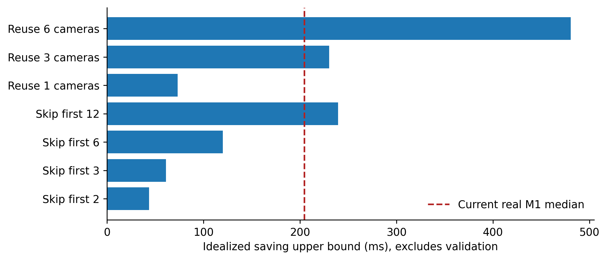
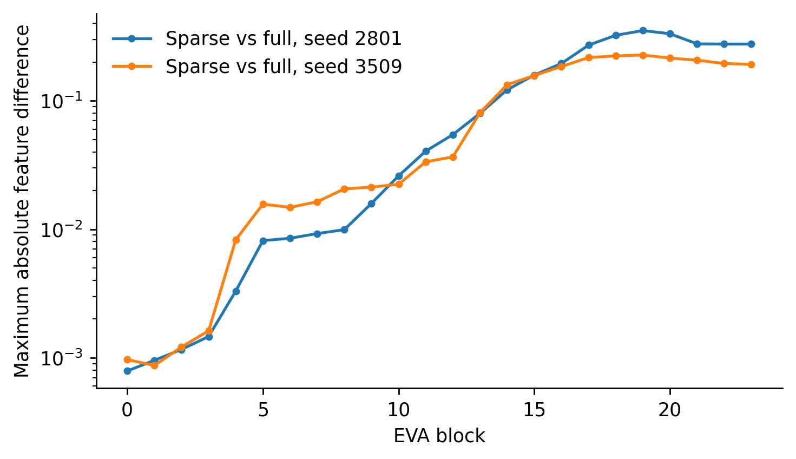
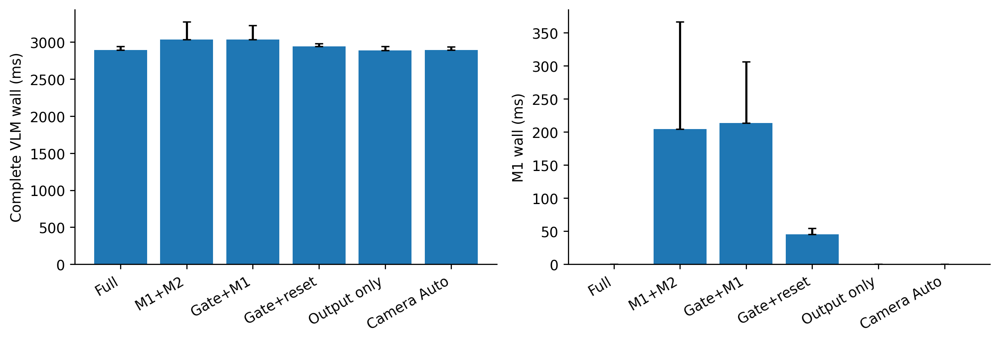
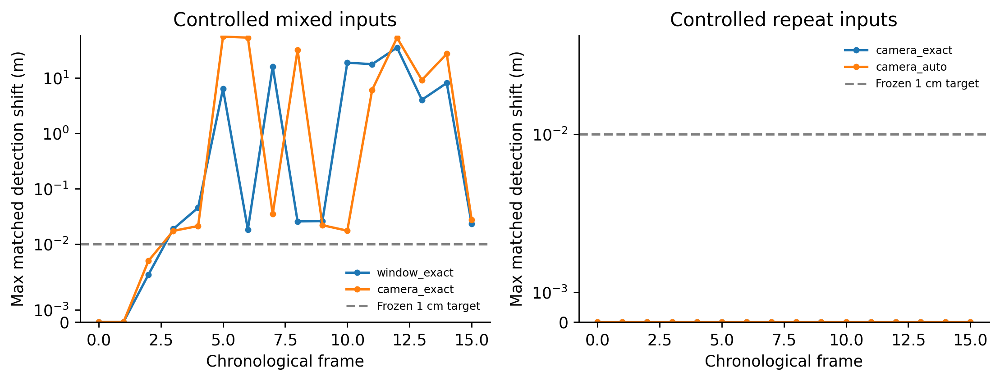
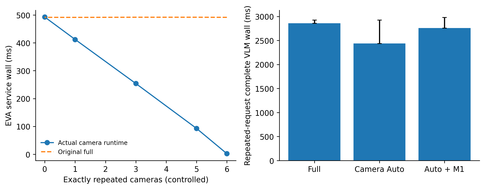

# OmniDrive M2 第三轮：计算边界、按需认证与相机级精确复用

研究决策：将 M2 转向**成本感知的更大粒度视觉状态执行**。保留 Window Packing 和 Dependency Closure，
但不继续以仅前两层局部跳算作为同步完整 M1 服务的核心收益来源。
本轮没有改变模型权重、窗口大小、刷新门限或先前冻结的下游目标，没有实现 M3。

## 实测依据与阶段决策

阶段 A 见 [feasibility_report.md](feasibility_report.md)。完整跳两层的上限低于历史 M1 成本，
Gate A No-Go；一个/多个相机全 Backbone 的收益上限更高，但只有严格相同输入才具有依赖条件。
阶段 B 见 [numerical_diagnosis.md](numerical_diagnosis.md)。全量 Packed 与 A 相同，子批次和 Dense 拆批出现差异，
不能把误差包络当作任务质量认证。Window Auto 维持 [0]，未扩大集合（Gate B）。
Camera 正式成本表批准的 changed_cameras 为 `[0]`，
只按实测 key/数量、GPU 和 wall 成本同时受益时复用。未验证部分相机路径保留为 Exact 实验，默认回退。
收益预算门另使用当前 input-adapter/precheck 实测加前帧 commit/output-adapter 成本估计。
Window Auto 若乐观的批准 Block 节省总和仍无法支付该预算，在 GPU closure 前拒绝；
Camera Auto 必须整体 wall 节省超过预算。它是简单的测量判据，不保证下一帧维护成本不会波动。
主16帧 camera_auto 是加入此预算门之前的诊断记录；最终含预算门的 Auto 以独立平衡复测为准。
真实六场景均零命中，预算门不改变其 GPU 执行分支；当前输出服务与完整 M1 服务分别报告。

## 完整模型真实六场景

冻结协议保留前轮四个 Scene，增加独立行人与夜间 Scene；每个索引 0/1/2/4，24 唯一帧。
1 次预热、2 次测量、Latin-square 模式轮换；逐序列重置，完整 Detection/Map/Memory/LLM 每帧执行。
CPU 数据加载/scatter 与诊断拷贝在计时外；M1、认证、cache、同步均在完整 wall 内。
CPU enqueue wall 与 CUDA interval 分开。所有模式都有同样的轻量 profiling wrapper 固定开销。
`original` 是本轮开始前保留的第二轮 M2 代码快照；不是重新实现的模拟基线。
冷缓存表示每段首帧的 cache warmup，不等于进程首次启动；首次 EVA 内容指纹初始化
另测为 582.48 ms（包括 device-to-host 读与 SHA256），不隐去该部署启动成本。
仅按 current-output 的每次重复命中节省估计，需约 2 次命中才能摊回该额外初始化；
这是基于实测单次节省的摊销推算，不是含模型加载的冷进程 benchmark。

| 模式 | E2E P50/P95 ms | M1 P50 ms | 复用 Camera | 跳过 Window 计算 | E2E speedup |
|---|---:|---:|---:|---:|---:|
| baseline | 2891.63/2939.23 | 0.00 | 0 | 0 | 1.0000× |
| original | 3035.18/3272.35 | 204.47 | 0 | 0 | 0.9527× |
| gate_maintain | 3031.16/3225.30 | 213.36 | 0 | 0 | 0.9540× |
| gate_reset | 2940.51/2980.13 | 45.25 | 0 | 0 | 0.9834× |
| gate_output | 2888.98/2939.92 | 0.00 | 0 | 0 | 1.0009× |
| camera_auto | 2891.57/2933.09 | 0.00 | 0 | 0 | 1.0000× |

`gate_maintain` 保留完整 M1 历史，只增加拒绝筛查；`gate_reset` 在拒绝时明确丢弃旧 WorldState，
然后执行当前 precheck/commit；`gate_output` 是仅需当前感知的服务，在拒绝时显式 reset 并跳过 M1，
下一次验证从空状态初始化。后两者不是保留完整 Anchor 历史的等价实现，不可混报。
本表 `camera_auto` 同样采用 output_only 服务；默认配置保留完整 M1 的正式相机 Auto，
另在两个真实 Scene 平衡复测：Baseline P50/P95
2900.14/2940.24 ms，
连续 M1 Camera Auto 2982.97/3454.36 ms，
每臂16计时、真实相机复用数 0；该补充不混入六 Scene 的样本数。
所有路径继续当前 pose/time、Detection/Map/StreamPETR Memory 和真实语言生成；从不缓存当前 heads 结果。

单独的真实视觉服务计时从请求进入到实际 LLM 入口（包含 M1、缓存、规划、当前 heads/query 与同步），
两真实 Scene 各4帧、两轮旋转顺序，模型已经过完整 VLM 预热。该 component-only probe 在语言入口退出，
不将其时间当作完整 VLM。主 profile 的 `visual_service` 标签仅为 extract_img_feat，完整视觉前缀以此表为准：

| 模式 | 视觉服务 wall P50/P95 ms | CUDA interval P50/P95 ms |
|---|---:|---:|
| baseline | 531.809/534.652 | 531.783/534.627 |
| original | 656.255/802.980 | 656.227/802.935 |
| gate_maintain | 650.034/799.774 | 650.006/799.747 |
| gate_reset | 583.133/591.262 | 583.106/591.233 |
| gate_output | 531.571/533.510 | 531.545/533.482 |
| camera_auto | 533.461/535.657 | 533.433/535.631 |

没有把不发生复用的延迟微小波动归因于 GPU 跳算；真实移动相机输入下实际复用数见表。
24 个唯一真实帧统计 1296 个相机窗口，
M1 完整观测 patch 计数 0，完整候选窗口
0；观测候选不是神经特征等价证明。
真实是否净加速按各模式表格和质量结果判断，重复请求的结果不能当作真实驾驶覆盖率。
CPU RSS 是进程生命周期高水位；逐模式 GPU allocated/reserved peak 见 summary.json，不能混作隔离 CPU 峰值。

## 受控非零复用与连续状态

两个独立 Scene 各 16 个真实时间/pose/任务输入，合成 mixed 局部变化序列，另有完全重复图像请求序列。
mixed 同时覆盖单 patch、完整 window、多个 window、单个/多个相机相同及全变化。
完全重复序列保留真实变化的自车 pose、时间戳与下游 Memory；首帧实际完整计算供缓存。
16 帧是约 7.5 秒的有限状态漂移回归，不是完整场景或长期安全证明。

16帧重复图像请求的 warmed E2E：Baseline P50 2863.15 ms，
Camera Exact P50 2442.66 ms，受控加速 1.172×。
这组16帧计时按方法成组，主要用于漂移回归；独立平衡顺序复测以正式 Camera Auto 为比较臂，
两个 Scene 各4帧、1轮预热和2轮计时、每臂16个计时，Baseline P50/P95
2858.92/2926.47 ms，
Camera Auto 2439.51/2927.85 ms，
受控净收益 1.172×。这是明确无 WorldState 连续性要求的 current-output 服务：
M1 manager 为空，完整逐像素相机输入等价仍由 M2 认证，heads/Memory/LLM 每次真实执行。
另一个保持完整 M1 连续性的正式 Auto 臂 P50/P95 为
2758.34/2980.36 ms，
受控收益 1.036×；它计入实际验证与前一帧维护成本估计，只有收益预算为正才批准复用。
上述收益指 P50 中位数；P95 未改善，包含冷缓存/状态维护成本，不声称整个尾部时延分布都更优。
平衡复测质量通过 48/48，
原始精度 Memory、完整输出与 feature 差异也逐项保留。不将该服务与每帧 M1 的服务混为相同契约。
质量结果为 `{'checks': 96, 'frozen_target_pass': 96, 'max_feature_abs': 0.0, 'max_detection_center_m': 0, 'max_map_control_abs_m': 0.0, 'max_native_memory_raw_abs': 0.0, 'text_equal': 96, 'planning_equal': 96}`；只有同输入下任务约束通过才称为受控净收益。
正式 camera_auto 在成本表发布后又实际执行完整模型验证，单轮质量结果单列，不冒充多轮性能。
初次中断留下的 4 个语言文件使最初 mixed Baseline 跳过了语言推理；这些单轮时间标记为无效，
未用于预热性能表。另在全新目录重放完整 16 帧 Baseline，逐帧核对原始精度 Memory 完全一致后，
用实际新生成文本重新比较 A/B/C。修正前原记录保留在 pre_language_oracle_recheck.json，过程见 language_oracle_recheck.json。

原始 dtype Memory NPZ、每帧质量与误差随时间数据见 state_drift_results.json 和 integration_final/；
raw 和同龄 slot 联合匹配同时保留，不能靠重排掩盖当前保留集合不同。
Mixed 强制实验中，后续仅恢复 full backbone 不能自动消除已经带偏的 Temporal Memory，
这也是拒绝未认证部分更新的原因；各独立序列/场景重置后从完整实际输出重新开始。

| 输入/执行模式 | 冻结目标通过 | EVA MaxAbs | 检测中心差 m | Map坐标差 m | 文本一致 |
|---|---:|---:|---:|---:|---:|
| real_camera_auto | 72/72 | 0 | 0 | 0 | 72/72 |
| real_gate_maintain | 72/72 | 0 | 0 | 0 | 72/72 |
| real_gate_output | 72/72 | 0 | 0 | 0 | 72/72 |
| real_gate_reset | 72/72 | 0 | 0 | 0 | 72/72 |
| real_original | 72/72 | 0 | 0 | 0 | 72/72 |
| mixed_camera_exact | 5/32 | 0.916857 | 56.1284 | 0.0951347 | 24/32 |
| mixed_packed_dense | 32/32 | 0 | 0 | 0 | 32/32 |
| mixed_window_exact | 5/32 | 0.955467 | 35.6543 | 0.148174 | 27/32 |
| repeat_camera_auto | 32/32 | 0 | 0 | 0 | 32/32 |
| repeat_camera_exact | 96/96 | 0 | 0 | 0 | 96/96 |
场景、camera 顺序、版本、权重、预算、输入 stride、非有限值与时间倒退在运行时/单测中 fail closed。
相机 cache 保存计算来源 frame/timestamp，复用只更新验证请求上下文，不伪造新的计算来源。

## 世界对齐近似方向

approximate_probe_results.json 单独记录离线必要可行性筛查。先在当前 absolute position 之前
对齐内容表示；不将历史 RoPE 相关上下文 token 直接 warp。几何观测支持不是 Transformer 等价。
若整层 Patch Embedding 的最大节省已无法覆盖认证，Gate D No-Go，停止深层/下游近似实验，
相应字段明确 not_run，不填虚构质量数；不加入在线 Auto。
本次离线累计完整观测支持 patch 计数为 0，重复帧/相机逐项记录；
筛查使用不含 Detection/Map 排除锚点的 geometry-only 乐观条件，不冒充部署候选覆盖率。
整层 patch oracle 节省能覆盖实测 precheck 下界的必要条件：
False。尚无下游任务认证的近似复用结论。

## 十项问题答复

1. Window 上限为 43.60 ms，完整输入认证/缓存后的部分更新成本另见 partial_window_costs.json。
2. 本轮原路径 M1 P50 为 204.47 ms（历史 189.12 ms）；同步完整认证超过该局部上限。
3. 全量 B 对照和 Dense microbatch 指向 batch shape 浮点差异；没有通过改阈值规避。
4. Window 正式集合未扩大，局部 sparse 未通过的任务目标仍导致回退。
5. Cheap Gate 仅拒绝；是否减少 M1 成本按上表消融判断，状态 reset/reentry 与连续服务分列。
6. 相机 batch 是更大合法边界，输入必须完整有限且逐值相等，签名、版本和顺序有效。
7. Camera GPU 成本见 camera_reuse_results.json；受控完整请求质量和时延如上，真实覆盖另列。
8. 不声称有获任务认证的世界对齐近似路径；必要条件失败后停止，没有默认启用。
9. 真实非零节省只能由实际计数支持，不将受控重复当成驾驶复用。
10. 完整 VLM 时延与任务约束同时检查；理想上限、受控实际、真实移动场景互相独立。

测试：161 项，失败 0、错误 0、跳过 0。
复现见 commands.sh；阶段加载中断/失败候选在 logs/ 留档。原 M1/M2/Refinement 结果逐文件 SHA256 验证。

配置入口：`worldstream_m2_camera_auto.py` 保留 M1；`worldstream_m2_camera_output_only.py`
显式不维护 M1，匹配平衡复测的 current-output 臂；`worldstream_m2_camera_on_demand.py`
在拒绝时丢弃 M1 历史，下一次需要验证时重新初始化。具体契约见 `docs/worldstream_m2_rearchitecture.md`。

## Profiling instrumentation changelog

| 文件 | 变更 | 用途 | 行号 |
|---|---|---|---|
| tools/worldstream_m2/rearchitecture/__init__.py | 新建 | 隔离实验包 | — |
| tools/worldstream_m2/rearchitecture/approximate.py | 新建 | 独立geometry-only/patch oracle必要条件 | — |
| tools/worldstream_m2/rearchitecture/balanced_camera_probe.py | 新建 | 正式Auto的平衡顺序完整模型复测 | — |
| tools/worldstream_m2/rearchitecture/common.py | 新建 | 冻结参考/原始dtype比较/实验目录 | — |
| tools/worldstream_m2/rearchitecture/component_audit.py | 新建 | Norm/QKV/FP16/Attention/MLP数值拆分 | — |
| tools/worldstream_m2/rearchitecture/feasibility.py | 新建 | 上限与认证成本的阶段决策 | — |
| tools/worldstream_m2/rearchitecture/integration.py | 新建 | 完整模型计时/Memory/greedy/场景对照 | — |
| tools/worldstream_m2/rearchitecture/monitor_gpu.py | 新建 | 按分钟核验外部竞争进程 | — |
| tools/worldstream_m2/rearchitecture/numerical_shadow.py | 新建 | 固定batch历史替换/真实kernel计数/部分窗口成本 | — |
| tools/worldstream_m2/rearchitecture/phase_ab.py | 新建 | GPU上限与逐层A/B/C | — |
| tools/worldstream_m2/rearchitecture/pipeline_probe.py | 新建 | Peft实际carrier投影和组装计时 | — |
| tools/worldstream_m2/rearchitecture/plot.py | 新建 | 测量数据的PDF/PNG导出 | — |
| tools/worldstream_m2/rearchitecture/postflight.py | 新建 | 补充验证/CUDA测试顺序编排 | — |
| tools/worldstream_m2/rearchitecture/refresh_camera_cost.py | 新建 | 显式数值策略下的实测零更新成本 | — |
| tools/worldstream_m2/rearchitecture/repair_language_oracle.py | 新建 | 全新16帧语言Oracle与原始Memory核对 | — |
| tools/worldstream_m2/rearchitecture/report.py | 新建 | 真实结果和kernel trace汇总 | — |
| tools/worldstream_m2/rearchitecture/visual_service_probe.py | 新建 | 隔离到LLM入口的视觉服务计时 | — |
| tools/worldstream_m2/rearchitecture/wait_gpu.py | 新建 | 按分钟检测可用GPU | — |
| worldstream/m2/approximate_probe.py | 新建 | 仅离线特征对齐探针，生产Runtime不调用 | — |

Profiler 只由独立实验脚本包装，不写入 EVA Forward。生产代码中的 admission/cache 是功能路径，
不是计时埋点；无需运行 profiling 脚本即可使用。所有原始数据保留，可按需移除独立 profiling 工具。
