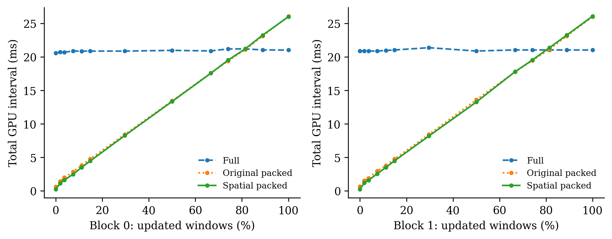
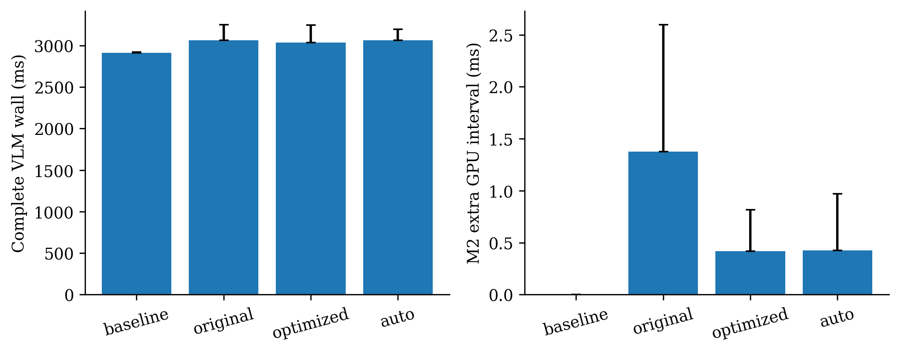
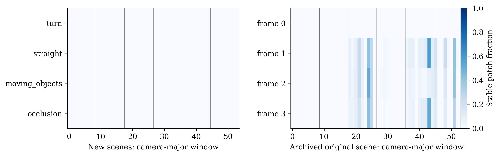
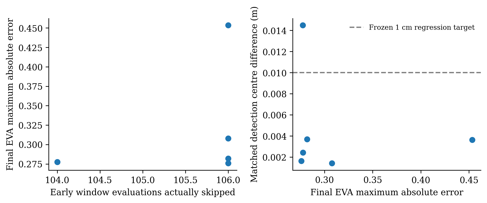

# OmniDrive M2 定向改进与真实 GPU 验证

本轮修复 Full Fallback→Cache→Sparse 状态转换，独立校准 Block 0/1 成本，减少小批量
窗口整理工作，并补充真实完整模型中非零跳算的下游对照。所有新结果在本目录，
原 `outputs/module2/` 由 SHA256 清单逐文件验证，未覆盖。没有修改模型权重、EVA 窗口大小或 M1 判定门限。
另修复最终特征输出 stride 与原始 Forward 不同的问题，避免后续算子因内存布局选择不同实现。
真实四场景全为 dense fallback，其计时不受此后增量返回格式修正影响；完整 EVA/Auto 与质量审计已按最终格式复测。
实测环境：NVIDIA GeForce RTX 3090，PyTorch 1.13.1+cu117，CUDA 11.7，
Python 环境 OmniDrive；权重 `ckpts/iter_10548.pth`，原 FP32 激活与 FlashAttention 内部 FP16 Q/K/V。
所有计时均为实际执行，未把理论 FLOPs 或未运行配置填入表格。

主要结果：真实 M1 场景的 M2 附加 interval P50 从
1.378 ms 降至
0.417 ms；计入全部 M1/M2 与 LLM 后，
完整 VLM 未获得净加速（0.959×）。受控完整模型确有非零跳算，但改变输入尚未通过冻结的下游目标，
正式 Auto 只批准更新数 `[0]`，未以放宽精度换取加速。

## 1. 缓存连续性与重复计算

原 `_dense()` 确实清空缓存并丢弃当前 full forward 的中间输出，但它本身没有重复运行
backbone；问题是下一帧无法继承当前真实执行结果。现在通过临时 hook 捕获同一次原始
full forward 的 Block 0/1，finally 移除 hook，预算允许后原子发布当前 input/outputs/context。
不兼容历史先失效；仅更新范围太大时仍能保存当前输出。Cache version 单调递增，
camera 顺序独立快照，旧输出不会被原地覆盖。`always/adaptive/never` 明确控制捕获。

`adaptive` 在真实 M1 没有完整窗口或要求强制刷新时不保存，记录
`capture_not_expected_to_pay`；其理由是当前没有后续收益证据。强制捕获的 Full→Sparse→Full→Sparse
测试验证每个 Full 只有一次 Block forward，下一次 Sparse 从前一帧读取版本，且对照原始 EVA 正确。
预算与 OOM 失败继续完整路径，未保留未经完成的缓存。

## 2. 零机会快速回退

优先读取同一 M1Result 对应的 CPU mask，避免重复解压。廉价采样只证明拒绝：每个窗口
只要一个已失效像素，就不能完整复用；所有窗口都被证明失效时不上传 mask、不构造 GPU closure、
不 gather/scatter，也不创建无收益缓存。采样没有发现失效不是通过，仍检查完整 pixel/patch footprint。
M1 precheck/commit、Detection/Map/Temporal Memory/LLM 都保留完整执行。

初次把完整 mask 归约搬到 CPU，实测附加成本约 1.7 ms，比原路径约 1.35 ms 更慢；
该失败候选已停止，部分数据保留在 `integration/`。最终数据来自 `integration_final/`，
不把失败候选混入最终汇总。必要条件的离线诊断在 12/12 次转换排除全部同坐标窗口复用，
但没有因此跳过 M1 更新：绕过 M1 需要额外验证显式 reset 的状态语义，本轮没有启用。

## 3. 每个实际 Block 的成本与 Scheduler

Schema v2 显式记录 block index、checkpoint 内容 SHA256（参数及 RoPE buffer）、输入
shape/stride/dtype、GPU 型号/架构/显存、PyTorch/CUDA、Flash backend、norm epsilon、
attention scale、autocast/TF32。权重替换或原地版本变化使内容指纹重新计算；首次哈希成本属于初始化。
旧 schema 和未知条件失败关闭；不插值，不将 Block 0 的记录套给 Block 1。
Block 1 的 dense 与 packed 输入 stride 可能不同，另行测量 `layout_cost_supplement.json`。

Auto 只接受经过整体独立精度验证的实测更新数，且总 GPU interval 与 wall 都快于 full。
最终输出布局下的改变输入 sparse 仍没有通过下游 1cm 回归目标。最终正式表批准的更新数为
`[0]`；其余数量保留成本与 backbone 精度记录，以 downstream 质量原因回退。
完全重复输入也必须先通过完整模型实际测试，不能只凭 backbone 值相同而忽略下游 stride。
Exact 强制路径仍可用于实验，不能把它当作已通过下游任务质量认证的默认路径。
Spatial packing 若没有同时快于 original 的两项测量，就保留 original packing；记录 backend 选择。
Full/Original/Optimized/Naive 各 20 次测量、5 次预热，方法顺序随 Block/数量反转。
表中为 GPU interval 中位数（ms）；CPU/wall/P95 和每次样本都在 JSON 中。
最终 Block 微基准显式保持原始输入 stride，成本 key 从实际计时 Tensor 生成；
旧版重建为 contiguous 却记录原 stride 的测量已移至 `pre_cost_layout/`，不用于正式表。

| Block | 更新 | Full | Original packed | Spatial packed | Naive | Original/Spatial |
|---|---:|---:|---:|---:|---:|---:|
| 0 | 0/54 | 20.564 | 0.630 | 0.243 | 0.620 | 2.595× |
| 0 | 1/54 | 20.713 | 1.417 | 1.123 | 1.464 | 1.262× |
| 0 | 2/54 | 20.709 | 1.994 | 1.617 | 2.149 | 1.233× |
| 0 | 4/54 | 20.873 | 2.842 | 2.476 | 3.551 | 1.148× |
| 0 | 6/54 | 20.861 | 3.819 | 3.503 | 4.965 | 1.090× |
| 0 | 8/54 | 20.870 | 4.779 | 4.464 | 6.362 | 1.071× |
| 0 | 16/54 | 20.865 | 8.413 | 8.249 | 11.863 | 1.020× |
| 0 | 27/54 | 20.976 | 13.440 | 13.349 | 19.595 | 1.007× |
| 0 | 36/54 | 20.895 | 17.603 | 17.564 | 25.889 | 1.002× |
| 0 | 40/54 | 21.193 | 19.395 | 19.521 | 28.683 | 0.994× |
| 0 | 44/54 | 21.197 | 21.097 | 21.221 | 31.511 | 0.994× |
| 0 | 48/54 | 21.045 | 23.111 | 23.247 | 34.300 | 0.994× |
| 0 | 54/54 | 21.019 | 26.086 | 26.006 | 38.483 | 1.003× |
| 1 | 0/54 | 20.874 | 0.636 | 0.245 | 0.641 | 2.602× |
| 1 | 1/54 | 20.877 | 1.522 | 1.188 | 1.454 | 1.282× |
| 1 | 2/54 | 20.869 | 1.898 | 1.589 | 2.041 | 1.195× |
| 1 | 4/54 | 20.864 | 2.975 | 2.552 | 3.643 | 1.166× |
| 1 | 6/54 | 20.966 | 3.781 | 3.493 | 4.990 | 1.083× |
| 1 | 8/54 | 21.029 | 4.751 | 4.473 | 6.405 | 1.062× |
| 1 | 16/54 | 21.371 | 8.418 | 8.188 | 11.964 | 1.028× |
| 1 | 27/54 | 20.872 | 13.606 | 13.255 | 19.626 | 1.026× |
| 1 | 36/54 | 21.038 | 17.761 | 17.787 | 25.966 | 0.999× |
| 1 | 40/54 | 21.029 | 19.455 | 19.530 | 28.731 | 0.996× |
| 1 | 44/54 | 21.034 | 21.121 | 21.385 | 31.583 | 0.988× |
| 1 | 48/54 | 21.031 | 23.116 | 23.252 | 34.358 | 0.994× |
| 1 | 54/54 | 21.024 | 25.996 | 26.078 | 38.546 | 0.997× |

Spatial gather 仅读取选中窗口，缓存单个 shape 的 padding/坐标元数据，避免全量
`partition(x)` 和每次 `ones_like()`。仍复制完整输出 cache，保留历史引用不可变；没有为了省
几十微秒引入未验证的双缓冲覆盖。Profiler traces 记录实际 linear shape、kernel-active、
kernel launch 与设备拷贝；kernel-active 不等于包含 host gap 的 CUDA Event interval。
沿用已验证普通 CUDA 执行，本轮没有把固定地址 CUDA Graph 微基准当作跨帧运行时收益。
原 Block 的 MLP 只作用于 40×40 有效 token；Packed 在补齐窗口上执行 MLP。
全更新时 48×48 相比 40×40 多 44% token 工作，这也是高更新密度不利的原因，不能只归因于 launch。

## 4. 完整 EVA 与独立数值检查

下表受控随机输入只证明执行器能力，不代表真实 M1 覆盖或完整 VLM 收益。
完整 EVA 7 次测量、3 次预热，每次恢复同一个真实历史 full-forward cache，包含认证、
打包、scatter、缓存发布；没有使用当前帧预先算好的结果冒充复用。

| 更新窗口 | Full EVA ms | Original M2 ms | Optimized M2 ms | EVA speedup |
|---|---:|---:|---:|---:|
| 0/54 | 489.32 | 440.08 | 439.07 | 1.114× |
| 1/54 | 489.14 | 441.29 | 440.65 | 1.110× |
| 6/54 | 488.44 | 446.67 | 445.59 | 1.096× |
| 36/54 | 489.00 | 473.98 | 474.00 | 1.032× |
| 54/54 | 489.59 | 491.38 | 491.63 | 0.996× |

新的 seed=811/1207 是此前未用的独立输入，10/10 个完整 EVA 局部变化条件
通过之前冻结的逐层数值范围。没有按本轮结果扩大 MaxAbs 或 RelL2 容差。
每层和最终 MaxAbs 的 camera/token/channel 位置、baseline/actual 数值均写入
`correctness_report.json`；独立 dense camera-microbatch 差异也保留。大 MaxAbs 不直接等同任务失败，
但也不能凭较小整体 L2 认定任务安全，以下单独比较下游输出。

单次 Full 捕获成本微基准（7 次测量/3 次预热）：原始 full GPU 480.956 ms，
带 runtime 但不保存 485.109 ms，冷状态捕获 485.057 ms。
后两者差包含 hook/缓存发布，不能假定捕获免费。独立 Auto seed=1909 的实际执行：

| 更新 | Auto GPU ms | Full GPU ms | GPU speedup | 跳过窗口计算数 | 第0层回退原因 |
|---|---:|---:|---:|---:|---|
| 0/54 | 436.50 | 487.42 | 1.117× | 108 | None |
| 1/54 | 492.21 | 489.31 | 0.994× | 0 | downstream_regression_target_failed |
| 2/54 | 491.72 | 489.77 | 0.996× | 0 | downstream_regression_target_failed |
| 6/54 | 491.75 | 489.35 | 0.995× | 0 | downstream_quality_unverified |
| 36/54 | 491.55 | 488.98 | 0.995× | 0 | downstream_quality_unverified |
| 48/54 | 491.42 | 488.90 | 0.995× | 0 | downstream_quality_unverified |
| 54/54 | 491.17 | 489.32 | 0.996× | 0 | insufficient_stable_windows |

## 5. M1 粒度与真实 Dependency Closure

离线只用元数据选 4 个独立 Scene，每个取索引 0/1/2/4 的时间有序片段（16 个唯一帧），
涵盖约 0.5/1.0 秒间隔；并非完整 Scene 或官方测试集。转弯/速度/低可见度用于描述采样，
不传入在线 M1 决策。低可见度元数据不是精确遮挡分割。

| 条件 | Scene | 片段 yaw 变化 rad | 最大标注目标速度 m/s | 低可见度标注比例 |
|---|---|---:|---:|---:|
| turn | scene-0778 | 1.073 | 3.14 | 0.516 |
| straight | scene-0796 | 0.024 | 17.78 | 0.374 |
| moving_objects | scene-0524 | 0.101 | 26.41 | 0.560 |
| occlusion | scene-1060 | 0.006 | 7.92 | 1.000 |

这 16 帧共统计 864 个实际 camera-window，完整 patch 候选累计
0，同时通过同坐标实际输入相等的支持 patch 为
0。完整候选窗口 0，实际复用窗口
0。最密窗口的稳定 patch 比例 0.000%，
最大四邻接稳定 patch 连通块 0 个。
每窗 stable/unknown/changed patch 数及 40×40 分布保存在 `real_m1_diagnosis.json`。
这批高运动/低可见度片段在完整 patch 级已经没有候选，不能用它代表所有 Scene。
另外只读重分析原模块二停车场 Scene 的 640×640 lossless masks：各帧有 [0, 542, 417, 438] 个
完整 patch，最密窗口达到 58.59% 稳定 patch，仍没有完整窗口。
这证明确有局部集中的支持却不足以覆盖注意力单元。该归档重分析独立标注在
`archived_m1_spatial_diagnosis.json`，不混入本轮四场景计时；归档没有 changed/unknown
逐像素分离证据，所以不伪造这两类计数。

未知/变化像素影响完整 16-pixel patch，任一无效 token 影响完整 16-token window，
Global block 2 再扩展到该相机的 1600 token。本轮仅前两层可独立复用，之后完整执行。
稳定像素与局部集中候选不足以形成完整注意力单元；移动相机下光流对应还不等于相同
normalized pixels/absolute position/RoPE/上游激活，故不能把几何移动后的 token 直接继承。
本轮不缩小 EVA window、不改变刷新区域、不把 `transformer_dependency_certified=False` 忽略。

## 6. 非零真实 GPU 跳算的完整模型质量

另在 turn/straight 两个 Scene 的实际完整 OmniDrive 上构造相同的受控输入序列：
以首帧预处理输入作底，下一帧局部 patch +0.03，再 +0.06，最后回到原 patch 并改变边缘 patch。
其他 pose/时间/任务输入按片段执行，每种模式使用同一序列；这是合成局部变化，不能代表真实移动相机收益。
两个 Scene 各 4 个受控输入，其中 6 个唯一输入实际发生部分窗口跳算；
测量重放中有 6 次非零跳算质量对照。LLM 每次真实执行，greedy、seed=0，
每次独立语言输出目录，不读取旧答案跳过推理。
这里以最终 output-stride 修正后的专项审计为质量结论：两 Scene 各 4 帧、一轮实际执行，
不将主计时中旧输出格式的 12 次非零对照混作最终代码的重复证据。旧数据保存在 `pre_output_layout/` 和主计时文件。

- 最终 EVA MaxAbs 最大 0.453423，具体空间位置和对应值在 `task_quality.json`。
- 同类检测按中心位置 Hungarian 匹配，最大中心差 0.0144822 m，未匹配数最大 0。
- Map 各坐标/分数叶的最大差为 `{'root[0][0]': 0.056549072265625, 'root[0][1]': 0.00025218725204467773}`，不把分数和米混为一种单位。
- Temporal Memory 原始张量最大差 90.0994；各 embedding/reference-point/timestamp 叶分别记录。
- greedy 文本完全相同 6/6，相对同输入 baseline 的 planning ADE 最大变化 0 m。
- 可解析且有 GT mask 的 planning 对照为 6/6；未解析/不可评分不会被当成零误差。
- 在看到受控结果前冻结的检测中心 1cm、无未匹配、文本/规划不变目标，检测与文本/规划通过：False。
- 连同 Map 坐标 1cm 的全部冻结回归目标通过：False。

最终特征最大误差位置（索引为 B,N,C,H,W，末两项是 40×40 token 坐标）：

| Scene前缀/序号 | MaxAbs | 索引 | Full值 | Incremental值 |
|---|---:|---|---:|---:|
| c5224b9b / 2 | 0.453423 | [0, 0, 170, 37, 37] | 21.3722 | 20.9188 |
| ca6e45c2 / 1 | 0.307825 | [0, 0, 170, 2, 28] | 26.5435 | 26.8513 |
| c5224b9b / 1 | 0.282059 | [0, 0, 170, 37, 37] | 20.9971 | 21.2792 |
| ca6e45c2 / 3 | 0.277649 | [0, 0, 170, 11, 8] | 16.9905 | 17.2682 |
| c5224b9b / 3 | 0.277496 | [0, 0, 170, 26, 5] | 41.2178 | 41.4953 |
| ca6e45c2 / 2 | 0.275967 | [0, 0, 170, 9, 23] | 51.395 | 51.6709 |

专项审计保留原始 dtype 的 Memory NPZ，按 timestamp/有效 pose 分组，再对 reference points
作一一匹配，并对全部 embedding/pose/velocity 等字段使用同一个排列，只读诊断，不修改模型状态。
汇总为 `{'det': {'max_matched_point_error_m': 0.01445453055202961, 'max_embedding_abs': 0.013304710388183594, 'every_slot_matched': True, 'aligned_timestamp_max_abs': 0.0}, 'map': {'max_matched_point_error_m': 0.03133120387792587, 'max_embedding_abs': 0.004131138324737549, 'every_slot_matched': True, 'aligned_timestamp_max_abs': 0.0}}`。未匹配原始张量约 90 的差异主要涉及 top-k slot 排序；匹配后仍有厘米级 residual，
不是完全等价。`pre_update_memory` 的前缀截断还可能使 rank 改变影响后续保留集合，因此不能只用
一次重排后的较小误差宣称长期安全。Map 匹配后的控制点差异也记录在专项结果中。
正式 Auto 没有降低 1cm 目标以保留正收益；改变输入的 sparse 默认拒绝，Exact 强制实验继续留档。
完全重复输入的完整模型非零跳算检查 6 次，
feature/detection/map/native-dtype Memory/text 完全一致：True。
这组结果和其余有限的改变输入回归检查分开，不能外推成驾驶安全认证。

这是短序列的数值/输出/规划回归检查，不是全面驾驶问答语义评分、官方 detection/map AP 或道路安全认证。
尤其 Memory 排列和 Map raw 差异不能单靠全局 L2 掩盖；全部叶数据和逐帧比较都保留，
若目标未通过，就不能宣称任务质量安全。没有实现/启用 Approximate Experimental 特征重采样，
没有经过本轮下游任务验证的近似复用结论；受控 Exact 的结果不能代替 Approximate 的质量证明。

## 7. 真实 M1 + 完整 VLM 性能

四种模式采用按 Scene/replay 轮换的 Latin-square 顺序，1 次预热、2 次测量重放，
每模式 32 个帧计时、16 个唯一帧。CPU 数据预加载与 scatter 在计时前，完整同步 wall
包含 M1 输入/输出适配、验证、commit、M2、所有 heads/memory 和实际 LLM。诊断拷贝在计时后。

| 模式 | E2E P50/P95 ms | EVA P50 ms | M1 P50 ms | M2附加 interval P50/P95 ms | E2E speedup | 跳算计数 |
|---|---:|---:|---:|---:|---:|---:|
| baseline | 2913.20/2922.41 | 483.15 | 0.00 | 0.000/0.000 | 1.000× | 0 |
| original | 3061.85/3253.37 | 481.99 | 215.51 | 1.378/2.599 | 0.951× | 0 |
| optimized | 3036.82/3249.31 | 481.68 | 189.12 | 0.417/0.818 | 0.959× | 0 |
| auto | 3062.15/3196.94 | 481.75 | 215.08 | 0.424/0.969 | 0.951× | 0 |

完整回退结果的 feature/detection/map/memory/text 按主计时诊断精度相同：True。
主计时诊断数组转为 FP32；专项 Memory 审计另保存原始 dtype（包括 float64 时间戳），不据前者宣称 double 的逐位一致。
计入 M1/M2 全部成本后，Optimized 相对 Baseline **未获得净加速（0.959×）**。
冷首帧、稳态、fallback reasons、cache-save 和 CPU/GPU 内存见 `summary.json`。
其中 `controlled_*` 条目保留主计时阶段的旧输出格式数据，并标注 code_stage；
最终格式的受控实验来自 `quality_audit_layout/`，只作一轮质量复测，不混成重复预热性能结论。
CPU RSS peak 是进程生命周期高水位（包含模型加载与 CPU oracle），不是隔离每个模式的瞬时峰值。
GPU allocated/reserved 每次运行重置 peak；oracle hook/reference 的固定开销同样用于各模式。

| 模式 | GPU peak allocated GiB | 进程 CPU RSS 高水位 GiB |
|---|---:|---:|
| baseline | 15.25 | 35.54 |
| original | 15.25 | 35.54 |
| optimized | 15.25 | 35.54 |
| auto | 15.25 | 35.54 |

Optimized 与 Original 的 E2E 中位数差不能全归功于 M2：本轮两者 M1 中位数分别为
189.12/215.51 ms，存在 CPU 调度/测量波动。
可以明确归因的是 M2 自身额外 interval 的下降；不把约几十毫秒整体差异当作该优化的确定收益。
四 Scene 和重复帧不能当作大量独立统计样本；不声明显著性或未测试场景的收益。

## 8. 九项交付结论

1. 原 M2 存在不必要缓存丢弃；没有为了建缓存重复 full forward。现在按条件捕获当前 full 输出。
2. Full→Sparse 的正确状态转换有实际 EVA 单测、版本/Scene/Camera/权重/OOM 覆盖。
3. 小更新量 Spatial packing 更快；高更新量收益不稳定，保留 original 或 full，不隐去负收益。
4. Auto 使用独立 Block/布局/权重成本；未知数量/不兼容表/无收益/未通过整体数值检查都不批准 sparse。
5. 当前 M1 候选在空间上不完整，且 same-coordinate equality 是额外屏障；窗口与 global closure 限制复用。
6. 没有已获任务质量认证的近似几何特征复用路径；默认也未启用。
7. 真实 M1 接受/跳算数以本轮统计为准；受控完整模型确有非零真实 GPU 跳算，二者分开。
8. 是否净加速以完整 E2E 表为准，M1/M2 所有开销均计入，没有用 kernel 加速替代完整 VLM 结论。
9. 即使减少 M2 整理开销，M1 数百毫秒成本和只可跳早期两层的结构上限仍是主要瓶颈；
   不靠不合法历史 token、训练或改模型语义制造正收益。

测试：136 项，失败 0、错误 0、跳过 0。
复现入口、冻结协议、源代码/旧结果 SHA256 在本目录；原结果未修改。

