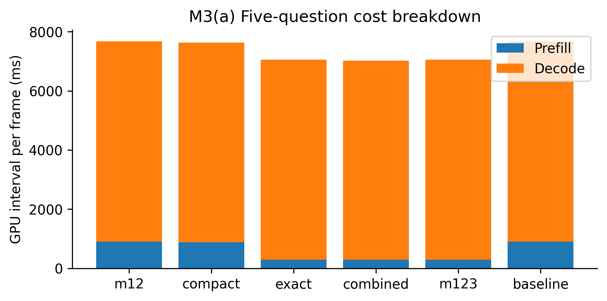
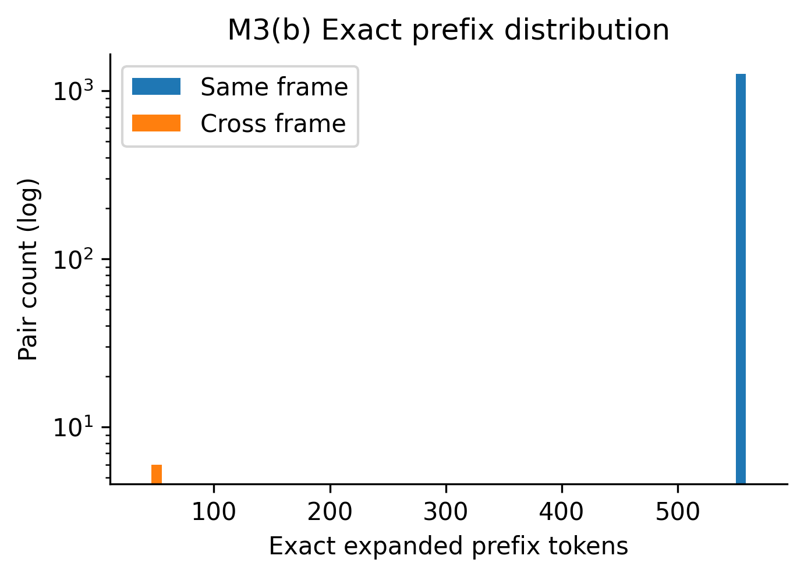
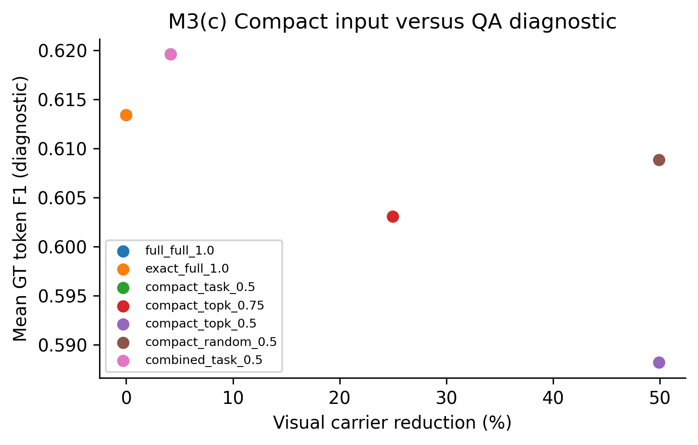
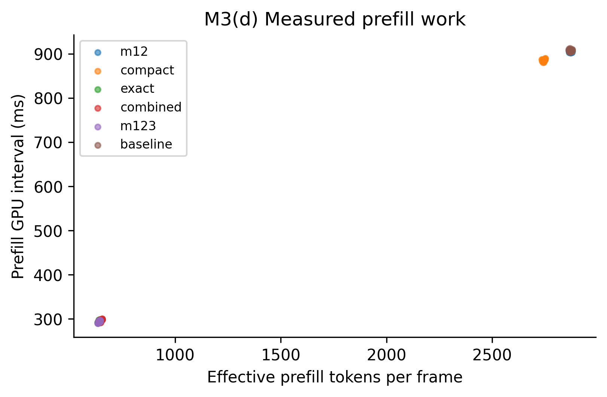
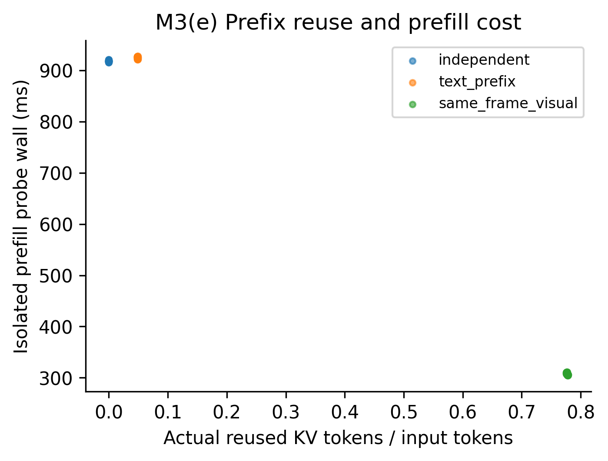
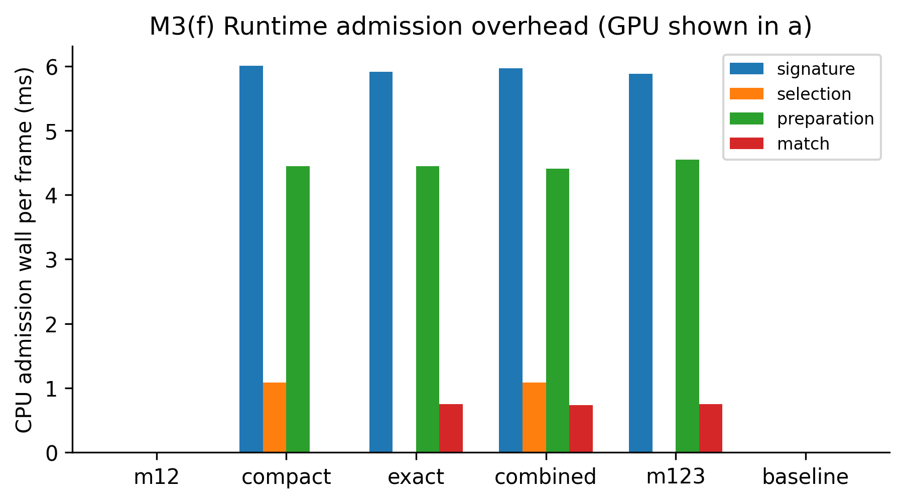
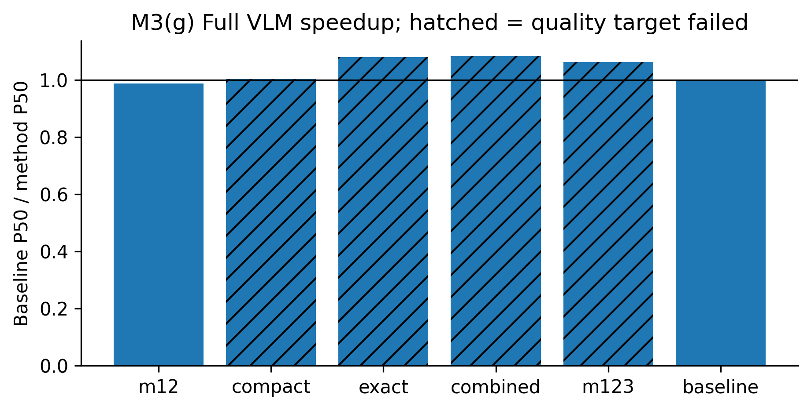

# M3 — State-Conditioned LLM Execution: 实验交付报告

真实 RTX 3090、原始 OmniDrive/LoRA 权重、Transformers 4.31.0；数据源 `outputs/module3/clean_multi_20261016_220113`。代码已集成，Compact 默认不获在线批准；Exact 的合法前缀匹配与实际跳算独立报告。

**交付结论：工程实现及本轮真实 GPU 实验已完成；优化未通过冻结的逐 Token 质量要求，正式 Auto 继续使用完整输入和原始生成路径。表中加速是离线实测，不能称为已通过质量约束的上线收益。**

## 协议与边界

六个真实 nuScenes 场景，每场景两个连续帧；每帧从全部原始问题中按问题文本确定五个任务覆盖问题。全部原始问题数 13–17，默认部署配置实际只有一个 planning 问题。一次整序列预热、两次计时，六方法按场景/重放轮换；每方法 24 个计时帧、120 个问题。保留原始 Question/GT；未重新训练、修改权重、改变生成长度上限或复用回答文件。
所有 E2E 方法保留 max_new_tokens=320；为逐 Token 正确性，性能对照使用 Greedy，部署默认 Sampling 不变并另测固定 RNG。CPU 数据加载/scatter 和结果落盘在 E2E 计时外；当前视觉、heads、M1/M2、选择、匹配、KV 拷贝和真实语言生成均在计时内。轻量 CUDA profiling wrapper 对所有方法一致。P95 为有限样本的经验分位，不是服务 SLA。正式 E2E 的 Prefill/Decode GPU interval 覆盖原始 CausalLM.forward（包括词表投影），独立 llm_probes.jsonl 的 full_forward_gpu_ms 也包含最终投影；探索 run03 仅测 decoder 的区间不能与正式结果混加。
冷缓存列表示序列首帧，并非进程加载冷启动；同帧模式每帧第一个问题冷 Prefill，后续问题共享。跨帧探针和单 Token Prefill 探针不作为完整服务结果。

## 原始输入与 Carrier 审计

每帧 256 Object + 1 Ego + 256 Map = **513** 个视觉 Token，宽度 4096；原始文本 Token 数 56–146，实际展开 Prefill 569–659。图像标记均在原始索引 [35]；同帧实际 Embedding LCP 557–570，跨帧首问题 LCP 35–35。没有将文本相同或 M1 Anchor 身份当作视觉 Embedding 等价证据。
Carrier 是独立 learned extra queries，先于预测 queries 被分离；proposal Top-K、框和车道输出与 Carrier 没有一对一可证索引。M1 可约束来源和时效，不能可靠地指定删除某个对象 Carrier。详见 carrier_semantics_audit.md。

## 完整 VLM 性能

| 方法 | Prefill GPU P50/P95 ms | Decode GPU P50/P95 ms | E2E wall P50/P95 ms | Prefill 加速 | E2E 加速 | Token 一致 |
|---|---:|---:|---:|---:|---:|---:|
| m12 | 904.63/907.85 | 6769.65/7836.72 | 8360.50/9512.26 | 1.003× | 0.987× | 120/120 |
| compact | 886.52/906.21 | 6742.14/7823.37 | 8225.57/9309.91 | 1.024× | 1.003× | 108/120 |
| exact | 294.82/298.52 | 6758.65/7825.51 | 7646.69/8725.73 | 3.079× | 1.079× | 118/120 |
| combined | 297.06/300.05 | 6730.11/7818.22 | 7619.70/8719.48 | 3.056× | 1.083× | 108/120 |
| m123 | 293.13/296.76 | 6763.86/7828.53 | 7765.10/8911.99 | 3.097× | 1.063× | 118/120 |
| baseline | 907.70/910.60 | 6771.38/7838.12 | 8253.36/9330.80 | 1.000× | 1.000× | baseline |

Baseline 的每帧累计 Prefill 为 907.70 ms，平均每问题约 181.54 ms；不能将一个问题的时间当作五问题总成本。Exact 累计复用 53548 个实际 KV Token；单独 M3 的 LLM GPU 时延下降 8.16%。
Decode 加速必须结合输出长度判断。精确路径若 Token IDs 相同，则输出长度相同；近似路径输出变化后的 Decode 降低不能宣称每 Token 更快。latency_results.json 保留输出 Token 总数、真实 Decode 调用数和 tokens/s。Prefill 指实际原始 Transformer interval；匹配、复制和缓存维护的全部净成本仍由 E2E wall 覆盖。

## 正确性、近似质量与 Auto 决策

Exact 配对问题严格一致：118/120；冻结目标通过：False。Greedy/Sampling 的逐 Token/Logits 探针、变化输入反例和缓存隔离见 kv_correctness.json。相同完整输入的 Profiler Prefill 长度记录为 []；后续实际 Decode 仍执行。原始 trace 在 outputs/module3/clean_multi_20261016_220113/traces/identical_prefix.json。失败请求的逐层 KV 和 Logits 数值差异见 exact_failure_diagnosis.json；有合法依赖不代表不同 FP16 Shape 的输出逐位相同，失败不获 Auto 批准。
Task candidate 仅对 object_relation 问题保留全部 Object/Ego 和一半 Map；地图、全局安全、未知任务保持完整。Top-K（norm，不是框置信度）和随机保序为独立离线对照。删 Token 改变后续位置与注意力，是近似输入；原始顺序不提供输出等价保证。
Compact 完整 VLM 严格 Token 一致：108/120；Combined：108/120。失败逐项保存在 quality_results.json，未放宽冻结目标。
真实 GT 的归一化 exact、Token F1 和对齐数值列表误差保存在 llm_probes.jsonl。F1 不是语义 QA Accuracy，数值数量不匹配不会被隐去为零误差，也不能将这些指标称为驾驶安全认证。扩展任务覆盖以及未覆盖域见 extended_quality.json；覆盖不足的任务不获在线批准。
默认 Auto 只接受匹配设备/后端/模型版本/Shape 的真实成本证据，以及紧凑输入独立 held-out 质量证据。本交付不因总体均值较好就伪造每 Shape 的生产证书；cost_table.json/quality_certificate.json 的 approved 为空。Auto 因未校准直接回退原始生成，离线 exact 的速度不冒充已上线 Auto 收益。

## 显存与瓶颈

Exact 最大持久 Cache 293.14 MiB；完整请求 peak allocated P50/P95 15.435/15.462 GiB。预算包含保存的 KV、输入和末 Token logits；每个活跃 Decode 的克隆分支是额外 workspace，在 diagnostics 中分列。
M1+M2+M3 的 E2E P50 加速为 1.063×；M1 总维护 P50 为 117.30 ms。M2 真实移动场景是否命中以 frames.jsonl 的实际 diagnostics 为准，不推断发生视觉复用。
主要收益机会是同帧长前缀；跨帧视觉变化仅保留短文本前缀。Decode 仍主导完整时延，KV 克隆/签名/匹配也消耗净收益。紧凑视觉表示缺乏对象级语义映射和训练适应，是近似路径的主要质量限制。

## 最终问题逐项回答

1. 513 个视觉 Token；文本 56–146；展开 569–659。默认一问题与实验五问题明确区分。
2. 有，同帧 LCP 557–570，由实际展开 Embeddings 认证。
3. 有，真实 suffix-only forward 只接收未命中后缀；完全相同请求不再执行 Transformer Prefill，Profiler 和调用长度证据保留。
4. 有，task 候选把适用问题视觉 Carrier 由 513 减至 385；Top-K/随机提供更大比例离线对照。
5. 未训练的删除会改变部分真实答案；失败不获在线批准。具体数值和失败文本见质量 JSON。
6. object_relation 是候选研究域，仍须逐任务质量验证；地图、安全/全局/未知问题保留完整，未证明任何任务可无条件压缩上线。
7. M1 能提供场景/时效约束，尚无 Anchor 到 learned Carrier 的可靠对应，不能据其删除单个 Carrier。
8. Exact Prefill P50 907.70→294.82 ms；Decode 6771.38→6758.65 ms。
9. 离线 M3 Exact 多问题 E2E 1.079×，质量冻结目标通过=False；Auto 未发布校准证书，不混为已上线结果。
10. 离线 M1/M2/M3 E2E 1.063×；仍须结合 P95 和逐问题一致性判断。
11. Decode 占比、单问题没有同帧共享、跨帧只剩短文本前缀、输入压缩质量限制，以及 M1/Cache 成本共同限制净收益；不将输出变短当作 Decode 算法加速。

## 可复现性与失败记录

命令见 commands.sh，生产接口见 docs/worldstream_m3.md；源码快照见 outputs/module3/clean_multi_20261016_220113/source/，后加载探针的真实 SHA 另见 llm_probe_source.json。run01 的加载中断、run02 的跨帧策略探索和 run03 的实验包装器引用循环/OOM 均保留且不计入正式表；已修复并新增生命周期回归。原始 M1/M2 交付不被覆盖，本次新产生的 M1 维护日志隔离在 module3 内。

## 原始单问题部署补充

实际默认 Sampling、固定 RNG、320 Token 上限，数据源 `outputs/module3/clean_single_20261016_220113`。原始精度 Detection/Map/Temporal Memory 数据保存至 perception/，每个输出与状态均按原 dtype/shape/内容 SHA 比较。

| 方法 | E2E P50/P95 ms | 实际复用 KV Token | 输出 Token 一致 | 感知/Memory 内容一致 |
|---|---:|---:|---:|---:|
| m12 | 3018.15/3250.40 | 0 | 8/8 | 8/8 |
| compact | 2899.06/2986.24 | 0 | 8/8 | 8/8 |
| exact | 2900.71/2970.04 | 0 | 8/8 | 8/8 |
| combined | 2903.15/2971.10 | 0 | 8/8 | 8/8 |
| m123 | 3031.95/3278.14 | 0 | 8/8 | 8/8 |
| baseline | 2901.64/2973.45 | 0 | baseline | baseline |

单问题结果不能套用五问题的共享收益；实验 exact 单问题仍捕获缓存，其额外成本如实计入，未校准 Auto 则回退原路径。

## 最终交付复核

完整主实验 216 个帧执行记录、其中 144 个计时帧；单问题实验 72 个记录。逐一核对原始回答文件、每问题 Prefill/Decode 调用次数，以及 72 个原始 dtype/shape/内容感知与 Memory 文件。GPU 回归 197 项通过、跳过 0；推理源码与本次 GPU 快照逐文件 SHA256 一致。

### 文本前缀与视觉前缀的独立消融

| 预填充探针 | 样本数 | 五问题累计 wall P50/P95 ms |
|---|---:|---:|
| independent | 36 | 918.00/920.60 |
| text_prefix | 36 | 924.94/927.14 |
| same_frame_visual | 36 | 307.36/310.88 |

探针仅生成一个 Token，隔离 Prefill 并包括匹配、复制、缓存捕获及 logits GPU→CPU 转移；它不是完整服务延迟。35 个纯文本 Token 的复用在该测量中未获净收益；同帧长视觉前缀约三倍 Prefill 收益与主实验一致。跨帧六个观测均仅命中 35 个纯文本 Token，不推断为视觉复用。
同帧前缀探针首 Token argmax 一致 180/180；完整生成的逐 Token 一致为 118/120。

### 数值分歧与质量准入

样本 e12ae352f31d4268a7f71c4d27aa0886 的回答首次在输出索引 27（第 28 个生成 Token）分歧。Prefill logits MaxAbs=0.02734375；分歧位置 MaxAbs=0.0185546875，Baseline 前两候选 logits 为 [18.515625, 18.5]，缓存路径为 [18.5, 18.5]，首选 Token 从 16800 变为 7962。相同输入前缀的第 0 层 K 已有 MaxAbs=0.005859375 差异。 结果与不同 Prefill Shape 下 FP16 舍入变化一致；没有单独隔离具体 cuBLAS 算法，因此不将算法归因写成已证明事实。
GT Token F1 略升不构成更高驾驶质量的证明。任务选择 30 问离线对照中只压缩 5 问，整体 Carrier 减少 4.16%；不能将其误报为所有问题减少一半。数量、地图、安全和关系任务的质量必须分别看原始回答，Token F1 不替代语义或安全认证。

### 保序压缩对照

| 方法 | 问题数 | 实际视觉 Token 减少 | 输出 Token 一致 | 原始 GT Token F1 |
|---|---:|---:|---:|---:|
| full_full_1.0 | 30 | 0.00% | 30/30 | 0.6134 |
| compact_task_0.5 | 30 | 4.16% | 27/30 | 0.6196 |
| compact_topk_0.75 | 30 | 24.95% | 17/30 | 0.6031 |
| compact_topk_0.5 | 30 | 49.90% | 9/30 | 0.5882 |
| compact_random_0.5 | 30 | 49.90% | 12/30 | 0.6089 |
| combined_task_0.5 | 30 | 4.16% | 27/30 | 0.6196 |

GT F1 仅有 14 个带原始文本 GT 的问题；其他问题保持缺失，未按零分或满分填充。单问题部署所有方法实际复用 KV 均为 0，时延微小波动不能归因为跳算。

### 原始任务与轨迹 GT

| 方法 | 关系问题 Token 一致 | 地图问题 Token 一致 | 全局/安全问题 Token 一致 |
|---|---:|---:|---:|
| m12 | 20/20 | 14/14 | 58/58 |
| compact | 8/20 | 14/14 | 58/58 |
| exact | 20/20 | 14/14 | 56/58 |
| combined | 10/20 | 14/14 | 56/58 |
| m123 | 20/20 | 14/14 | 56/58 |

轨迹 GT 直接按 sample token 读取原始验证集及有效 mask；不从生成文本反构 GT。

| 方法 | 有效轨迹回答数 | ADE m | FDE m |
|---|---:|---:|---:|
| m12 | 24/24 | 1.111112 | 2.488925 |
| compact | 24/24 | 1.111112 | 2.488925 |
| exact | 24/24 | 1.111112 | 2.488925 |
| combined | 24/24 | 1.111112 | 2.488925 |
| m123 | 24/24 | 1.111112 | 2.488925 |
| baseline | 24/24 | 1.111112 | 2.488925 |

这是生成的六步轨迹误差，不是碰撞率或闭环驾驶评价；整体安全类分组中部分短动作问题没有文本 GT，不能据 Token 一致给出语义正确率。

### 统计与显存

| 方法 | 按场景配对平均 wall 节省 ms | 平均 wall 降幅 | 场景聚类 bootstrap 描述性 95% 区间 |
|---|---:|---:|---:|---:|
| m12 | -151.51 | -1.96% | -2.44%–-1.71% |
| compact | 33.39 | 0.43% | 0.12%–0.85% |
| exact | 602.32 | 7.79% | 7.02%–8.80% |
| combined | 627.51 | 8.12% | 7.31%–9.07% |
| m123 | 453.60 | 5.87% | 5.26%–6.53% |

区间以六个场景为重采样单元，两个重放不被当作不同随机种子；它只描述本次六场景，不外推到道路总体。配对均值与前表 P50 比例是不同统计量，不混用。
修复后的 Exact 计时峰值 allocated 为 15.398–15.463 GiB，同一帧两次重放峰值最大差 0.000 MiB；本轮完整结束，没有复现 run03 的逐模式 KV 累积/OOM。真实移动场景 M2 复用 Camera 计数为 0，不将 M3 的语言收益归因为视觉 Cache 命中。

### Profiler 与数量类补测

完全相同输入的真实 Profiler 只记录 2 次 Decode，所有 bmm query length 为 1，没有 Transformer Prefill；证明加载 Cache 后确实省略了 Prefill。
不同原始问题的视觉共享 trace 命中 558 Token，实际只执行 18 Token 后缀；m3_suffix_prefill 记录为 1，m3_full_prefill 为 0。原 trace 在 traces/shared_visual_prefix.json，未把原始公共前缀重新送入 Transformer。
补测 4 个实际 nuScenes 帧的原始数量类问题，GT 仅用于生成后的评价；不加入冻结的主实验时延表。

| 方法 | 数量问题 Token 一致 | 原始 GT Token F1 |
|---|---:|---:|
| exact/full | 4/4 | 0.4044 |
| compact/task | 3/4 | 0.4483 |
| compact/topk | 1/4 | 0.4034 |
| compact/random | 2/4 | 0.4502 |
| combined/task | 3/4 | 0.4483 |

数量 GT 及原始回答见 quantity_results.json；没有结构化明确数量的答案不强行转换为数值精度。该补测是质量覆盖，不比较 baseline 的 VLM wall 和候选的 LLM-only wall。

### 决策与后续研究边界

1. 当前部署保持 Full 回退，cost_table.json 和 quality_certificate.json 的 approved 均为空；没有放宽冻结质量目标。
2. 后续若研究数值稳定的前缀执行，需要独立验证后端/计算 Shape 与完整解码等价，不能沿用本轮失败的质量结论直接批准。
3. 紧凑 Carrier 应先建立可验证的语义映射或单独适应性证据；当前无可靠 Anchor-to-query 映射，不能据 M1 ID 删 Token。
4. 所有原始失败实验保留；本轮完整结果、补测和描述性统计分别归档，未覆写 M1/M2 交付。
