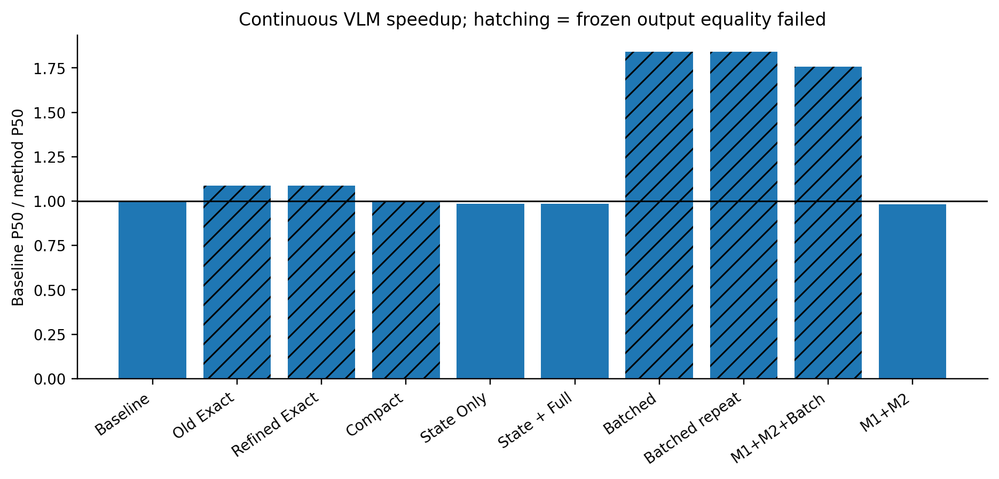
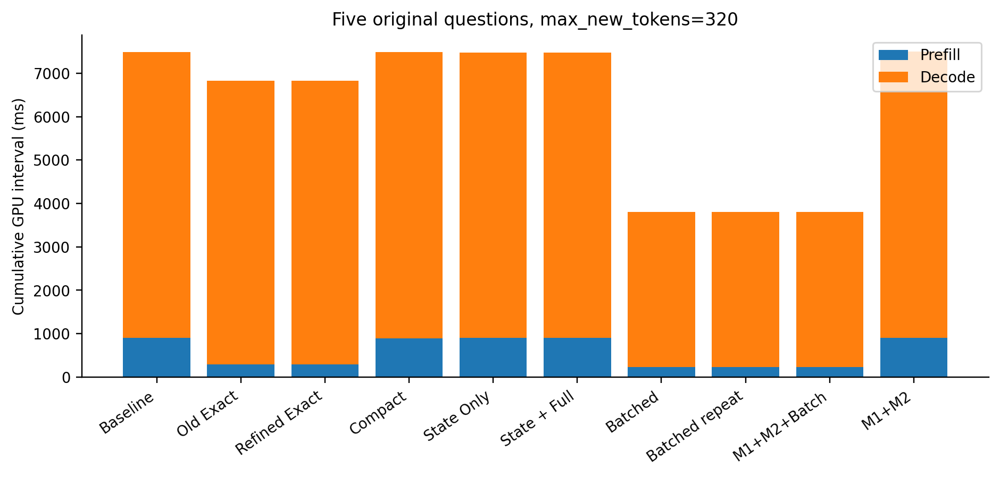
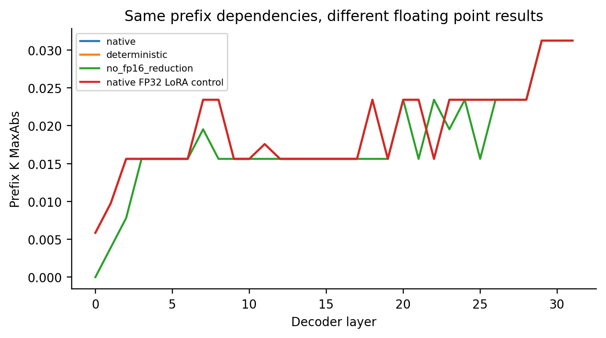
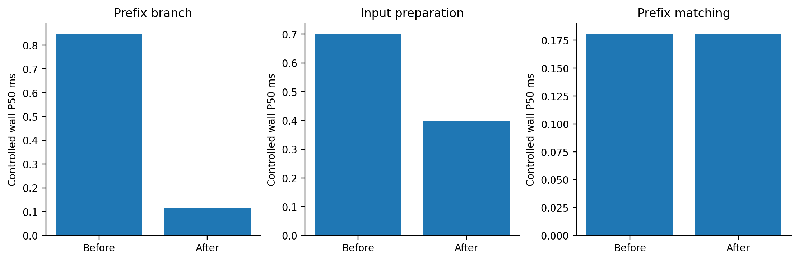
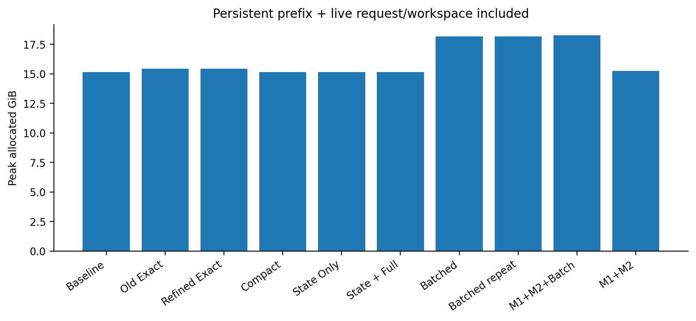
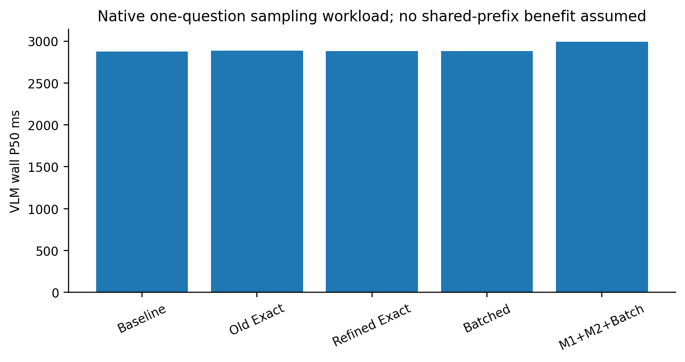

# M3 Refinement：数值路径、持久状态与语言执行改进

**代码改进、真实 GPU 实验及质量审查已完成。当前不发布生产优化批准，默认 Auto 保持原生完整生成。逐策略的实测通过情况见下表；工程交付完成不代表持久状态质量目标或全部优化目标已经达成。**

原始 OmniDrive/LoRA 权重、RTX 3090、OmniDrive 环境；主实验 `outputs/module3_refinement/multi_20261017_005514`，单问题 `outputs/module3_refinement/single_20261017_005514`。旧 `outputs/module3/` 保留不覆盖。GPU 回归 212 项通过、跳过 0。

## 协议与真实执行边界

保留六个原场景、每场景两个连续帧，并严格冻结上一轮真实 Question/Token IDs 与五问题顺序；只重放原始问题，不复用历史 Carrier，所有视觉/Head 重新执行。新增两个互斥场景作为 held-out，原生问题在 seed=0 的数据准备阶段固定，方法间共享完全相同的问题。按原问题文本选择覆盖，不读 GT；一轮预热、两轮计时，各方法按场景/重放轮换。额外数值 E2E 只针对原失败场景单独运行，不加入主实验性能统计。默认单问题另测原始 Sampling。全部完整生成保持 max_new_tokens=320，EOS 正常结束，不减少问题数或截短答案。
CUDA Prefill/Decode interval 覆盖整个 CausalLM.forward（含词表投影）；完整 wall 包含当前视觉、Detection/Map、真实 M1/M2 服务、M3 签名/匹配/输入/缓存与语言生成。数据加载/scatter、采样监控及回答记录的额外 CPU 拷贝/落盘在计时外；原生输出解析仍计入服务。Profiler 控制实验不作为常规速度表。独立 GPU 利用率以 1 Hz 采样，与实际服务时间戳对齐；短窗口利用率不作为瞬时 SM 占用率。

所有主实验记录的输出数与真实问题数一致；逐问验证 Token IDs 能解码回原始回答文件，未修剪生成序列。

## 1. Exact Prefix 数值定位

旧实验两条失败是同一真实样本在两次计时重放中重复失败，不是两种独立案例。本轮保留该样本完整生成，并覆盖六场景十二个实际帧的不同问题长度和自然生成长度。区分输入前缀完全相同、因果依赖合法、浮点结果相同和最终 argmax 相同四个命题。
首个可观测分歧位于第 0 层 Q/K/V 基础 Linear：公共 Embedding 完全相同，采样行的 input/RMSNorm 相同，但 577 行与 570 行 FP16 投影不同；Q/K MaxAbs=0.00390625。该位置 LoRA A/B 的采样输出仍相同，因此 LoRA 不是本案例的首发源。差异经 RoPE、attention score/softmax/output、MLP 和 residual 传播。真实全前缀逐层 K/V、32 层采样算子、最终 norm/LM Head，以及原生与后缀路径的中间张量均保存。
控制 GEMM sweep 固定相同输入行与原始权重，只改变矩阵行数，直接复现基础投影差异；FP32 误差更小但转回 FP16 后仍可跨舍入边界，不能据此声称恢复原始输出。当前实际后端是 Transformers 4.31 eager LlamaAttention，不运行 FlashAttention；没有升级后端或混入未经验证的 FlashAttention 性能。Profiler 记录算子 Shape 与 CUDA Kernel，但不把观察到的 F.linear Shape 敏感性扩大为已隔离某个特定 cuBLAS 内部算法的证明。

| 真实 Carrier 完整序列候选 | Token 一致 | Prefill GPU P50/P95 ms | 完整 LLM wall P50/P95 ms |
|---|---:|---:|---:|
| native | 59/60 | 290.45/294.89 | 7109.12/8086.67 |
| deterministic | 59/60 | 292.49/295.62 | 7117.81/8129.41 |
| no_fp16_reduction | 52/60 | 292.91/296.27 | 6860.48/7851.28 |
| fp32_lora | 59/60 | 292.79/295.79 | 7123.25/8132.30 |
| independent_common_prefix | 52/60 | 324.59/327.80 | 7125.32/8080.95 |

独立公共前缀顺序计算是新增候选，保留其失败记录，不因批量探针某个样本通过就称为全序列修复。原始 numerical_02 的 decode 最大差包含分歧后的不同历史，不把该值当成同输入误差；控制实验 same_history_logits.json 只比较首次分歧之前及当步。原失败动作首次分歧为第 28 个生成 Token。没有引入低 logit margin 的“保证一致”回退规则，也未改变冻结目标。

原失败帧两个实际问题的受控检查：Prefill logits MaxAbs=0.02734375；首次分歧之前及当步的相同历史 Decode logits MaxAbs=0.03125000。该原生失败样本的第 0 层全前缀 KV MaxAbs=0.00585938，全部 32 层最大=0.03125000。这是固定样本的观测误差，不是可用于任意请求准入的误差上界。

### 数值候选的真实 VLM E2E（失败场景独立协议）

| 方法 | Prefill GPU P50 ms | VLM wall P50/P95 ms | Token 一致 |
|---|---:|---:|---:|
| baseline | 908.95 | 9060.10/9375.70 | 20/20 |
| precision_deterministic | 298.10 | 8452.27/8759.52 | 18/20 |
| precision_no_fp16_reduction | 299.63 | 8164.32/8468.80 | 16/20 |
| precision_fp32_lora | 298.61 | 8455.57/8766.49 | 18/20 |
| common_prefix_seq | 329.66 | 8480.70/8779.22 | 16/20 |

精度设置只在语言 runtime 调用内生效，不改变视觉 Backbone/Head 的计算策略。原生 loader 已将可训练 LoRA 参数置为 FP32，因此 fp32_lora 是原算术的 sanity control，不能当作新增高精度改进。另对基础 Q/K/V Prefill GEMM 实施临时 FP32 计算，并分别比较原始 Baseline 与同精度 Full 输出，见补充表；没有整体转换 LLM 或修改任何权重。每次退出恢复 forward 和全局精度/确定性设置。

### 基础 Q/K/V FP32 Prefill 专项

原生 LoRA 本来就是 FP32。新增候选只将基础 Q/K/V 的多 Token Prefill 投影使用临时 FP32 操作数，输出回到原激活类型；单 Token Decode 保留原生算术。参数对象、数值与 dtype 均未编辑。除与原始 FP16 Baseline 比较，还与相同精度 Full 比较，避免把改变 Baseline 当作缓存修复。
下表是十六个实际帧的控制 LLM 重放；保留参考 logits 的显存与计时不能冒充完整 VLM 服务。全部完整生成保持 320 上限。逐层张量、同生成历史首次分歧之前/当步的 logit 误差、全序列 IDs 与精度实际调用计数见 projection_precision_results.json。Batch 不支持结构化 scores，故其 logits 误差明确缺失，只比较完整序列。

| 候选 | calibration 对原 Baseline | held-out 对原 Baseline | calibration/held-out 对同精度 Full | LLM wall P50 calibration/held-out ms |
|---|---:|---:|---:|---:|
| native_full_reference | 60/60 | 20/20 | 不适用 | 7666.57/7196.71 |
| fp32_qkv_full | 54/60 | 18/20 | 不适用 | 8122.24/7577.26 |
| fp32_qkv_exact | 55/60 | 18/20 | 58/60, 20/20 | 7255.43/6690.87 |
| fp32_qkv_batch | 53/60 | 18/20 | 51/60, 18/20 | 4229.26/3689.87 |

相同 FP32 Prefill 策略的固定失败样本，第 0 层前缀 K MaxAbs=0.00195312，全部层 KV MaxAbs=0.03125000；基础投影误差降低仍未达到逐位相同。该结果不构成严格输出修复。

同一失败场景的补充真实 VLM E2E，独立执行且不合并主性能表；包含新的完整视觉/Head 与实际 M1/M2（联合模式）。此专项 baseline/batched 保留原生算术；fp32_full、refined_exact、refined_combined、m123 分别使用 FP32 Q/K/V Full、Exact、Batch 和联合 Batch：

| 模式 | Prefill P50 ms | VLM wall P50/P95 ms | 对原 Baseline Token 一致 | peak P50 GiB |
|---|---:|---:|---:|---:|
| baseline | 908.09 | 9063.95/9359.14 | 20/20 | 15.167 |
| fp32_full | 1354.51 | 9497.27/9806.34 | 16/20 | 15.167 |
| refined_exact | 462.60 | 8595.39/8908.28 | 16/20 | 15.464 |
| batched | 233.64 | 4961.58/5248.38 | 20/20 | 18.259 |
| refined_combined | 348.59 | 5082.41/5361.17 | 18/20 | 18.260 |
| m123 | 347.40 | 5191.41/5567.87 | 18/20 | 18.351 |

该候选是显式离线精度实验，未获得独立严格质量/成本准入，不进入生产 Auto。

## 2. Task-Verified World-State Retrieval

新增持久语义视图、轻量任务查询与可控文本插入。视图在真实 M1 precheck 后、当前感知 commit 前冻结；要求匹配 scene/frame/time/epoch/execution signature，源观测必须早于当前帧且在有效时限内。只接受 M1 当前验证的历史 anchor，保留类别、相对坐标、已有可靠速度、几何、源/验证时间、Camera 与确实有效的 Feature Version。原 M1 不保存每 anchor 的源 Frame ID，因此保持 Unknown；不伪造灯色、动作意图、拓扑或 Anchor-to-Carrier 映射。
按问题的类、方向、运动依赖检索；地图查询仅用地图 anchor，运动依赖需要可靠速度。部分历史不用于证明全场数量/缺失，全局安全/未知问题保持完整视觉。C=历史状态文本替代 Carrier；D=状态文本+Full Carrier，均是位置/格式变化的近似输入。文本超预算、无验证证据、过时或任务覆盖不足均直接走原生完整生成。B 为原有 task deletion，A 为完整原输入，C/D 不偷偷混入 Prefix 收益。
本轮状态视图累计包含 28 条验证历史记录（含 C/D 与重复计时；去重后 7 个 frame/anchor 对），真正进入 LLM 的状态问题数 0。结论：**Feasibility No-Go: no usable verified historical task input**。不能将 C/D 全回退后的输出一致称为世界状态输入质量通过。来源与回退原因见 state_feasibility.json。

### 更长连续历史的可行性核查

为避免只看两帧冷历史就作全局结论，另对 3 个实际场景各执行 16 个连续帧，共 48 帧。该阶段仅执行原生感知与真实 M1，显式关闭语言服务；LM 参数对象保留并恢复，参数版本不变，没有伪造回答或把该时延称为 VLM 加速。
累计当前验证的历史记录 0 条，满足任务条件且可装入上下文预算的查询 0 个。结论：**Feasibility No-Go on this longer history workload**。原始逐帧验证拒绝原因、Query 和冻结上下文见 `outputs/module3_refinement/state_sweep_02`。

另测持久 KV/输入/末 logits 拥有式捕获，wall P50/P95=0.9221/0.9300 ms。该保存复制仍存在，不能把只读 branch 的优化误报为删除了全部 KV 复制。真实五问题批量 Decode 后，重新计算同 Shape 公共前缀并逐元素验证全部 32 层 K/V 均未改变。
附加数值路径对照保存了 attention 后 residual 输入、最终 norm/LM Head、原始 full-question seed 与独立 common seed 的逐层前缀误差；它是诊断控制，不加入连续 E2E 性能。

## 3. Shared-Prefix Batched Decode 与 KV Runtime

新增批执行器独立计算实际共同前缀，按真实后缀长度左侧 padding，维护每行 positions/mask，并由原始 HF greedy loop 管理 EOS 和长度上限，恢复原问题顺序并剔除 EOS 后为同批其他请求产生的 pad。Sampling、定制停止/处理器和不支持的输出契约回退逐问题原生 generate，避免宣称改变 Batch RNG 调度仍逐位相同。持久和活跃工作区分别预算，空间不足回退。
只读分支仅对已核实的 4.31 原生 LlamaAttention out-of-place torch.cat 开放，其他后端保留 clone。它省掉显式分支 clone；attention 的 cat 仍产生独立动态 KV，批量 KV 也会物化各行前缀，未实现 paged KV 或物理零拷贝。控制实验逐张量验证持久 KV 未修改，真实峰值包含所有动态开销。

| 运行时组件，真实控制实验 | 原 wall P50 ms | 新 wall P50 ms |
|---|---:|---:|
| clone → borrow | 0.8484 | 0.1161 |
| legacy_preparation → preparation | 0.7017 | 0.3969 |
| legacy_match → match | 0.1809 | 0.1803 |

单分支避免的显式前缀拷贝为 279.50 MiB。签名检查仍覆盖实际模型/LoRA/forward 与数值设置，未为节约几毫秒删除有效性检查。CUDA event 跨越 CPU 签名检查时包含排队空隙，因此开销表使用 wall，不将签名 interval 称为 GPU 算术。

## 4. 五问题完整服务结果

| 方法 | Prefill GPU P50/P95 ms | Decode GPU P50/P95 ms | VLM wall P50/P95 ms | E2E 加速 | Token 一致 |
|---|---:|---:|---:|---:|---:|
| baseline | 908.26/911.50 | 6576.25/7816.74 | 8055.84/9310.32 | 1.000× | 160/160 |
| legacy_exact | 295.06/298.43 | 6528.42/7806.43 | 7415.19/8703.52 | 1.086× | 154/160 |
| refined_exact | 295.71/298.88 | 6530.43/7812.78 | 7412.57/8706.07 | 1.087× | 154/160 |
| compact | 887.43/907.78 | 6603.40/7870.15 | 8074.34/9365.04 | 0.998× | 144/160 |
| state_only | 906.10/908.87 | 6574.23/7820.86 | 8180.22/9422.36 | 0.985× | 160/160 |
| state_full | 905.56/908.76 | 6573.89/7816.23 | 8180.53/9438.31 | 0.985× | 160/160 |
| batched | 234.67/236.17 | 3571.24/4752.82 | 4373.50/5553.68 | 1.842× | 152/160 |
| refined_combined | 234.84/236.07 | 3572.14/4753.27 | 4374.48/5553.58 | 1.842× | 152/160 |
| m123 | 233.50/234.69 | 3570.38/4754.68 | 4584.01/5605.40 | 1.757× | 152/160 |
| m12 | 905.77/909.19 | 6596.08/7818.09 | 8195.34/9429.11 | 0.983× | 160/160 |

Refined Exact 保留原始算术与第一问题来源，加入只读 KV、向量化 provenance/LCP 和单问题快速回退；失败的独立前缀数值候选单独归档。没有通过质量准入的精度或状态候选可与 Batch 组合，因此本轮 refined_combined 与 batched 的实际配置相同，是重复对照；两行的时延波动不是新增优化贡献，不能当作独立策略或额外样本。M1+M2+Batch 保留完整 M1 服务及既有 M2 camera auto。记录实际 Camera 命中，不把没有发生的视觉复用计为收益。

| 方法 | Decode 有效 tokens/s | 输出 Token 总数 | 后缀 pad / Decode pad | 实际节省前缀 Token | peak allocated P50/P95 GiB | 计时窗口 NVML 利用率 P50 |
|---|---:|---:|---:|---:|---:|---:|
| baseline | 39.45 | 8018 | 0/0 | 0 | 15.150/15.175 | P50 99.0% |
| legacy_exact | 39.52 | 8008 | 0/0 | 71402 | 15.448/15.473 | P50 99.0% |
| refined_exact | 39.50 | 8008 | 0/0 | 71402 | 15.449/15.473 | P50 99.0% |
| compact | 39.50 | 8018 | 0/0 | 0 | 15.150/15.175 | P50 99.0% |
| state_only | 39.46 | 8018 | 0/0 | 0 | 15.150/15.175 | P50 99.0% |
| state_full | 39.46 | 8018 | 0/0 | 0 | 15.150/15.175 | P50 99.0% |
| batched | 68.31 | 8002 | 588/10468 | 71360 | 18.170/18.312 | P50 99.0% |
| refined_combined | 68.31 | 8002 | 588/10468 | 71360 | 18.170/18.312 | P50 99.0% |
| m123 | 68.30 | 8002 | 588/10468 | 71360 | 18.262/18.404 | P50 99.0% |
| m12 | 39.45 | 8018 | 0/0 | 0 | 15.241/15.267 | P50 99.0% |

有效 Decode 吞吐按所有问题的真实非 padding 后续 Token 数除以 Decode GPU 时间；批量 forward 调用次数不能当作 Token 数。原始输出长度和 pad 开销保留，未将回答变短当作每 Token 算法加速。NVML 为离散窗口统计，不称为逐 kernel 占用率。冷缓存表示序列第一帧，不是进程冷启动；cold/later 分位在 performance_results.json，未把相邻第二帧短文本 LCP 当成共享视觉。

## 5. 独立测试质量、GT 与单问题

| 方法 | 六场景 calibration Token 一致 | 两场景 held-out Token 一致 |
|---|---:|---:|
| baseline | 120/120 | 40/40 |
| legacy_exact | 118/120 | 36/40 |
| refined_exact | 118/120 | 36/40 |
| compact | 108/120 | 36/40 |
| state_only | 120/120 | 40/40 |
| state_full | 120/120 | 40/40 |
| batched | 114/120 | 38/40 |
| refined_combined | 114/120 | 38/40 |
| m123 | 114/120 | 38/40 |
| m12 | 120/120 | 40/40 |

逐任务 Token 一致、原始 GT Token F1、归一化 exact、可对齐数值列表误差和数量不匹配全部保留。F1 仅是文本重叠诊断，不等于语义准确率；安全动作缺少文本 GT 的项目保持 Unknown，没有当前 GT 参与在线查询或选择。
离线补齐了原生 description 模板对应的 desc/val 描述注释，并记录源文件 SHA256；这是读取原有注释，不修改 GT 或在线选择。keywords/val 不存在，未把 desc/action 的长理由文本冒充 short-action 的原始目标。扩展注释覆盖后的 F1 不与上一轮不同覆盖范围的绝对 F1 混比；本轮方法始终按同问题、同注释配对。

各方法使用同一批原始注释的文本重叠诊断（独立于完整 Token 一致性）：

| 任务 | 有注释问题数/总数 | Baseline GT Token F1 | Refined Exact | Compact | Batch |
|---|---:|---:|---:|---:|---:|
| global_safety | 16/80 | 0.3944 | 0.3948 | 0.3944 | 0.3944 |
| unknown | 36/36 | 0.4335 | 0.4305 | 0.4335 | 0.4305 |
| object_relation | 28/28 | 0.5802 | 0.5802 | 0.5994 | 0.5802 |
| map | 16/16 | 0.4974 | 0.4974 | 0.4974 | 0.4974 |

原始 GT 与有效 mask 按 sample token 评价六步 Planning：

| 方法 | 轨迹解析数 | ADE m | FDE m |
|---|---:|---:|---:|
| legacy_exact | 32/32 | 0.860554 | 1.905021 |
| refined_exact | 32/32 | 0.860554 | 1.905021 |
| compact | 32/32 | 0.860554 | 1.905021 |
| state_only | 32/32 | 0.860554 | 1.905021 |
| state_full | 32/32 | 0.860554 | 1.905021 |
| batched | 32/32 | 0.861407 | 1.909202 |
| refined_combined | 32/32 | 0.861407 | 1.909202 |
| m123 | 32/32 | 0.861407 | 1.909202 |
| m12 | 32/32 | 0.860554 | 1.905021 |
| baseline | 32/32 | 0.860554 | 1.905021 |

这些轨迹误差不替代碰撞率或闭环安全认证。错误原文、GT 和 Token IDs 在 quality_results.json；规划 GT 和 task 明细在各 run 的 qa_ground_truth_analysis.json。

| 默认单问题 Sampling | VLM wall P50/P95 ms | 实际共享 Token | Token 一致 | 感知/Memory 摘要匹配 |
|---|---:|---:|---:|---:|
| baseline | 2876.05/2933.54 | 0 | 8/8 | 8/8 |
| legacy_exact | 2887.76/2944.51 | 0 | 8/8 | 8/8 |
| refined_exact | 2878.29/2936.68 | 0 | 8/8 | 8/8 |
| batched | 2878.73/2936.00 | 0 | 8/8 | 8/8 |
| m123 | 2993.04/3167.30 | 0 | 8/8 | 8/8 |

单问题没有同帧共享机会，Refined Exact/Batch 显式提前回退，不做 M3 签名/展开/缓存捕获。微小时延波动不能归因于不存在的 KV 复用；M1/M2 维护成本保留在联合运行中。采样 batch 默认原生顺序回退，固定 RNG 对照见 sampling_proof.json。

## 6. 双重准入与最终十项结论

| 策略 | calibration 逐 Token 目标 | held-out 逐 Token 目标 | 实测 P50 净收益 | Auto 批准 |
|---|---:|---:|---:|---:|
| legacy_exact | False | False | True | False |
| refined_exact | False | False | True | False |
| compact | False | False | False | False |
| state_only | True | True | False | False |
| state_full | True | True | False | False |
| batched | False | False | True | False |
| refined_combined | False | False | True | False |
| m123 | False | False | True | False |
| m12 | True | True | False | False |

改进后的 common-prefix Auto 入口要求独立且互斥场景的质量证据，并同时匹配 model version、execution key、完整问题长度列表、prefix length 和 generation key；成本必须包含冷捕获/维护且缓存满足预算。execution key 还绑定实际 forward 包装链代码、LoRA 启用/合并/缩放状态与数值设置，native 和局部 FP32/禁用 adapter 不能误用同一证据。不能把旧 first-question cache 成本行用于批准独立 prefix seeding，也不能用 greedy 行批准不同 Sampling 配置。实际 approved 数组仍为空，未因某张表全局平均较好制造证书。批量与状态输入仍是显式离线实验。

1. 原失败的首发数值路径定位到基础 Q/K/V GEMM 的 Shape 敏感性，证据包括相同输入、逐层 hook、直接投影 sweep 和真实完整生成。两次旧失败为一个唯一请求的重放。
2. Refined Exact 与原 Exact 的原六场景一致性均为 118/120，没有提高完整序列一致性；仍保留 3.071× Prefill 加速。确定性、局部精度和独立 prefix seeding 未提供严格修复。
3. M1 接口实际支持带来源的历史类别/几何/已有可靠速度查询；本协议实际激活 0 个状态问题，不伪装成已经获得可用覆盖。
4. 未取得可上线的独立紧凑状态质量证据。C/D 无可用状态时完整回退，不能用回退答案一致性批准新输入格式。
5. 批量 Decode GPU interval P50 从 6576.25 降至 3571.24 ms，但完整输出仅 152/160 一致。单个控制样本通过不能推广到全部场景。
6. 分支 wall P50 从 0.8484 降至 0.1161 ms，避免 279.50 MiB 显式 clone；匹配的变化很小，签名检查仍保留。
7. 单问题 Baseline/Refined Exact wall P50=2876.05/2878.29 ms，没有实际净加速；原生快速回退消除无用缓存工作。
8. 五问题 batch wall P50=4373.50 ms，离线 1.842×。质量未通过，quality_constrained_offline_e2e_speedup 为 null，不能作为生产质量约束下的收益。
9. M1+M2+Batch 离线 1.757×，未通过严格质量；M1+M2 单独 0.983×，没有净收益。联合 batch 实际 camera 复用 0 次，全部维护已计入 wall。
10. 当前不批准生产优化；native Full 回退持续生效。精确输入依赖、完整输出保留、GT 质量和道路安全分别报告，没有放宽冻结标准。

## 复现与归档

命令见 commands.sh，GPU 全流程见 tools/worldstream_m3/run_refinement.sh。各运行保存 source/source_manifest、原始 Question/GT/IDs、回答文件、计时与峰值、1 Hz GPU 记录、状态来源和真实 Profiler。numerical_01 的追踪形状错误及控制/预热 pilot 记录均保留，不混入正式性能。随机模板 pilot 没有被当作冻结负载的计时结果。推理参数版本未修改；实际执行的推理节点与 GPU 快照一致。启动后仅收紧了未在这些离线计时路径调用的生产成本键函数，其精确 AST 差异与专项测试在 delivery_audit.json 单列，未把文件 SHA 不同冒充逐文件一致。

