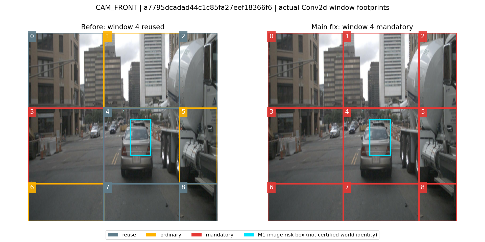

# WSGRR 主路径修复与正式复测

最终状态：**冻结的唯一 WSGRR 主方案已完成 6019 帧、150 场景官方 Detection/Map 评估，以及两次同输入完整请求复测。Detection 精度损失显著缩小，视觉与完整请求均未获得净加速；未通过生产认证。** 完整机器结果见 `summary.json`，来源与公平性核验见 `final_evidence.json`。

## 已确认的问题与修改

M1 原来在 `geometry_valid=False` 时直接跳过区域导出，即使 `predicted_region` 仍是当前预处理图像内有限、非空的框。M2 因而只得到经窗口平均稀释的图像风险，不能区分这个区域与普通未知背景。历史异常帧 a7795dcadad44c1c85fa27eef18366f6 的前视汽车框正是这种情况：窗口 4 的原评分约 0.28133，但没有进入当帧普通预算，实际被复用。

修复将图像风险与可信世界区域分开导出。有限图像框的几何失效作为局部必要刷新；几何有效但观测不可靠的图像框，以现有 `[0,1]` 风险尺度进入统一漂移、年龄、不确定性评分。它们均不授权世界对象身份或像素复用。失效的历史区域会先刷新对应旧范围再撤销，避免持续保存过时优先级。

对象没有当前可靠投影时，只能撤销其已知旧范围，并依赖既有逐像素、逐来源覆盖协议约束当前缓存；不能把对象跨近裁面投影失败等同于整相机来源失效。真正的相机/来源失效仍保留原有保守刷新约束。多个局部风险的并集可以覆盖整相机，但没有因单个对象投影失败而无条件刷新相机的新路径。

普通预算仍为每相机最多 3 个窗口，不截断必刷集合；权重、阈值、精度、dtype、可缓存前缀和 Block 2 全局屏障均未更改。新策略版本使旧成本/质量证据不可误用于新行为；没有新增生产批准。

本轮真实测量通过既有 `evaluate_offline` 的 D 入口执行当前主策略，显式保留 `quality_certified=False`。生产默认仍由原有批准表控制，没有将未经认证的实验缓存复用自动启用到生产。

| 修改文件 | 实际作用 |
|---|---|
| `worldstream/m1/computation_state.py` | 导出有限图像风险，传播旧区域失效；每相机只校验一次投影输入，避免对每个对象重复校验 |
| `worldstream/m1/state_types.py`、`state_manager.py` | 增加独立风险记录；紧凑导出仍拥有独立副本并保留待提交状态与来源摘要检查 |
| `worldstream/m2/m1_adapter.py` | 校验风险记录的相机、帧、时间、坐标、数值和身份授权限制 |
| `worldstream/m2/region_refresh.py` | 用真实 Conv2d 格点映射局部风险，保留必刷约束与按相机普通排序；复用局部掩码，移除事务提交前多余的区域深拷贝 |
| `worldstream/m2/runtime.py` | 复用已验证的依赖足迹及 GPU 窗口索引，去除多余年龄张量副本；保留复用窗口描述符、来源与真实年龄 |
| `worldstream/m2/dependency_planner.py` | 接收本次请求已验证的前缀，避免重复证明同一拓扑；全局屏障不变 |
| `worldstream/m2/config.py`、`cost_model.py` | 更新并绑定刷新策略版本，不复用旧行为的成本证据 |
| `tools/worldstream_m2/promote_costs.py` | 去除写死的旧版本号，仍要求当前完整签名、独立精度与任务证据及 GPU/墙钟净收益 |
| `tools/worldstream_m2/window_validate.py` | 增加仅运行主方案的离线入口及计时外缓存审计；阶段剖析与普通延迟样本分开 |
| `tests/worldstream_m2/test_uncertainty_refresh.py`、`test_wsgrr.py`、`test_cost_promotion.py` | 覆盖局部风险、旧/新范围、普通预算、来源与坐标错误、真实采样格点及旧策略证据拒绝 |

`window_executor.py` 和 `state_cache.py` 没有修改：既有局部执行器、全刷新 Native Block、有限值检查、独立张量副本和原子提交均保留。

## 已完成的验证

- 最终 GPU 回归：**333 passed，0 failed，19 条既有依赖警告**，见 `tests_gpu_final_boundaries.log`。相较原有 320 项新增 13 个测试实例。
- 真实 EVA 执行器回归：10 个案例与历史结果完全相同，执行器文件 SHA 一致。全刷新和零更新路径精确一致；部分窗口的既有浮点差异仍在，局部最大误差 0.00082037，传播后的视觉最大误差 0.89028168。没有据此授予任务质量认证。
- Native 复用：97 项模型、配置、数据、评估与执行来源哈希检查通过，checkpoint SHA 为 `6468af836dbdbc41034545d2a4669abc3b5288a669b4e13ac9a99bf9bb53c30d`。保存了 Native 预测、配置、序列和评分文件的当前哈希。历史原始图像没有逐文件哈希，未声称重新核对其每个字节。详见 `native_reuse_check.json`。
- 连续视觉测试：40 帧，39 个连续帧，每帧预热 2 次、测量 5 次；486 项缓存审计全部通过。必刷集合全部执行、普通窗口按相机受限；未选窗口输出、描述符和来源不变，年龄递增；已选窗口年龄归零，来源更新。

| 40 帧视觉测试，统计后续 39 帧 | 修改前 D3 | 修改后主方案 |
|---|---:|---:|
| 窗口更新率 | 70.8927% | 87.7493% |
| 复用率 | 29.1073% | 12.2507% |
| Native 视觉 P50，195 个样本 | 487.4622 ms | 486.8778 ms |
| WSGRR 视觉 P50，195 个样本 | 490.5548 ms | 492.5912 ms |
| Native 视觉 P95 | 490.9220 ms | 490.8576 ms |
| WSGRR 视觉 P95 | 500.8457 ms | 501.6540 ms |
| 逐帧特征 MAE 的平均值，预测差异指标 | 0.150338 | 0.066674 |

上表 P50/P95 直接取全部重复样本；与历史报告“逐帧中位数再求分位数”的数值会略有区别，原始测量没有改写。前后来自各自配对的 Native 计时，不把跨运行硬件波动当作优化收益。当前主方案的视觉 P50 比同轮 Native 慢约 1.17%，**尚无净加速**。特征误差降低不能代替正式精度。

## 异常帧与窗口证据

`anomaly_window_trace.json` 同时保存历史正式任务、旧视觉回放、新视觉回放和新完整任务执行的窗口 4 记录。新完整任务中该窗口为必刷，输入年龄 1、漂移 0.00054264、不确定性 1.0；视觉连续审计确认执行后年龄为 0。来源假设以 `source_track_id` 记录，不当作真实对象身份。

原始 51.7928 m Map 异常及 0.6253 m Detection 异常记录继续保留在历史目录。本轮已从完整真实预测生成 `anomaly_prediction_diagnostics.json`，没有使用 Native 回放冒充候选任务预测。

异常汽车的返回索引 4 在旧正式 D3 中相对 Native 的中心偏移为 **0.625975 m**（先前短测约 0.6253 m），新主方案降至 **0.000857 m**。原生、旧 D3、新主方案至最近真实汽车标注的 XY 距离分别为 **2.960206、3.563052、2.960708 m**；因此只能说额外偏移被显著抑制，不能说这个对象已被正确检测。最近 GT 不是对象身份认证，也不替代正式分数排序匹配。

旧 Map 51.792896 m 来自 Native 线 95 与候选线 87 的强制配对。旧候选返回索引 95 的分数为 0.277802，低于原有 0.3 诊断截断，而其与 Native 线 95 的对称几何距离仅 0.138963 m。新主方案该分数恢复至 0.367388、对称距离为 0.003458 m；同帧旧口径最大匹配距离为 0.073762 m，新门控诊断匹配 23 条，原生未匹配 0 条、候选未匹配 1 条。旧 95→87 配对在新预测中仍空间无关，其对称距离 29.939454 m 也保留用于复核。**历史异常没有删除；诊断分数、2m/3m 门限及正式评估口径均未调整。** 同返回索引本身不证明身份，诊断一致性不等于 GT 精度。

## 性能归因的边界

`profile_attribution.json` 保存修改前后同类单帧剖析。修改后单次剖析中，缓存提交记录约 2.99 ms CPU、1.72 ms 归属 CUDA；另有约 413.93 ms 的 CUDA 流同步等待。普通主路径的“缓存发布”主机计时中位数仍约 432 ms，因为其边界包含排队 GPU 工作的等待，不能解释为 432 ms 的复制或缓存计算被消除。

全局屏障后的 22 个 Block 仍执行全部计算，是主要 GPU 成本。剖析中这些 Block 的归属 CUDA 总时间约 471.13 ms；剖析有观测扰动，且嵌套统计重叠，不与普通视觉墙钟相加。新旧帧选择数量不同，不能用两次剖析直接声称某项优化的因果加速。真实净收益以上表同步重复计时及后续完整请求计时为准。

<!-- PROFILE_TABLE -->

| 单帧剖析范围 ms | 修改前 CPU总计 | 修改前归属CUDA | 修改后 CPU总计 | 修改后归属CUDA |
|---|---:|---:|---:|---:|
| Patch Embedding + Block0 输入 | 1.894 | 4.205 | 0.797 | 4.175 |
| M1-M2 准入读取 | 9.067 | 0.000 | 8.331 | 0.000 |
| 评分与选择 | 5.585 | 2.885 | 5.378 | 1.403 |
| 依赖计划 | 0.165 | 0.255 | 0.158 | 0.018 |
| Block0 QKV | 0.165 | 2.906 | 0.131 | 3.818 |
| Block0 Attention | 0.254 | 0.443 | 0.245 | 1.644 |
| Block0 输出投影 | 0.048 | 0.930 | 0.033 | 1.510 |
| Block0 MLP | 0.141 | 5.742 | 0.132 | 8.317 |
| Block1 QKV | 0.125 | 4.503 | 0.103 | 3.862 |
| Block1 Attention | 0.195 | 0.444 | 0.169 | 6.204 |
| Block1 输出投影 | 0.046 | 0.927 | 0.037 | 4.015 |
| Block1 MLP | 0.292 | 6.202 | 0.295 | 8.147 |
| 缓存原子提交包装器 | 2.956 | 1.721 | 2.993 | 1.719 |
| CUDA 流同步等待 | 421.567 | 0.279 | 413.926 | 2.928 |
| 全路径张量 copy，非缓存专属 | 424.525 | 37.742 | 417.102 | 40.662 |

以上各行存在父子归属重叠，禁止直接相加；copy 包含后续网络布局转换。同步等待的 CPU 时间不应归为 CUDA 计算。阶段剖析的选窗工作量不同，只作归因，净速度以上述配对同步墙钟为准。

<!-- END_PROFILE_TABLE -->

## 正式 Detection、Map 结果

完整验证集 6019 帧、150 场景，样本顺序、预处理、任务头和 Detection 评估条件与 Native 一致。Native 引用通过哈希核验的历史完整结果；本轮只有一个最终完成的 WSGRR 主方案全量评分。

| 指标 | Native | 修改前 D3 | 修改后主方案 | 相对 Native 绝对差 | 相对变化 |
|---|---:|---:|---:|---:|---:|
| mAP | 0.377397 | 0.337861 | 0.375755 | -0.001642 | -0.4351% |
| NDS | 0.471343 | 0.440563 | 0.470092 | -0.001250 | -0.2652% |
| mATE | 0.772330 | 0.811194 | 0.774251 | +0.001921 | +0.2487% |
| mASE | 0.288197 | 0.289317 | 0.288272 | +0.000075 | +0.0259% |
| mAOE | 0.423998 | 0.442550 | 0.423656 | -0.000342 | -0.0806% |
| mAVE | 0.469165 | 0.504832 | 0.470858 | +0.001692 | +0.3607% |
| mAAE | 0.219871 | 0.235781 | 0.220817 | +0.000946 | +0.4302% |
| DET_l | 0.132207 | 0.135661 | 0.132247 | +0.000041 | +0.0307% |
| lane_Fscore | 0.081051 | 0.080703 | 0.080970 | -0.000081 | -0.1003% |

mATE、mASE、mAOE、mAVE、mAAE 越低越好。Detection mAP 的相对损失由约 10.48% 缩小到 **0.4351%**，NDS 由约 6.53% 缩小到 **0.2652%**。Map 没有全面提升：DET_l 比旧 D3 下降 0.003414，车道 F-score 比旧 D3 增加 0.000267；两者目前均接近 Native。

模型实际支持车道中心线 DET_l 与 3D Lane F-score。没有交通元素或学习到的拓扑预测头，零邻接占位产生的 TOP_ll 等值不能解释为拓扑能力。

| 类别 AP | Native | 修改前 | 修改后 | 对 Native 相对变化 |
|---|---:|---:|---:|---:|
| car | 0.544839 | 0.483891 | 0.544883 | +0.0081% |
| truck | 0.348825 | 0.303345 | 0.349574 | +0.2147% |
| bus | 0.371610 | 0.339461 | 0.369556 | -0.5527% |
| trailer | 0.103569 | 0.093039 | 0.104587 | +0.9826% |
| construction_vehicle | 0.154129 | 0.127338 | 0.150945 | -2.0659% |
| pedestrian | 0.473266 | 0.414563 | 0.470099 | -0.6692% |
| motorcycle | 0.380957 | 0.320438 | 0.378556 | -0.6303% |
| bicycle | 0.437992 | 0.351432 | 0.434290 | -0.8452% |
| traffic_cone | 0.529058 | 0.520073 | 0.525998 | -0.5783% |
| barrier | 0.429730 | 0.425025 | 0.429066 | -0.1545% |

150 个场景中，134 个比旧 D3 的 mAP 更高；90 个仍低于 Native、60 个高于 Native。场景 mAP 差值中位数为 -0.000407、最差为 -0.023656。逐场景结果见 `paired_scenes.json`。

| 残余下降场景 | Native mAP | 旧 D3 | 新主方案 | 场景描述 |
|---|---:|---:|---:|---|
| scene-0797 | 0.182737 | 0.128489 | 0.159080 | 汽车、公交经过、超车、等待 |
| scene-0912 | 0.210489 | 0.135991 | 0.190786 | 雨天、停车场、卡车、工程车辆 |
| scene-1067 | 0.089918 | 0.050793 | 0.071452 | 夜间雨天、暗处行人、进入交叉口 |

正式 SDK 2m 分数排序匹配的原始统计（全部保留分数，无 0.3 诊断截断）：Native/新主方案预测数为 1,283,894/1,285,217，TP 为 112,054/111,966，FN 为 9,807/9,895，GT 总数均为 121,861。这是原始匹配工作点统计，不是 mAP 的替代指标。逐类、逐对象和漏匹配记录位于 `main_full/official_eval/detection_matches_2m/`。

### 残余对象的实际预测复核

按“Native 是 TP、新主方案成为 FN”集合中 Native 分数最高的样本，各取一个重点类别进行离线复核。所有该类 GT 状态变化保存在 `residual_detection_gt_changes.json`，没有为了降低误差删样本。具体坐标、分数、逐窗口年龄/漂移/不确定性、风险记录和执行窗口见 `residual_detection_cases.json`。

| 类别 / 帧 ID | Native 对 GT 距离 m | 新方案最近同类候选对 GT 距离 m | 当前缓存前缀全部刷新 |
|---|---:|---:|---|
| car / d968a5eaaae446f6848302351550dd71 | 1.992949 | 2.137183 | 否 |
| bicycle / af15c54e76b04b77a7f6c6aa793e7013 | 1.973851 | 2.030867 | 否 |
| pedestrian / 36a0632fe8304bccbe1cdbc67f9f0726 | 0.693440 | 0.712283 | 是 |
| motorcycle / ccc19df4b0784fb28d67f76645641bc7 | 1.988843 | 2.002172 | 否 |

汽车、自行车、摩托车的代表性候选仍在原有严格 2m 门限之外；没有放宽门限将其改报为匹配。行人最近候选距该 GT 为 0.712283m，但已被分数排序匹配分配给另一个 GT；该帧全部缓存前缀都刷新，因此不能单凭当前帧区域遗漏解释。下游历史状态和匹配竞争仍可能贡献残余差异。其余案例存在局部复用，但窗口元数据本身不构成对象级因果证明；本轮没有新增反事实推理实验。

## 全量窗口与缓存有效性

| 6019 帧统计 | 修改前 | 修改后 |
|---|---:|---:|
| 执行更新率 | 69.1086% | 88.0028% |
| 复用率 | 30.8914% | 11.9972% |
| 执行窗口数，两个缓存 Block | 449,242 | 572,064 |
| 必刷唯一窗口数 | 128,435 | 204,530 |
| 普通唯一窗口数 | 96,186 | 81,502 |
| 已识别必刷集合执行遗漏 | 0 | 0 |
| 缓存发布失败 | 0 | 0 |

两个 Block 的执行窗口分母均为 650,052；必刷与普通数量按每帧唯一相机窗口计数，不能与双 Block 工作量直接相加。新主方案普通预算超限 0 次、未来来源时间戳 0 次；637 帧按 M1 安全约束完整刷新。这验证已声明约束被执行，不表示真实事件漏检率为零，也不构成 M1 世界身份认证。

## 完整请求与性能结论

以下是相同 40 帧、40 个唯一问题，两次重复的 80 个观察值；顺序为 Native_r0 → main_r0 → main_r1 → Native_r1。每次预热 1 帧后重置状态，正式计时包含冷启动首帧和后续复用，GPU 在边界同步。包括预处理、传输、M1、M2、Detection、Map、原生语言生成与输出处理，审计序列化和计时外检查不计入。两次重复不能当作 80 个独立场景。

| 完整请求 ms | 历史 Native | 历史 D3 | 本轮 Native | 本轮主方案 |
|---|---:|---:|---:|---:|
| P50 | 1708.80 | 2106.76 | 1714.24 | 2060.36 |
| P95 | 9108.50 | 8106.82 | 9081.68 | 8941.24 |

| 本轮重复 | Native P50/P95 ms | 主方案 P50/P95 ms |
|---|---:|---:|
| 0 | 1832.64 / 9089.09 | 2030.36 / 8915.78 |
| 1 | 1676.80 / 9062.91 | 2086.89 / 8942.80 |

**视觉 P50 比同轮 Native 慢 1.17%；完整请求 P50 慢 20.19%，平均耗时慢约 10.62%。未获得稳定净加速。** 完整请求 P95 略低不能当作视觉代码加速：Native/主方案每次实际生成 3022/2926 个 token，真实输出长度不同。输入问题、参考答案、输入 token 数、生成参数与 Native 生成路径相同，核验见 `final_evidence.json`、`vlm_groups.json`。

当前完整请求中 M1 Precheck 主机 P50 为 195.61 ms，M1 Commit 主机 P50 为 76.56 ms，含适配器的 M1 总量 P50 为 292.13 ms，M1–M2 状态读取 P50 为 25.16 ms。这些范围嵌套，不能相加。历史相同范围的完整 M1 总量未记录，未用猜测补值；可比记录见 `request_phase_breakdown.json`。CUDA event 的 stream span 包含 CPU 提交间隙和等待，不等于活跃 GPU 内核时间。

全量感知请求描述性 P50 为 1002.95 ms，其中 M2 诊断墙钟 P50 为 487.29 ms。该全量计时没有本轮重算的配对 Native，不能拿它与历史 Native 计时直接宣称速度变化；净收益判断使用本轮同步配对测量。

## VLM 短测与未完成项

40 个唯一问题的 Exact Match 均为 0；Token F1：Native 0.359270，主方案 0.369617，两次重复结果相同。9 个含数值参考的问题均未满足预测与参考的数字数量一致条件，数值 MAE 的有效分母为 0，应报告不可用，不能填 0。空间关系 5 题 Token F1 均为 0.343176；global_safety 15 题为 Native 0.368056、主方案 0.365157。分组来自既有问题分类器，Exact Match 的失败率不是独立标注的驾驶语义错误率。

完整 VLM 验证集、独立语义正确性/关键驾驶场景错误率尚未验证；不能用这 40 题外推。Map 交通元素和学习拓扑指标因模型缺少对应预测头不适用。

## 验收判断与保留限制

关键图像风险导出遗漏与旧范围撤销已修复，预算、年龄、来源与依赖约束通过回归和连续审计；正式 Detection 损失显著改善。但没有预先批准的生产精度容忍阈值，且部分场景仍有明显下降、Native 自身也有错误，不能自动认定质量可接受。部分窗口执行器的既有浮点差异仍在，M1 总开销与全局后缀成本仍大，净加速目标未达成。生产批准表和正式配置均未修改。

开发过程中一次未完成推理在 1220 帧中止以补齐空框/越界/非有限范围撤销；记录保存在 `main_full_pre_boundaryfix/`，没有正式评分，未用于最终指标。本报告全量结果均来自最终冻结代码的完整 `main_full/`；其他开发失败/中断见 `attempts.json`。

## 仪器化变更记录

| 文件 | 类型 | 仪器化用途 |
|---|---|---|
| `tools/worldstream_m2/window_validate.py` | 修改 | 离线主方案限制（532行）、计时外缓存审计（140行）、单帧 cProfile（238行）和分阶段 torch.profiler 调用 |
| `tools/worldstream_m2/profiling.py` | 原有文件，未修改 | 本轮调用其 CPU/CUDA、复制和同步事件包装器，剖析调用不进入普通耗时样本 |
| 本目录 `summarize.py`、`finish_validation.py`、`run_main_validation.py`、`verify_native_reuse.py`、`plot_anomaly_windows.py`、`diagnose_final_anomaly.py`、`final_evidence.py`、`build_report.py`、`residual_detection_audit.py` | 新建离线脚本 | 从真实记录汇总、串行执行必要复测、来源哈希核验、实际窗口可视化 |

所有测试和实验以 `taskset -c 0-3,6-31` 启动，子进程继承亲和性；使用 `OmniDrive` 指定解释器。未停止其他用户进程。历史输出、生产批准表及正式配置保持原样。开发失败和中断原因见 `attempts.json`，相应日志保留。
